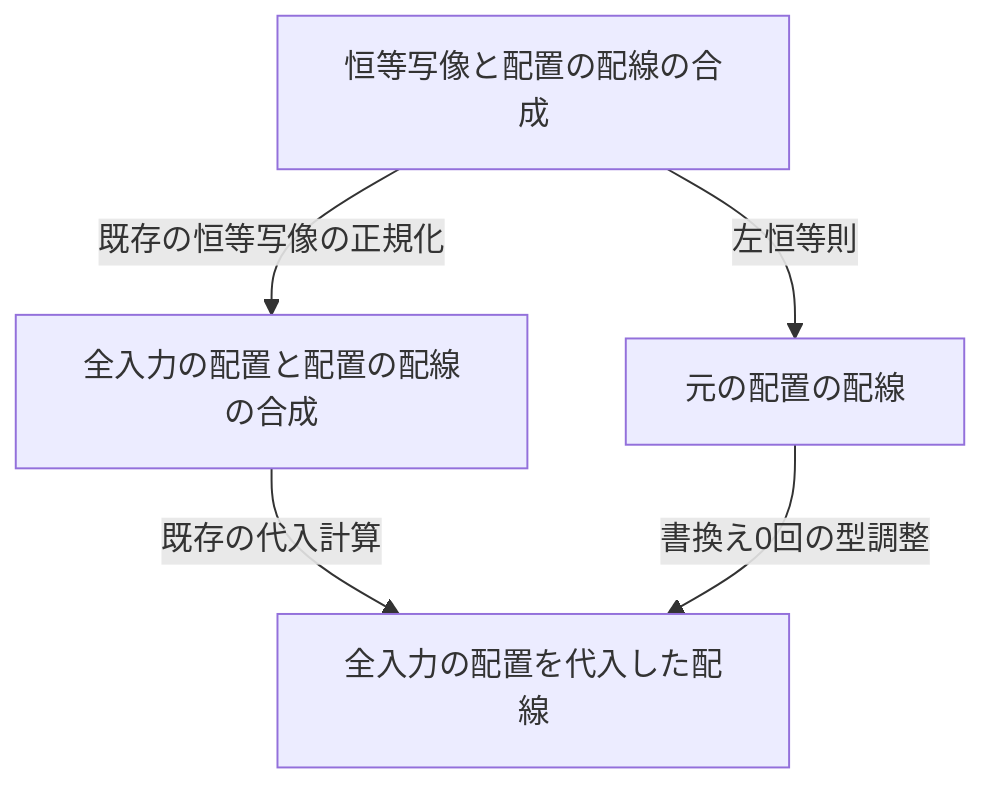
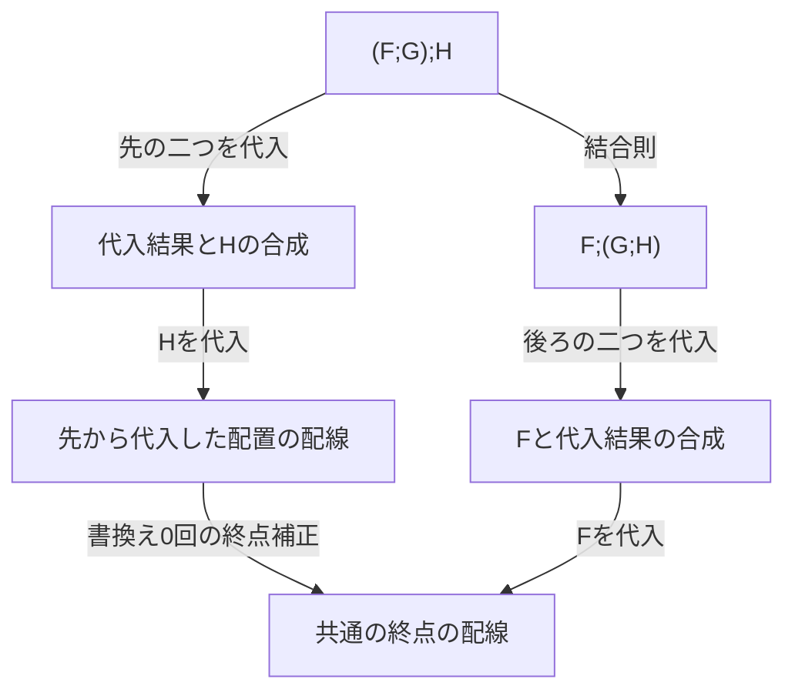

# Issue #8：ポリグラフによる推論と証明変形

[Issue #8](https://github.com/CryptoVerification/Foundation/issues/8) の推論層、実験層、暗号への解釈を実装しています。作業ブランチは `issue-8-polygraphic-security`、Lean と mathlib は `v4.33.0` です。

対象は、一つの0胞体を持つ推論層と、4次元までの生成子・変形経路です。任意次元の自由な厳密高次圏を構成する汎用ライブラリとは区別します。既存の暗号論理と実行意味論は維持し、新しい構文をそれらへ接続しています。

## 実装の入口

パスはリポジトリのルートからの相対パスです。

| モジュール | 実装した役割 |
| --- | --- |
| `Foundation/Logic/Polygraph/Basic.lean`、`Presentation.lean`、`Interpretation.lean` | 型付きの生の推論図、形式的な証明木の組、両者の往復、モデルへの合成的な評価です。 |
| 同ディレクトリの `Cell.lean`、`Category.lean` | 形式的な証明木の組が一致する図を商にした推論セルです。恒等・結合、有限個の射の組の射影・復元、横合成の恒等保存・交換法則を証明します。mathlib の圏と、指定した4胞体で経路を商にした亜群のインスタンスも提供します。亜群は、すべての射に逆射を持つ圏です。 |
| 同ディレクトリの `Rewriting.lean`、`Structural.lean`、`Higher.lean`、`HigherPresentation.lean` | 基本書き換え、方向付き経路、可逆な3次元経路、指定した平行経路を結ぶ4胞体です。利用者が追加する3・4次元の生成子も、合成された境界を型に持ちます。 |
| 同ディレクトリの `Normalization.lean`、`Coherence.lean`、`DiagramNormalization.lean` | 恒等・結合の停止性と合流性、実際の正規化経路、正規化を使う4次元の補完、横合成・組の内部も訪れる図の正規化です。 |
| 同ディレクトリの `FiniteCoherence.lean`、`CriticalBranchings.lean`、`FiniteConfluence.lean`、`FiniteCompletion.lean` | 恒等・結合について、11種類の局所的な基本図式、分岐の網羅的な分類、正規形までの経路の比較、逆経路を含む任意の平行経路の比較を構成します。 |
| 同ディレクトリの `CartesianContext.lean`、`CartesianCoherence.lean`、`CartesianLaws.lean` | 再構成規則を含む全構造変形について、９種類の基本図式から任意の並行経路を比較します。横合成の交換、複製・破棄の自然性、配線の合成、組の射影・復元の経路も構成します。 |
| 同ディレクトリの `RelationalInterpretation.lean` | 基本規則についての関係保存から、図全体・独立した構造変形・規則の展開についての関係保存を導きます。 |
| `Foundation/Crypto/Logic/General/ResourceImprovement.lean` | 同じ攻撃者変換を実装する異なるコードを比較し、単調な後続への改善の合成と資源制約付き安全性への接続を証明します。 |
| 同ディレクトリの `Translation.lean`、`Occurrences.lean` | 規則の展開、置換と展開の順序を比較する3胞体、モデルの保存、仮定の出現順と重複の保存です。 |
| `Foundation/Crypto/Logic/Polygraph/{Syntax,Interpretation,Resources,Translation}.lean` | 純粋なコード生成、安全性、具体的上界、実行の証拠を接続します。 |
| 同ディレクトリの `Experiment.lean`、`ExperimentSyntax.lean`、`ExperimentInterpretation.lean` | 優位性の観測の変更、確率的なプログラム、分布の完全一致、統計的な上界、認証済みの計算量的な帰着を分けます。統計的な変形から多前提の推論図への解釈も提供します。 |
| `Foundation/Crypto/Meta/Polygraph/Normalization.lean` | 同じ構造変形経路から、コード・指定した証明木・損失式・実行証拠全体の厳密な保存を導きます。 |
| 同ディレクトリの `FiniteCoherence.lean`、`CartesianCoherence.lean` | 恒等・結合の部分と全構造変形のそれぞれについて、有限種類の基本図式からの経路比較を暗号のコード・上界・実行証拠全体の保存へ接続します。 |
| 同ディレクトリの `FiniteHybrid.lean`、`UniformHybrid.lean` | 固定有限長の純粋な推論図と、共通上界・多項式回数を要求する可変長の実験列です。可変長の具体例は一つの固定機械の実行と資源を保持します。 |
| `Foundation/Crypto/Semantics/Machine/MaskingFused.lean`、`MaskingAdministrative.lean` | 最後のビットの書込みと制御の移譲を一つの遷移にし、１遷移を省きます。停止命令の追加による不要なコードを除去する際の分布一致も証明します。 |
| `Foundation/Constructions/Symmetric/PRGOptimized.lean`、`PRGOptimizedPolygraph.lean`、`PRGOptimizedPipeline.lean` | PRG の両帰着について、小さい停止予算、同じ局所的証明と損失、可変長の停止命令追加を除去した固定コードを接続します。 |
| `Foundation/Crypto/Meta/General/CertifiedPipeline.lean` | 任意の有限長の認証済みコンパイラ列とその実行証拠を構成し、加算的な共通費用の条件から可変長の資源上界を導きます。 |
| `Foundation/Constructions/Symmetric/PRGPolygraph.lean`、`PRGPolygraphPaths.lean` | PRG の局所的な証明、一般の実験変形への接続、証拠を保存する正規化です。 |
| `Foundation/Constructions/Symmetric/EncryptThenMAC/Polygraph.lean` | 暗号化後に認証符号を付ける方式の高水準規則を展開し、コード・上界・実行証拠・安全性を接続します。 |
| `Foundation/Examples/Polygraph{Logic,Coherence,Experiments,Audit}.lean`、`PRGPolygraph.lean` | 実行例、型で拒否する例、異なる経路とその4胞体、暗号への接続、公理依存の検査です。 |
| `Foundation/Examples/FinitePolygraphCoherence.lean` | 基本分岐と文脈内の分岐の分類、有限種類の図式からの五角形と逆経路の比較、PRG と Encrypt-then-MAC のコード・上界・証拠の保存です。 |
| `Foundation/Examples/CartesianPolygraphCoherence.lean` | ９種類の基本図式、横合成の変形順序、複製と破棄、選択した出力内の変形、空出力、暗号の解釈の保存を検証します。 |
| `Foundation/Examples/PolygraphResourceImprovement.lean` | 実際の２遷移から１遷移へのコード変更、資源制約、単調性がない場合の反例、図全体の改善を検証します。 |

## セルの境界と同一視する範囲

推論層の1胞体は判断の有限列です。判断は、前提や結論として使用する主張の構文です。2胞体は判断列から判断列への推論です。3胞体はその推論を変形する経路です。4胞体は同じ始点・終点を持つ3次元経路を比較するデータです。

`Diagram` は括弧を保持する生の構文です。恒等、基本規則、順次合成、独立した入力列での横合成、位置の対応 `Wiring`、共通の前提から出力の組を作る `tuple` を持ちます。`Wiring` の複製・破棄は論理的な仮定への参照です。乱数、鍵、私有状態、機械実行を物理的に複製する規則ではありません。

`Forest Γ Δ` は、出力位置ごとに入力文脈 `Γ` からの形式的な証明木を持ちます。`Diagram.toForest` と `Diagram.ofForest` の往復を証明しています。商にした `Cell T Γ Δ` と `Forest Γ Δ` の間には `Cell.forestEquiv` という同値があります。

この商が比較するのは形式的な規則と葉を保持した証明木です。特定の安全性モデルで結論が真になることだけでは図を同一視しません。`Cell.eq_iff_all_models` は、形式的な項のモデルによって商の等式を検出できることを示します。異なる規則を数値で区別する例も検証しています。

`Cell.seq_assoc`、`identity_seq`、`seq_identity` は商の上での圏の法則です。`tuple_projection` と `tuple_eta` は、有限個の出力を組にして射影・復元する法則です。`tensor_identity` と `tensor_seq` は横合成の恒等保存と交換法則です。文脈は長さと位置の族で表現するため、連結の括弧が違う型を定義上同じ型とする実装とは区別します。

## 3胞体と4胞体

`RewritePath` は方向付きの書き換え経路です。`Track` は恒等、基本書き換え、経路合成、逆経路を保持する生の可逆な経路です。両方とも `Type` のデータです。

`Presentation3` は平行な合成図の間に利用者の3次元生成子を登録できます。`Step` は生成子と構造変形を、順次合成、横合成、出力の組の内部へ適用できます。`Cell3` はそれらから構成する経路です。任意のモデルに対する保存を自動的に仮定せず、`Respects` で各生成子の保存証明を要求します。`Cell3.eval_eq` がその条件から経路全体の保存を導きます。

`Presentation4` は、同じ境界を持つ3次元経路の間に4次元生成子を登録します。`Cell4` は経路の合成・逆と、順次合成・横合成・組の内部での適用を持ちます。指定した生成子から構成する4胞体がある場合だけ経路を比較できます。任意の並行する暗号証明を無条件に同じとはしません。

`Four.Path.eq_iff` は、指定した4次元提示で経路の商が一致することと、その提示で4胞体が存在することの対応です。4胞体を持たない経路まで、Lean の証明の無関連性によって同一視する実装ではありません。

## 正規化と整合性

### 恒等と結合の収束する部分

`Composition.Expr` は、境界が一致する辺の恒等・合成式です。辺には多入力・多出力の図を使用できます。次の三つの規則を、合成の左右の内部でも適用できます。

1. 左の恒等を除去します。
2. 右の恒等を除去します。
3. 左に括弧が付いた合成を右結合にします。

`Expr.Step.decreases` は、各書き換えで重みが厳密に減り、式の大きさは増えないことを証明します。合成の重みには左部分式の大きさも加えます。`terminating` はこの重みによる停止性です。

`Chain` は辺の型付きの列です。`flatten` は恒等と括弧を除いた列を作り、`reflect` は恒等を除去した右結合の式を作ります。`normalizePath` は元の式から正規形までの方向付き経路を構成します。`normal_irreducible` は得られた正規形に適用可能な書き換えがないことを証明します。`Step.flatten_eq` と `Path.flatten_eq` は書き換えが同じ列を保つことを示します。`confluent` は任意の分岐が、この共通の正規形へ合流することを証明します。

この停止性は、任意の暗号帰着や実験の変形に対する定理ではありません。`Diagram.normalizeWithPath` は横合成と組の内部にも再帰的に正規化を適用し、元の図から結果までの3胞体を同時に返します。

### 正規化を使う4次元の補完

まず一般の正規化経路を使う補完を実装し、その後、恒等・結合の部分については次節の有限種類の局所的な図式から整合性を導く証明を追加しました。一般の補完は汎用の構成として残しています。図全体に対する有限種類の基本図式は、後述の `Cartesian` で別途構成します。

`Normalizer` には、変形で保存する形式的なキー、キーの代表元、元の式から代表元までの経路を渡します。`Normalizer.Vertex` はキーが等しい式の型です。各基本書き換えについて、その書き換えに続けて正規化する経路と、直接正規化する経路を結ぶ `NormalSquare.step` を4次元生成子にします。

`NormalSquare.contract` と `factor` は、経路の構成に関する再帰で4胞体を合成します。`coherent` は同じ境界を持つ二つの経路を結ぶ4胞体を返します。全経路の比較を生成子として直接追加するのではなく、一回の書き換えに対する正規化図式と亜群の法則から比較を構成します。生成子の形式は固定していますが、各書き換えの適用位置や式ごとの生成子を持つ、一般には無限の提示です。

この補完を二つの対象に適用しています。

- `Composition.Expr.normalizer` は、辺の列をキーにします。停止性と合流性も別途証明済みです。
- `Diagram.normalizer` は、形式的な証明木の組をキーにします。`StructuralStep.reconstruct` は、図をその証明木の組から再構成する3次元生成子です。この再構成を含む関係全体の停止性は主張しません。

`Examples.PolygraphCoherence.pentagon` は、結合則を2回使う経路と3回使う経路の比較です。両経路の長さが異なり、データとして等しくないことも証明します。`unitCoherence` は恒等と結合が重なる分岐の比較です。競合の有限個の最小生成子への削減は、この補完の保証に含めません。

### 有限種類の局所的な図式による整合性

`Composition.Finite.Generator` は、次の11種類の基本図式です。ここで「有限」は規則形式の種類を指します。任意の型、式、書き換え位置についての適用例全体が有限という意味ではありません。

| 種類 | 個数と内容 |
| --- | --- |
| 規則の重なり | 5種類です。結合則どうしの五角形、結合則と左・中・右にある恒等の比較、左右の単位則どうしの比較です。 |
| 部分式との変形順序 | 5種類です。左右の単位則と部分式の変形の比較、および結合則の三つの部分式それぞれの変形との比較です。 |
| 独立した位置の交換 | 1種類です。左右の別々の部分式を書き換える順序を比較します。 |

4胞体は、この11種類の生成子、経路の亜群の法則、式の左右の文脈内への適用から構成します。生成子の境界には局所的な経路だけを使います。式全体の正規化経路を比較する `NormalSquare.step` は、この提示の生成子に含めていません。

`CriticalBranchings.lean` の `Composition.Finite.localJoin` は、同じ式から始まる任意の二つの書き換えを受け取ります。合流先、そこまでの二つの方向付き経路、それらを比較する4胞体、分岐の分類を返します。規則の重なり、部分式との変形順序、独立した位置の交換を処理し、同じ部分式の内部で起きる分岐は再帰的に分類します。全構成子の場合を処理する関数の型検査によって、分類の網羅性を検証しています。

`FiniteConfluence.lean` の `Composition.Finite.terminalCoherence` は、同じ書き換え不能な終点へ至る二つの方向付き経路を比較します。始点の重みについて再帰し、一回の書き換え後の式では重みが厳密に減ることを使います。局所的な合流先から共通の正規形までの経路を作り、帰納的な比較と局所的な4胞体を合成します。`stepNormalization` は、この有限種類の図式から、従来は生成子として与えた一回の書き換えと正規化の比較も構成できることを示します。

`FiniteCompletion.lean` の `Composition.Finite.coherent` は、逆経路も含め、同じ始点・終点を持つ任意の二つの恒等・結合の経路に対して4胞体を返します。比較の結果は `Composition.Finite.Cell4` という `Type` のデータです。一般の正規化による補完に依存せず、11種類の局所的な基本図式から導いています。これは型付きの恒等・結合の書き換えについての保証です。全構造変形への拡張は次節の `Cartesian` で扱います。11種類が最小であるとは主張しません。

`Examples.FinitePolygraphCoherence.kinds` は、11種類の基本分岐、左右の内部に入った分岐、同じ書き換えを選ぶ分岐を実行して確認します。型が異なる始点・終点を持つ例も扱います。五角形には、基本生成子を直接使う構成と、一般の `coherent` を使う構成の両方があります。逆経路を含むループと空の辺列も検証します。

暗号への接続では、同じ証明に恒等を付加した図について、その恒等を除く二つの経路を作り、有限種類の図式から比較します。PRG では二つの帰着コード、上界 `2ε(n)`、実行証拠全体を保存します。Encrypt-then-MAC でも二つのコンパイラの出力、上界 `ε + δ`、異なる資源の型を持つ証拠のモデルを保存します。

### 横合成・複製・破棄を含む全構造変形

`Cartesian.coherent p q` は、同じ生の図を始点・終点とする任意の二つの `Diagram.Cell3` を結ぶ4胞体を返します。対象には逆経路、横合成の両側、共有入力からの組の各出力、証明木からの再構成を含みます。`StructuralStep.tupleAt` を追加したため、組の内部の変形を元の経路のまま保持できます。

この定理は、既存の `reconstruct` 規則を含む提示に対する９種類の基本図式から導いています。`reconstruct d` は、図 `d` から、その形式的な証明木の組を再構成した図への一回の変形です。`Cartesian.normal` はこの一回の変形を使います。

| 基本図式 | 種類数と境界 |
| --- | --- |
| 根にある規則と再構成の比較 | ３種類です。結合則、左単位則、右単位則のそれぞれについて、その規則の後で再構成する経路と直接再構成する経路を比較します。 |
| 代表元の再構成 | １種類です。すでに証明木から再構成した代表元の再構成経路を恒等経路と比較します。 |
| 一つの部分図の再構成 | ５種類です。順次合成の左右、横合成の左右、組の指定した出力の内部で再構成してから全体を再構成する経路と、直接全体を再構成する経路を比較します。 |

`Generator.code` は全生成子を `Fin 9` に分類します。`stepSquare` は構造変形の全構成子について再帰し、任意の一回の変形と再構成との比較を導きます。再帰で文脈を一段ずつ外すため、任意の構造変形や任意の経路そのものを引数とする比較生成子は必要ありません。`contract`、`factor`、`coherent` が、合成と逆経路について比較を構成します。生成子と4胞体は `Type` のデータであり、経路を命題の証明として同一視していません。

`CartesianLaws` の `interchange`、`duplicateNatural`、`discardNatural`、`wiringComp`、`tupleProjection`、`tupleEta` は、横合成・複製・破棄・配線・組の法則の具体的な3胞体です。これらをどの構造的な文脈で合成した経路も、`coherent` の対象になります。複製するのは仮定への参照であり、乱数や実行状態ではありません。

`Examples.CartesianPolygraphCoherence` は９種類すべての生成子の分類を実行します。横合成の左右を変形する二つの順序、複製後に破棄する二つの経路、組の指定した出力内の変形、空出力、異なる規則の木を同一視できないことも検証します。PRG では組の射影を経由する図について、生成コード、上界 `2ε(n)`、実行証拠全体の厳密な保存を確認します。Encrypt-then-MAC では組からの復元を経由する図の全モデルへの評価を保存します。

ここでの有限性は、既存の再構成規則に対する基本図式の形式が９種類であるという意味です。再構成は任意の大きさの図を引数とする規則です。複製・破棄・交換だけを原子的な生成子とする別の提示について、有限個の最小競合を列挙した定理ではありません。９種類の最小性や、再構成を含む関係全体の停止性も主張しません。この区別の下で、従来は恒等・結合だけだった有限種類の基本図式による経路比較を、現在の全構造変形へ拡張しています。

## 展開、コード、上界、実行証拠

`Translation.diagram` は、基本規則を別体系の導出へ展開する既存の翻訳を、図全体へ適用します。`seqPath`、`identityPath`、`compPath`、`substitutePath` は、合成・恒等・翻訳の合成・仮定の置換について、処理順を比較する実際の3胞体です。異なる体系の図を直接比較せず、共通の展開先で比較します。

`eval_preserving` は、指定したモデル間の準同型から、図全体の評価の保存を導きます。コードや上界が一致することから、無関係なモデルの証明木や資源まで一致すると推論しません。

暗号の `Derivation.plan` と `run` は、安全性の意味論を受け取らないコード生成です。`sound` と `bounded` は指定した解釈の下で安全性と具体的上界を導きます。`runWitnesses_emitted` は実際の生成コードと実行証拠のコードを対応させます。

`Meta/Polygraph/Normalization.lean` の `presented_eq`、`tree_path`、`run_path`、`loss_path`、`witnesses_path` は、同じ構造変形経路から厳密な保存を導きます。`normalize_witnesses` は、正規化後も証拠のリスト全体が一致することを証明します。この一致には、元の型の資源値、停止、分布の実現、許容される攻撃者の証明を含みます。異なる機械の資源単位を一つの数値へ変換していません。

## 実験の変形

`Experiment.Program` は結果の型を持つ確率的なプログラム構文です。値の返却、明示した分布からの標本化、前の結果に依存する後続処理を持ちます。一般の標本化分布を構文に含められることは、そのプログラムが効率的な有限コードで実装できることを意味しません。

`ExactStep` は標本化の全単射による付け替え、独立した二つの標本化の交換、分布一致の証明、確率的な合成の法則、処理内部での変形を持ちます。`ExactPath.sound` は観測結果だけでなく分布全体の一致を示します。標本化の交換では、二つ目の分布が一つ目の結果に依存しないことを構文で要求します。

`Observed` は、プログラムと評価する事象を組にした実験です。`Hop.coupling` は、明示した同時分布、両実験への周辺分布の一致、失敗事象の外での観測事象の一致を要求します。誤差は失敗事象の確率です。`Hop.comp` は誤差を足し、`weaken` は上界を緩めます。`Hop.sound` は確率差の不等式を証明します。正の誤差を持つ変形を、完全一致の経路や可逆な上界改善として扱いません。

`Experiment.Statistical.diagram` は、この変形から推論図を構成します。閉じた基本規則は、証明済みの完全一致または明示したカップリングです。三角不等式と上界の緩和は、対応する前提を保持した推論規則です。`comp_tree` は二段の接続が二前提の三角不等式の証明木になることを示します。

`ComputationalPath` は、認証済み帰着の恒等・基本帰着・合成を保持します。評価結果は `CertifiedReduction` です。`secure`、`code_eq`、`executes`、`realizes` が、安全性の輸送と、実際の生成コードに対する停止・資源・実現を接続します。統計的な誤差の数値だけでは、この証拠を作れません。

## 暗号の具体例

### PRG 暗号

`PRGPolygraph.proof` は、PRG の置換、一様パッドの分布一致、三角不等式から構成します。暗号全体の安全性定理を一つの基本規則として登録していません。葉の位置は `[0, 0]` です。左右の帰着コード、共通上界 `ε(n)` からの `2ε(n)`、既存の `Generator.mapWitness` と一致する完全な実行証拠を得ます。

`PRGPolygraphPaths.idealPadPath` は分布一致を一般の実験経路へ接続します。`replacementPath` は実際のマスキングコンパイラを伴う計算量的な経路です。`normalized_witnesses` は正規化前後で証拠のリスト全体が一致することを示します。

### 有限長と可変長のハイブリッド論法

ハイブリッド論法は、中間実験を並べ、隣接する実験間の確率差の上界を足す方法です。`FiniteHybrid.proof length` は `length + 1` 本の辺を持つ純粋な図であり、実験や安全性の引数を受け取りません。`run` は各辺のコードを元の順序で出力すること、`loss` は各上界の有限和、`bounded` と `secure` はその安全性を示します。`witnesses_legacy` は証拠のリスト全体を既存の明示的なハイブリッドの証明木と比較します。

0本の辺の比較には `emptyPath` と `bounded_zero` を使います。空の前提から任意の暗号の安全性を導く規則は導入していません。

`UniformHybrid` は安全性パラメータによって辺の本数が変わる実験列です。各パラメータで使用するすべての位置に共通する上界が必要です。多項式本の辺と共通の無視できる上界から、端点間の無視できる確率差を導きます。固定した位置ごとの無視できる上界では代用しません。

`executedGame` は既存の一つの固定した8命令の問い合わせ機械の実行を、実験構文で表します。`executed_resources` はすべての実験位置で `14 * queries(n) + 6` の停止予算と正確な問い合わせ回数を保持します。可変長の図全体から任意の有限コードを新規生成する一般定理とは区別します。

### Encrypt-then-MAC

`EncryptThenMAC.Polygraph.expand` は高水準の二前提規則を、秘匿性、完全性、その結合に展開します。`expansionPath` は共通の展開先での3胞体です。`code_preserved`、`loss_preserved`、`witnesses_preserved` は任意の高水準の図に適用できます。`proof_codes` は暗号化と認証の二つのコンパイラの出力順を特定し、`proof_loss` と `bounded` は上界 `ε + δ` を保持します。


## 資源上界を改善する証明変形の研究

調査基準日は2026年10月16日です。現在の結論は、基本図式の個数そのものよりも、証明変形・変更後の有限コード・資源制約付きの安全性を結ぶ一般定理を研究対象にする、というものです。以下の一般的な補題と反例は Lean で検証しています。研究分野全体での新規性や、論文としての独創性を確定したという意味ではありません。

### 先行研究との関係

ここでの比較は、対象を絞った文献調査です。全出版物を網羅した体系的レビューではありません。検索には `polygraphic interpretations complexity`、`mechanized adversarial complexity`、`cryptographic security compiler preservation`、`game hopping Lean polynomial time`、`quantitative relational Hoare logic` を使いました。検索結果の日付表示ではなく、論文本文と著者の書誌情報から版と年を確認しています。

| 一次資料と確認範囲 | 既に扱われている内容 | 本研究で検証する差分 |
| --- | --- | --- |
| Guiraud–Malbos, [Higher-dimensional normalisation strategies for acyclicity](https://arxiv.org/abs/1011.0558v3), 2012年、§3–4 | 正規化と高次元の整合性を結ぶ一般的方法です。 | 正規化から経路比較を作ること自体は独創性の根拠にしません。 |
| Bonfante–Guiraud, [Polygraphic programs and polynomial-time functions](https://arxiv.org/abs/cs/0701032), LMCS 2009年版、序論・§2–3・定理3.27 | ポリグラフの解釈による計算量解析と多項式時間の特徴付けです。複製と破棄の扱いも含みます。 | ポリグラフに資源の解釈を付けるだけでは新規性になりません。暗号の実際の帰着コードに対する証拠との接続を調べます。 |
| Barbosa ほか, [Mechanized Proofs of Adversarial Complexity and Application to Universal Composability](https://adrienkoutsos.fr/papers/ec-complexity-long.pdf), CCS 2021年長版、§1・§4.3・§5 | EasyCrypt による時間と問い合わせ回数の解析、優位性と計算量の関係、合成の機械検証です。 | 「暗号の安全性と資源を同時に形式化した」という広い主張は既存研究と重なります。 |
| Gaboardi ほか, [Graded Hoare Logic and its Categorical Semantics](https://arxiv.org/abs/2007.11235), §3.4–3.5・§5 | 順序付きの評価量と、合成で評価量を扱う意味論です。 | 合成が資源の順序を保存するという条件自体は既存の考え方です。元の実行証拠の型と値を保持する実装を検証します。 |
| Arranz-Olmos ほか, [The Jasmin Compiler Preserves Cryptographic Security](https://arxiv.org/abs/2511.11292v1), 2025年、§1・§5–6 | 確率的・非停止の意味論を含め、コンパイラ前半25パスについて暗号の安全性を保存します。 | 安全性を保つコード変換一般を新規性として主張しません。対象は帰着の資源比較と証明経路の組合せです。 |
| Dziembowski ほか, [Game Hopping in Lean](https://arxiv.org/abs/2608.06261v1), 2026年8月プレプリント、§1.1・§2.4・§4 | HOPSCOTCH は明示的な証明対象から帰着と具体的な優位性上界を構成します。§2.4.2 は帰着の多項式時間性などを外部条件とし、定数で抑えた証明深さと一様性についても説明しています。 | 実際の有限コード、停止、元の資源値を証明内で追跡することは、直接比較すべき方向です。この論文への接続や、その未形式化条件全体の解消はまだ達成していません。 |
| Avanzini ほか, [Hopping Proofs of Expectation-Based Properties](https://doi.org/10.1145/3649839), 2024年、出版社の抄録を確認 | 期待値の性質を、関係する別のプログラムへ移す方法です。 | 今回の全分岐の停止予算と、期待計算量の改善は区別します。この論文との詳細な定理比較には本文の追加確認が必要です。 |

### 定理A 関連する入力から図全体への比較

`RelationalInterpretation.lean` の `InterpretationRelation` は、同じ規則体系の二つのモデル `M` と `N` の間に、判断ごとの関係 `Rel` を持ちます。各基本規則について、すべての入力が関係を満たすなら、二つの出力も関係を満たすことを要求します。基本規則の形式が有限なら、この条件は有限種類の証明義務です。型付きの適用例全体が有限という意味ではありません。

この局所的な条件から、任意の生の図 `d` の対応する出力について、次の関係を証明しています。

\[
\bigl(\forall i,\; \mathrm{Rel}(e_M(i),e_N(i))\bigr)
\Longrightarrow
\forall k,\; \mathrm{Rel}(\llbracket d\rrbracket_M(e_M)_k,
                            \llbracket d\rrbracket_N(e_N)_k).
\]

`InterpretationRelation.diagram` は、方向付きの資源比較を含む任意の関係に適用できます。横合成、共有入力からの組、複製、破棄、空出力も対象です。証明は形式的な証明木の帰納法と、図の評価との一致を使います。基本規則の出力だけを同じ入力で比較する条件では不十分であり、関係する二つの異なる入力についての保存条件が必要です。

`structural` は、二つの解釈で独立に構造変形経路を選んだ後も、終点の関係を保存します。同じ始点・終点を持つ経路どうしは、従来の９種類の図式による `Cartesian.coherent` で比較できます。資源比較を、逆向きにも成り立つ経路の等式へ変えてはいません。`expanded` は、規則を別体系の導出へ展開する翻訳にも、同じ関係を適用します。

### 定理B 変更したコードの資源制約付き安全性

`General/ResourceImprovement.lean` の `Implementation X Y t` は、固定したインスタンス・攻撃者の変換 `t` を実装します。実装は有限なコンパイラ構文、入力証拠から出力証拠への写像、証拠内のコードと実際の生成コードの一致を保持します。異なる実装が異なるコードを生成しても構いません。

対象の資源型に順序を指定し、改善後の実装 `I` と元の実装 `J` の間の `Improves I J` を、すべての入力証拠 `W` についての次の条件として定義します。

\[
  \mathrm{resources}(I(W)) \leq \mathrm{resources}(J(W)).
\]

異なる機械の資源型を同一のスカラーへ変換していません。比較するのは、同じ終点の機械が持つ元の資源型です。入力コードの長さによって後続費用が変わる場合、その情報を資源の比較へ含めるか、対応する追加条件を証明する必要があります。

`postcompose` は、後続実装 `H` が、同じ攻撃者を実現する二つの入力証拠の資源順序を保存するなら、`I;H` が `J;H` を改善することを示します。`precompose`、`comp_improves`、`comp_monotone` は、それぞれ前段への接続、両段の同時置換、順序を保存する実装の合成です。これらの証明は、すべての入力証拠についての資源比較を合成します。

`constrainImprovement` は、資源が小さくなるほど満たしやすい述語 `Q` を出力証拠へ付けます。元の実装の出力が `Q` を満たせば、改善後の出力も `Q` を満たします。コードに固有の制約は、資源順序だけからは引き継ぎません。

`constrained_bounded` は、資源制約 `Q` を満たす対象攻撃者に対する上界 `ε` から、元の目標に対する上界 `r.loss(ε)` を導きます。生成コードには改善後のコンパイラを使います。停止・実現・許容される攻撃者の証拠も改善後のコードのものです。元の帰着の損失関数は保持します。資源が改善しただけで、損失関数そのものも小さくなるとは推論しません。

### 反例と実行による確認

`Examples/PolygraphResourceImprovement.lean` は次を検証します。

1. 実際のビット機械で、`[jump 1, halt]` は全入力について空の出力を２遷移で返します。`[halt]` は同じ出力を１遷移で返します。前者が１遷移以内には停止しないことも証明しています。コードが異なることと、両方の分布が対応する停止予算で一致することを確認します。
2. このコード変更を、同じ攻撃者の変換を実装する二つの実装として登録します。資源は自然数値の予算関数です。改善後のコードには、１遷移以下という対象クラスの制約を付けられます。
3. 後続処理に単調性を仮定しない反例を構成します。前段の予算は１と２ですが、後続の証拠は、それぞれ予算３と１を選びます。後続はどちらも実際に停止する同じコードを生成します。したがって、反例が示すのは「認証済みの資源上界の比較は自動的に後続へ保存されない」という事実です。物理的な実行時間が逆転したという主張ではありません。
4. `resources_eq_of_both` は、半順序の下で双方向の資源改善が成り立つなら、各出力証拠の資源値が等しいことを示します。厳密な改善を自由に逆向きへ使う規則にはできません。
5. 実装を基本規則のモデルとし、定理Aから任意の図全体の改善を導きます。横合成の具体例では、各出力のコードが長さ２から長さ１へ変わります。これは各出力に対する証明であり、二つの出力の実行費用を共有して半減したという意味ではありません。構造変形の二つの経路を有限種類の図式から比較する例も含みます。

暗号目標は実行インターフェースを検証するための合成例であり、優位性を０としています。既存の暗号方式について新しい安全性上界を証明した例ではありません。


### 具体的な PRG 帰着の資源改善

`PRGOptimized.lean` は、上記の合成例に続き、既存の PRG による暗号化の二つの帰着で実際の実装を変更します。変更箇所は、入力の最後の１ビットの読込みです。従来は、そのビットをテープへ書いた後、空になった待ち行列を確認する別の遷移で攻撃プログラムへ制御を渡していました。改善後は、最後のビットを書き込んだ遷移で制御を渡します。ヘッダのコピー、排他的論理和、ビットの読込み、元の攻撃プログラムの各命令を省いていません。

２種類の制御器を選ぶ有限の符号を、同じ実行基盤で解釈します。符号には選択用の値、左右の分岐、元の攻撃プログラムを持たせます。コンパイラへ渡すのは元の有限コードだけです。インスタンス族、安全性パラメータ、停止予算はコードへ埋め込みません。

元の攻撃の予算を `t(n)`、PRG の出力長を `L(n)` とすると、両帰着の全体予算は次のようになります。

\[
T_{\mathrm{old}}(n)=2n+10L(n)+9+t(n),\qquad
T_{\mathrm{new}}(n)=2n+10L(n)+8+t(n).
\]

`eval_saved` は、すべての生成器、元の有限プログラム、パラメータ、メッセージ対、チャレンジについて、上記の対応する予算で得る保持状態の分布全体が一致することを証明します。最後の推測ビットだけの比較ではありません。空でない読込み対象が必要ですが、PRG のヘッダの長さは `n + 4L(n) + 3` なので常に満たします。入力全体が空の場合に同じ１遷移の削減を主張しない実行例もあります。

`implementation` は元と改善後の実装を同じ攻撃者変換の下で登録します。`improves` と `resources_strict` は出力証拠の予算を比較し、`code_changed` は２種類の生成コードが異なることを示します。時間と出力長の多項式上界から、改善後の予算にも多項式上界を構成します。中間状態の最大保持量や、実機上の処理時間を新たに評価した定理ではありません。

`PRGOptimizedPolygraph.lean` は、計算量的な置換、一様パッドの分布一致、三角不等式という元の局所的証明を、新しい実装へ接続します。`run` は左右の二つの生成コードを特定し、`resource_profiles` は両方の実行証拠が `T_new` を持つことを示します。`loss` と `bounded` により損失係数は２のままです。PRG の仮定を適用する対象クラスの停止予算を、１遷移小さくできます。資源改善だけから損失係数も小さくなるとは主張しません。

同じ図の単位則を使う経路と、再構成を使う経路には、有限種類の基本図式から比較を構成します。`witnesses_path` は、改善後のコードに対する実行証拠全体が、これらの構造変形によって保存されることを示します。

`Examples.PRGOptimized` は、元の局所的証明図が出力するコードを実行します。既存の実行用の例では、左右とも43遷移から42遷移へ短縮され、41遷移の予算では結果が出ません。この例に使う生成器自体は意図的に安全でないものであり、計測用の例から PRG の安全性を推論しません。一般の安全性定理は、指定した対象クラスに対する PRG の安全性仮定を要求します。

### 可変長の認証済みコンパイラ列

`CertifiedPipeline` は、各位置の機械・暗号目標・資源型を型に保持するコンパイラ列です。`compiler` が有限のコンパイラ構文を構成し、`run` が対応するインスタンス族、攻撃者、完全な実行証拠を位置ごとに構成します。`code`、`executes`、`realizes` は同じ実際の生成コードについての定理です。

各位置で明示した資源の観測値を `r_i(n)` とします。異なる機械の時間単位を自動的に同一視するものではありません。観測値を実行時間として使う場合は、対象基盤の実行契約でその意味を正当化する必要があります。元の証拠には、観測しない他の資源値とその型も残します。

各段で `r_(i+1)(n) ≤ r_i(n) + δ_i(n)` が成立すれば、`accumulated` は `r_d(n) ≤ r_0(n) + Σ_(i<d) δ_i(n)` を導きます。さらに、選択する位置のすべてで `δ_i(n) ≤ h(n)` が一様に成立し、初期値・深さ `d(n)`・共通の増加量 `h(n)` が多項式で抑えられれば、`polynomial_envelope` は最終観測値を `r_0(n) + d(n)h(n)` で抑え、その多項式上界を導きます。深さが定数という前提はありません。

この条件は、各段が個別には多項式で抑えられるという条件より強いものです。`doubling` は、２倍にする操作を `d` 回合成すると `2^d` になることを証明します。個々の部品の多項式性だけから、可変長の合成全体の多項式性を推論しません。

パラメータに依存して列の長さを選ぶと、生成コードもパラメータごとに変わり得ます。上記の資源上界だけでは、攻撃者族全体を一つの固定プログラムで実現する保証にはなりません。一般の一様なコード生成を別の義務として残しています。

### 不要な停止命令の追加を除去する一様なコード生成

`MaskingAdministrative.lean` は、攻撃プログラムの末尾に明示的な停止命令を追加しても、全状態からの各遷移が変わらないことを使います。元の機械は、命令列の末尾から外へ進んだときにも同じ遷移で停止するためです。乱数命令や、末尾へ飛ぶ命令も含みます。この一致を元と改善後の両制御器へ持ち上げます。

`PRGOptimizedPipeline.administrative` は、この変更を実際の有限コンパイラとして登録し、元の予算・実現・許容される攻撃者の証拠を保存します。`eval_compiler` は任意の段数と任意の観測時刻で、追加前後の保持状態の分布が一致することを示します。

`uniform_extraction` は、固定した元の攻撃コードから、改善後の PRG 帰着コードを実際に構成します。末尾へ停止命令を追加する段数を任意の関数 `d(n)` で選んでも、その族の実行分布を同じ固定コードで実現できます。固定コードの停止予算は `T_new` です。この特定の変更については、深さが定数であることも、多項式で抑えられることも要求しません。

これは、元のコードと追加する変更の形が明示されている族についての抽出定理です。任意の証明族を解析して一様なコードを生成するアルゴリズムの定理ではありません。正規化前の巨大なコードの保存量や、証明を正規化する処理自体の費用も評価していません。実行例では、停止命令を100個追加した左右のコードについても、42遷移で同じ結果が得られることを確認します。

### 新規性の評価と次の研究課題

研究の焦点を、実装済みの個々の補題の新規性から、ポリグラフを使う証明方法へ広げます。[証明方法の研究案](polygraphic-proof-methods.md) では、実験の依存関係から暗号仮定を適用する境界を選び、その局所的な移動から帰着と上界を生成する方向を整理しています。これは未証明の研究案であり、以下の実装済みの結果とは区別します。

定理Aの関係保存、順序を保つ写像の合成、双方向の不等式からの等式は一般的な証明原理です。これらを単独の新定理として主張しません。今回の成果は、研究に必要な前提を固定し、誤った一般化を反例で除き、現在の有限な整合性の提示・実際のコード・制約付き安全性へ接続する基礎を機械検証したことです。

より強い研究上の主張の候補は、可逆な構造変形と方向付きの実装改善が混在する体系について、有限種類の局所条件から資源付きの安全性証明全体を輸送する定理です。現時点では定理Aによる意味論上の保存までを示しています。改善経路そのものに対する混在した高次元の有限提示や、その完全性は未証明です。

PRG の１遷移の削減と、上記の限定した変更族の固定コードへの抽出は証明済みです。次に検証すべき対象は、次の三つです。

- PRG の制御遷移の削減に続き、攻撃者の呼出し回数や保持量も改善する帰着を対象にします。同じ攻撃者の実現を保つ条件と、具体的な改善量を証明します。
- 一般の可変長の証明族について、加算的な費用の条件を証明構造から導き、合成後の共通予算とコードの一様性を実行意味論内で証明します。多項式回数の合成でも、費用が各段で２倍になれば `2^n` となるため、全体の解析が必要です。
- 再構成規則を原子的な複製・破棄・交換などへ展開し、改善との混在に必要な図式を分類します。今回の９種類の提示が、この原子的な提示の有限性も証明しているとは扱いません。

この三つを満たす具体的な結果と、上記の先行研究との定理単位の比較が、論文としての独創性を判断する次の材料になります。

## 保持状態の局所的な正方形から共通の実現を構成する

`Logic/Polygraph/StateCube.lean` は、変形の適用済み集合を頂点とする、保持状態の変換を扱います。状態には現在の頂点を保持させます。`ofFamily` は集合ごとに異なる状態型を扱い、`Fiber` と `edge` は頂点を型に保持します。未適用の異なる二変形の正方形が、実際の状態の写像として可換であることを要求します。終点の分布一致だけで、この証明義務を代用しません。`ofCommuting` は、頂点に依存しない可換な操作からモデルを作る補助構成です。

`Exchange` は前後の文脈を保持した隣接交換です。`Comparison` は既存の `Track` の構文を使って、その比較を合成・反転します。`comparison_complete` は任意の並べ替えがこの構文で比較できることを、`comparison_sound` は比較が状態の評価を保存することを示します。`query_insert` により、一つの初期状態から得る全頂点の状態は、すべての辺で指定した変換と同時に整合します。適用済みの操作を繰り返しても結果が変わらないことも証明しています。

`Crypto/Logic/Polygraph/StateCube.lean` の `Measured` は、各頂点の分布と、各辺がその分布を移す証拠を要求します。依存する状態型の分布を直接渡す `Measured.ofFamily` と、一つの初期分布から構成する `Measured.fromRoot` を用意しています。`joint` は初期標本を一度生成し、その標本から任意の頂点を評価する関数の分布です。`joint_marginal` は全周辺分布を、`joint_edge_law` は指定した全辺のカップリングを実現します。`joint_unique` は、決定的な辺の対応と初期分布による同時分布の一意性です。

`common_bad_bound` と `common_bad_between` は、共通の初期標本上に明示した一つの失敗事象から、初期頂点と任意の頂点、または任意の二頂点の観測の確率差を評価します。その事象の外で各辺が観測を保つことは別の仮定です。`commonBadHop` は結果を既存の統計的なゲーム変形 `Experiment.Hop` へ接続します。可換性だけから小さい失敗確率や、計算量的な識別困難性を導くものではありません。

`run` は渡されたリスト順に評価する関数です。`runCount_eq` は変換の適用回数がリスト長であることを示します。集合 `S` を重複なく列挙すれば、数学的な標準構成 `query` と一致し、変換の適用回数は `|S|` 回です。`query_cost_le` は、各変換に与えた費用が一様に `h` 以下なら、その合計が `|S|h` 以下であることを証明します。これは変換回数と明示した費用の評価です。初期標本の生成・複写・集合管理を含む一様な機械実装と、その実行時間への接続は今後の課題です。

`Examples.StateCube` は、二つのビット反転、記憶領域の型が増える変換、変形数によらず同じ失敗確率 `1/2` を使う例を検証します。四つの公平なビットの反例では、各辺に正しい周辺分布を持つカップリングを構成しても、指定した四辺の分布を実現する同時分布が存在しないことを証明します。出力だけの分布一致と、証明に用いる状態の対応の整合性の違いを検査する例です。

この層は、立方体に沿う状態変換についての証明基盤です。任意のポリグラフの局所条件を有限の競合へ帰着する定理や、暗号証明から正方形・共有乱数を自動生成する処理は含みません。研究上の位置づけは [証明方法の研究案](polygraphic-proof-methods.md#高次元の利点を検証するモデル局所証明を同時に実現する) を参照してください。

## ランダムオラクルと実際の表検索への接続

`Crypto/Logic/Polygraph/RandomOracle.lean` は、未使用の乱数を保持する状態の立方体を、既存のランダムオラクルへ接続します。ランダムオラクルは、入力ごとに初回の問い合わせで一様な値を生成し、再問い合わせでは同じ値を返す機構です。有限な入力集合について、証明側では一つの一様な関数を保持し、適用済み集合を、すでに取り出した座標の集合として扱います。実行側の既存オラクルは必要な値だけを生成します。入力集合全体の列挙を実装へ追加しません。

`prefetch_run` は、選んだ座標集合の値を先に取り出す変換を、適応的な問い合わせを行うプログラム全体の前後で交換できることを証明します。各問い合わせとの交換には、状態の立方体の局所的な正方形を使います。プログラムが自身の乱数を使い、過去の応答で次の問い合わせを選び、同じ入力を繰り返し問い合わせる場合も含みます。これは、終点の分布一致を仮定する定理ではありません。

`executionJoint` は、一回の実行とその内部の乱数から、先に値を取り出す座標集合が異なるすべての実験を同時に構成します。`execution_marginal` は各実験の正しい周辺分布、`execution_public` は同じ標本上での結果と公開履歴の一致、`execution_edges` は全辺で指定した状態変換との一致を証明します。各実験を別々の乱数で実行しているわけではありません。`coordinate_final` は、実際の適応的な問い合わせ履歴から状態を立方体の評価として再構成します。問い合わせが高々 `q` 回なら、取り出した異なる座標も高々 `q` 個です。

`coupled` は、実際の遅延生成によるオラクル実行と、全頂点の状態を一つの同時分布にします。`coupled_lazy` は結果・連想リストの表・順序付きの公開履歴を含む実際の実行の周辺分布を保存します。`coupled_cube` は前節の共通の実現との一致です。`coupled_cache` は、過去の応答に応じて決まる最後の問い合わせ集合でも、実際の表の全検索結果と共通の実現が一致することを示します。既存の `eager_lazy` の証明を利用し、同じ定理を新たに独立実装してはいません。

連想リストの並びは、問い合わせ順序に応じて変わります。`snapshot` と `view` は、その表を「どの入力にどの値を対応させるか」という状態へ写します。生のリストが一致するとは主張しません。公開履歴には問い合わせと応答の順序を残します。`public_correct` は任意の事前の取り出し集合について、この公開実験が実際の遅延生成と一致することを示します。`prefetchPath` は、その一致を既存の厳密なゲーム変形の証明へ接続します。

`Constructions/Hash/PolygraphLookup.lean` は、ハッシュのシミュレータで既に使っている有限命令の表検索へ接続します。`coupled_lookup` は、実際の表を検索して返す応答が、同じ同時分布の状態を参照した結果であることを証明します。外部のオラクル状態と、それまでの履歴も保持します。`coupled_lookup_first` は、最初の実際の停止までの応答と正確な遷移数を同時に保持します。

出力幅を `n` ビット、ペイロード幅を `κ` ビットとします。元のプログラムの問い合わせ回数が高々 `q` 回なら、`coupled_lookup_budget` は、その後の一回の表検索の実際の遷移数を

\[
q(9n+8\kappa+18)+12n+7\kappa+19
\]

で抑えます。この上界には、検索中のキー比較、テープ移動、応答の複写と停止を含みます。検索用の表と入力がテープに符号化済みであることが前提です。初期化・新しい値の生成・挿入・呼出し元との受渡しを含むシミュレータ全体の時間上界ではありません。既存の幅ごとの検索コードを使っており、安全性パラメータ全体に共通する一つの固定コードへの変換も今回の定理には含みません。

`Examples.PolygraphRandomOracle` は、内部の乱数・応答による分岐・再問い合わせを持つプログラムで接続を検査します。実際の検索コードの例では、同じ二件の表の格納順を変えると、同じ応答を返すまでに38遷移と73遷移を使います。共通の上界は108遷移です。それぞれ停止の一遷移前には完了した応答を返さないことも確認します。値の対応が一致しても、実際の時間まで一致するとは推論しません。

## 遅延生成オラクルの生成・挿入と累積費用

`Constructions/Hash/PolygraphOracle.lean` は、表の検索に続き、未登録の入力に対する値の生成・挿入・応答までを共通の実現へ接続します。既存の固定した命令列が、検索結果に応じて保存済みの値を返すか、局所的な乱数命令で値を生成するかを選びます。応答には、更新後の表へ実際に書いた値を使います。ここで扱うのは遅延生成のランダムオラクルです。ハッシュ構成に固有の終端認識や理想オラクルを呼ぶ分岐の安全性までを含めたものではありません。

`physicalRound` は、保存済みの物理的な機械状態と到着した問い合わせから、応答が初めて取り出せる状態まで実行します。論理的な表を引数に取らず、実行中にホスト側の表検索を呼びません。表は、機械の入力テープを正当化する証明側の引数です。出力幅 `n > 0`、ペイロード幅 `κ`、表の件数の上限 `L` に対し、一回の上限は

\[
B(n,\kappa,L)=L(15n+12\kappa+26)+21n+12\kappa+40
\]

遷移です。問い合わせの受入れ、テープへの書込み、検索、新規の場合の乱数生成と挿入、表の復元、応答を実際に読み出す処理を含みます。問い合わせは符号化されたパケットとして到着し、初期の表はテープ上に保存済みであることを仮定します。

`physicalRound_law` は、更新後の表・応答・正確な到着までの遷移数の同時分布を、既存の遅延生成オラクルへ対応させます。`physicalRound_retained` は、返された実際の機械のテープが更新後の表を保持し、次回の物理的な入力として再利用できることを証明します。指定する上限が十分大きければ、最初の到着と実際の費用は変わりません。

`costedOracle` は、この問い合わせ処理の遷移数を累積する証明用のオラクルです。`physicalRound_costed` が各段の費用を物理的な初回の到着分布へ接続します。`erase_cost` は、費用だけを除くと元の結果・表・公開履歴の分布が一致することを示します。`state_from_trace` と `reconstruct_cost` は、その同じ履歴から更新後の表と費用を再構成します。費用を別の乱数で生成して対応させるものではありません。

`coupledCost` は、前節の共通の実現に累積費用を追加した同時分布です。`coupledCost_execution` は費用付きの実行の周辺分布、`coupledCost_cube` は同じ状態の立方体の周辺分布を保存します。`coupledCost_cache` は、適応的に選ばれた最終の問い合わせ集合について、実際の表と共通の実現の対応を保ちます。費用は実行履歴に応じた値として保持します。

`cumulative_bound` は、初期の表の件数が `L₀`、元の費用が `t₀`、問い合わせ回数が高々 `q` 回なら、十分な容量 `L₀ + q ≤ L` の下で、最終件数が `L₀ + q` 以下、累積費用が `t₀ + qB(n,κ,L)` 以下となることを証明します。空の表と費用０から始める場合、`empty_bound` と `coupledCost_bound` により

\[
T\le q\{q(15n+12\kappa+26)+21n+12\kappa+40\}
\]

を得ます。問い合わせの選択が過去の応答やプログラム内部の乱数に依存しても成立します。`totalBudget_polynomial` は、`n`、`κ`、`q` が安全性パラメータの関数として多項式で抑えられるなら、この上限も多項式で抑えられることを証明します。

この累積費用は、各問い合わせ段の物理的な実行によって正当化するオラクル側の費用です。呼出し側の命令による問い合わせの構成、局所的な計算、応答の受渡しを含む連続実行への接続は、次節の `NativeOracleExecution` で扱います。初期の表の準備は別途必要です。幅が変わっても共通する一つの固定コードを構成する定理は含みません。資源の多項式上界だけから、方式全体の一様な多項式時間の実装を推論しません。

`Examples.PolygraphOracle` は、同じ物理テープを再利用する二回の問い合わせを検査します。幅１ビットの例では、初回の生成値が表へ書かれ、次回の問い合わせで供給する乱数を反転させても同じ応答を返します。入力の書込み開始から命令列の停止までの実行例は65遷移と79遷移です。問い合わせの受入れと応答の読出しを含む契約上の正確な費用は73遷移と87遷移です。`repeated_law` と `repeated_exact` は、二回で160遷移、応答が一致し、表の件数が一件であることを確率分布として証明します。一般の二問い合わせの上界358遷移にも収まります。

## 呼出し側の計算を含む単一の継続実行

`Constructions/Hash/NativeOracleExecution.lean` は、問い合わせの構成から最後の呼出し側の停止までを、既存の `SimulatorQueryRound.callerStep` という一つの遷移関数で合成します。呼出し側の有限命令列、オラクル側の有限命令列、両側の外部オラクルは、実行の途中で変更しません。呼出し側が命令で問い合わせをテープへ書き、実際の要求を読み出して渡し、オラクル側が応答を生成します。制御器が応答を一セルずつ呼出し側へ書き戻した後、呼出し側は保存されていたプログラム位置から再開します。

`Session` は、オラクル側と呼出し側の完全な物理状態に、表の配置を正当化する証明を加えたものです。`response_layout` と `round_layout` は、更新後の表を実際の入力テープが保持することを、既存の命令レベルの不変条件から証明します。次の区間は返された両側の状態から開始します。論理的な表をホスト側で作り直して機械へ戻す操作はありません。`round_costed` は、配置の証明を付けても、完全な物理状態と実所要時間の同時分布が変わらないことを示します。 `service_lazy` は、応答を書き戻した呼出し側の完全な状態と、更新後の表の観測を、通常の遅延生成オラクルの分布へ対応させます。`service_lazy_costed` は、その同じ対応に応答の受渡しを含む実所要時間を残します。前節のオラクルの費用と、連続する呼出し側の実行を、このサービスの契約を通じて接続します。

`Selection` は、実際の呼出し側が次の問い合わせまたは停止へ到達するまでの証明です。開始状態が直前の呼出し側の状態と一致すること、到達したすべての問い合わせが所定の形式を持つこと、応答処理の時間上限を証明する必要があります。問い合わせの選択は、呼出し側の状態や過去の応答に依存できます。`Policy` は、許可する実行状態の不変条件と、各状態の `Selection` をまとめます。条件の保存と時間上限は、その不変条件を満たす状態について要求します。任意の不正な要求や任意の大きさの表に、一律の停止性や定数上限を仮定しません。

`execution_succ` は、連続する区間の実所要時間を加える再帰式です。各区間には、呼出し側の次の問い合わせまでの命令実行、要求の読出し、所有権の受渡し、オラクル側の処理、応答の書戻しを含みます。最後の区間は、最後の応答を受けた呼出し側の計算と停止だけでも構いません。この場合、応答処理の実所要時間は０です。`execution_reachable` は、報告された完全な物理状態が、報告された遷移数で同じ遷移関数から実際に到達可能であることを証明します。

`execution_law` は、合計の実所要時間を差し引いた残りの時間で、同じ機械実行が続くことを示します。`execution_final` は、最終状態がすべて実際に停止しているという証明を用い、機械全体の実行分布が合成した最終状態の分布と一致することを証明します。応答待ちの状態は停止に含めません。問い合わせ形式や表の配置が正しいことだけから、呼出し側の停止性を推論しません。

呼出し側の一区間の上限を `C` 遷移、表の件数の上限を `L` とすると、`selection_budget` は、適切な応答上限の下で一区間を

\[
C+1+B(n,\kappa,L)+(3n+4)
\]

遷移で抑えます。`1` は要求の受渡し、`3n+4` は応答の書戻しと呼出し側への復帰です。`r` 区間の上限はその `r` 倍です。これは実所要時間を上限まで水増しするスケジュールではありません。`wholeBudget_polynomial` は、区間数・呼出し側の時間上限・幅・表の容量が多項式で抑えられる場合、この全体上限も多項式で抑えられることを示します。呼出し側ごとの到達・形式・不変条件・停止の証明は必要です。抽象的な問い合わせ回数の上限だけから、任意の呼出し側の局所計算時間を導く定理ではありません。

`Examples.NativeOracleExecution` は、空の表から二回問い合わせる一つの有限命令列を検査します。呼出し側は四ビットの要求を実際に書き、初回の応答に応じて入力テープを更新し、二回目の要求を書きます。二回目の応答を受けてから、その反転値を出力テープへ書いて停止します。乱数命令の両方の分岐を列挙する処理について、`next_law` と `paths_support` が、元の確率的な機械実行との対応を証明します。`first_halt_exact` は、どちらの分岐でも全体の初回の停止が224遷移であることを証明します。`one_before_unfinished` は223遷移では停止していないことを示します。`whole_run_correct` は、同じ応答が二回返ること、実際の表にその値が保存されること、呼出し側の入力と最後の反転出力が正しいことを、全体実行のすべての可能な結果について保証します。

### 呼出し側の証明義務を具体的に満たす適用例

`Examples.NativeOraclePolicy` は、前述の二回問い合わせる有限命令列について、一般定理へ渡す証明を実際に構成します。`Policy` の不変条件には、初期状態から実際の遷移関数で到達可能であることを使います。`round_closed` は、任意の到達可能な開始状態から一回の処理で実際に到達した状態も、この不変条件を満たすことを証明します。出力を望ましい論理状態へ置き換えて不変条件を満たす方法は使いません。

`visited` は、既存の実行例の全乱数分岐について中間状態も列挙します。`eval_visited` と `reachable_visited` は、その列挙が確率的な機械実行の到達状態を網羅することを証明します。224遷移以後の網羅性には、前述の全分岐の停止証明を使います。`sourceFrames_support` は、呼出し側の計算の列挙と確率的な実行の対応です。列挙は証明を検査するための計算であり、実行時の機械に命令を追加するものではありません。

`checked_sources` と `source_facts` は、すべての到達可能な呼出し側の状態について、次を証明します。

- 呼出し側は25遷移以内に、次の要求または実際の停止へ到達します。`caller_complete` が、この到達性を一般定理に必要な形で取り出します。
- 到達した要求は必ず四ビット列 `[false, false, false, false]` です。`request_format` は、この列が型付きの問い合わせを所定の形式で符号化したものと一致することを証明します。
- 要求を選ぶ区間の計算中に、問い合わせの履歴は変わりません。履歴が増えるのは実際のサービスで応答を受け取るときです。
- 呼出し側の履歴には高々二回の問い合わせしかありません。オラクル側の実際の入力テープの表は高々10ビットです。`table_bound` は、配置の証明から論理的な表の件数も高々一件であることを導きます。

`selection` は、この到達性・要求形式・表の件数から、応答処理を133遷移以内とする証明を構成します。要求の受渡しの一遷移を加えた一区間の上限は159遷移です。`policy` は、これらの証明と不変条件の保存を一般定理の入力としてまとめます。開始状態の証明も `start` で構成します。

`round_progress` と `trace_progress` は、まだ停止していない実行では、完了した区間ごとに問い合わせが一回増えることを示します。履歴が高々二回であるため、三区間目までに停止します。`three_rounds_stop` は、この停止を追加の仮定として受け取りません。最後の区間には、二回目の応答後に反転値を計算し、停止命令を実行する処理を含みます。

`certified_execution` は、要求形式・時間上限・不変条件・停止の証明をすべて与え、一般定理 `execution_final` を実際に適用します。一般定理から得る保守的な全体上限は477遷移です。前述の224遷移は実際の初回の停止時刻であり、477遷移は各区間の一律上限を三回分合計した値です。`certified_result` は、一般定理による実行のすべての結果について、実際の停止・最終テープの正しさ・477遷移以下の費用を、未証明の呼出し側固有の前提なしに保証します。

## 不可逆な状態対応の不整合確率

`Crypto/Logic/Polygraph/RootedTransport.lean` は、根から到達できる有向の状態変換を扱います。頂点ごとの状態型は異なってよく、辺の写像に逆写像や単射性を要求しません。各辺が正しい頂点分布を保存することは必要です。

`failure_optimal` は、指定した全辺の状態対応のうち、少なくとも一つが破れる確率の最小値を与えます。根から各頂点へ選んだ経路で状態を構成し、辺ごとの指定と一致しない根の状態を集めると、その事象の確率が最小値に等しくなります。構成した同時分布は、全頂点で正しい周辺分布を持ちます。`failure_lower_bound` は、他の任意の同時分布にも同じ下界が成立することを証明します。

`compatible_joint_iff` は、完全な同時実現が存在するための必要十分条件です。`joint_unique` は、実現できる場合の一意性を与えます。`route_independent` は、頂点分布と指定した状態対応が同じなら、根や経路を別のものに変更しても、この最適値が変わらないことを証明します。

`Examples.RootedTransport` では、根の二ビットから片方ずつを取り出して残りを破棄する図式を扱います。各辺は正しい分布を保存しますが、指定した状態対応すべてを同時に保てない確率の最小値は厳密に `1/2` です。この量は、選んだ証明の状態対応の不整合を表します。公開する実験の識別優位性ではありません。先行研究との比較と、新規性の主張について残る確認は、[研究記録](polygraphic-proof-methods.md#研究の更新不可逆な状態対応の不整合を定量化する) に記載しています。

## 全変形順序の安全性証明を共有する大きさの比較

`Logic/Polygraph/ScheduleCertificate.lean` は、独立な変形が `n` 個あるときの全順序の主張について、経路を列挙する証明書と局所図式を共有する証明書を比較します。`ExplicitCertificate` は、完全な順序をすべて含む表です。`rows_lower_bound` は最低 `n!` 行が必要であることを、`size_lower_bound` は各行の変形と終点を数えた展開後の節点数が最低 `(n+1)n!` であることを証明します。`SharedCertificate` は、状態変換の局所的な法則と一つの標準順序についての証明を保持します。`sound` は、この証明書から全順序の同じ性質を導きます。局所的な証明義務と標準の証明を数えると `(n+1)²` 個の証明枠です。`smaller_than_enumeration` は `n≥3` で両者の厳密な不等式を証明します。

`Constructions/Symmetric/RandomFunctionMACSchedules.lean` は、これをメッセージ認証符号の安全性へ適用します。理想的な秘密鍵は一様な有限関数です。署名要求にはその関数値を返し、攻撃者は未署名のメッセージと正しいタグを提出すると成功します。応答依存の分岐、ローカルな乱数、再問い合わせを許します。比較する順序は、秘密の関数の座標を証明内部で露出済みにする変形の順序です。攻撃者の問い合わせ順序は変えません。

`checkedAttack_run` は、署名履歴の記録と最終検証を元の実行へ対応させます。`game_lazy` は理想ゲームと既存の遅延生成による推測ゲームの厳密な同値です。`scheduled_game` は、どの完全な変形順序も同じゲームの分布を持つことを証明します。`securityCertificate` は局所図式と標準順序の安全性証明だけを保持します。`all_schedules_secure` は一般の `SharedCertificate.sound` を適用し、全順序について偽造成功確率がタグの種類数の逆数以下であることを導きます。

任意の鍵付き関数族について、`keyed_secure` は、その関数族とランダム関数を識別する攻撃の上界 `ε` を受け取り、認証符号の偽造成功確率を `ε + タグの種類数の逆数` 以下とします。`checkedAttack_queries` は、署名要求の上限 `q` に対して最終検証を含む識別攻撃の問い合わせ上限が `q+1` 回であることを証明します。`keyed_all_schedules` では、すべての変形順序で同じ識別攻撃と同じ誤差上界を使えます。特定の関数族の擬似ランダム性や、この新しい識別攻撃の機械時間を証明したという主張はしません。

`Examples.ScheduleCertificate` は、8メッセージ、256種類のタグ、応答に依存する分岐と再問い合わせを含む3回の署名要求の例です。全40,320順序に対する成功確率 `1/256` 以下の証明について、列挙形式の展開後の節点数は362,880個、共有する証明枠数は81個です。関数族への識別攻撃は最終検証を含めて4回の問い合わせで、偽造上界は `ε+1/256` です。4変形と8変形については全ラベル列を実際に生成し、行数と節点数も検査します。

この比較は、証明書の形式を指定した上での構造の比較です。Lean の証明項のバイト数や検証時間の実測ではありません。各局所証明の内部の大きさは別に扱う必要があります。この認証符号の局所証明は、変形数とタグ型について一様な三つの場合の証明です。既存の証明支援系全般に階乗の下界を示したものでも、全構造変形について同じ上界を示したものでもありません。詳しい定式化、再現手順、先行研究との比較は[研究記録](polygraphic-proof-methods.md#経路の列挙と局所図式の共有を比較する定理)にあります。

## 指定した状態対応の自動診断

`Crypto/Logic/Polygraph/MaskedTransport.lean` は、根に入力 `x` と一様ビット `b` を置き、左右へ `b` と `b+f(x)` を渡し、共通の終点で両方の状態対応を要求する四辺の図式を構成します。加算は排他的論理和です。入力を破棄する写像について、`preserve` は、どの述語 `f` でも全辺が正しい分布を保存することを証明します。一方、完全な整合性は `f(x)=0` を必要とします。`obstruction_probability` と `unavoidable_obstruction` は、最適な不整合確率が `Pr[f(x)≠0]` であることを証明します。

`no_marginal_only_checker` は、頂点の分布だけを入力とする方法では、この整合性を完全に判定できないことを証明します。判定器の補題共有や計算時間に制約を置きません。述語が定数0でも定数1でも頂点分布は同じであり、整合性は異なるからです。状態の対応も受け取る既存の関係的な証明手法に対する不可能性は主張しません。

`Crypto/Logic/Polygraph/AffineTransportCertificate.lean` は、任意の二元体上の論理式をこの図式へ接続します。`Formula.obstruction_count` は、入力ビットが `n` 個、式が非ゼロになる入力が `N` 個なら、最適な不整合確率が厳密に `N/2^n` であることを証明します。`checker_transfer` は、生成した図式を完全に判定できる方法があれば、同じ方法で式が全入力でゼロかを判定できることを示します。内部の証明形式や補題共有に制約を置く定理ではありません。計算量クラスの形式化は含めません。

定数と排他的論理和からなるアフィンな式には、実行可能な検証器を実装しています。`counterexample` は、ゼロ入力と各座標の基底入力を調べます。`diagnosis_correct` は、この計算が反例を返さないことと、図式の完全な同時実現が存在することの同値です。`obstruction_certificate` は、返された入力が実際に不整合を起こすことを保証します。`searchCount_result` は、計数付きの探索が同じ結果を返すことを、`checker_visits_le` は、実際の探索における式内部の節点評価回数が `(n+1)×式の節点数` 以下であることを証明します。証明枠の数だけを数えた費用ではありません。ただし、これは式の節点評価の単位であり、ネイティブ機械の遷移数ではありません。

`Examples.AffineTransportCertificate` は、128入力ビットの正しい式を129個の入力検査、903回の節点評価で受理します。項を一つ欠いた式には、2個の入力検査、10回の節点評価で実際の不整合入力を返します。積を含む式 `x₀x₁` は、ゼロ入力と基底入力の検査をすべて通るにもかかわらず不整合です。この反例について、最適な不整合確率が `1/4` であることも証明します。アフィン性の条件を外して完全性を適用しません。

この実装は、指定した証明の状態対応を検査するものです。内部の不整合から暗号方式の識別優位性を導きません。任意の実験図に対する自動生成器、一般の補題共有を許す既存手法に対する計算量下界、独立した学術的新規性の確定は、今回の成果に含めません。比較対象の修正と先行研究の照合は[研究記録](polygraphic-proof-methods.md#比較対象の修正と状態対応を自動診断できる範囲)にあります。

## 確率ゲーム変換を含む証明編集の保証

`Crypto/Logic/Polygraph/GameCoherence.lean` は、ゲームの変換経路を、完全な状態を次の完全な状態へ移す条件付き分布として解釈します。変換 `p : Path G H` の `p.kernel x` が、元の状態 `x` を固定した後の最終状態の分布です。保持したい乱数、秘密の予備領域、表、履歴、コード、資源値、実行証拠は、ゲームの `Outcome` 型に明示します。

局所変換 `Step` には、条件付き分布のほか、元の分布から次の正しい分布を生成する証明、失敗事象、失敗しない到達可能な状態で成功事象が一致する証明、失敗確率の上界が必要です。経路は恒等変換・局所変換・順次合成で構成します。乱数生成や破棄を無条件に逆向きへ実行する規則はありません。

二つの経路を比較する証拠を、この層では `Cell4` と呼びます。その局所的な生成子には、すべての初期状態についての条件付き分布の一致と、損失の厳密な一致が必要です。`Cell4.sound` は、この条件が比較の合成・対称化・順次合成の文脈で保存されることを証明します。比較を対称化しても、元の確率的な処理を逆向きに実行することにはなりません。任意の確率的な変換経路が同じ境界を持つだけで比較できる、という主張ではありません。

この証拠から得られる保証は次のとおりです。

- `Cell4.joint_eq` は、元の状態と最終状態を対にした同時分布の一致です。`retained_law` は、保持した任意のデータについての条件付き分布の一致です。決定的に抽出されるデータには `deterministic_output` による値そのものの一致が得られます。
- `GameCoherenceCoupling.lean` の `Path.mismatch_bound` は、経路自身の条件付き分布から構成した同時分布で、元の成功事象と最終の成功事象が食い違う確率を、局所損失の合計以下とします。最終分布だけを比較する別のカップリングへ取り替えた評価ではありません。
- `GameCoherenceProduct.lean` の `Cell4.exchange` は、独立した二つの状態成分で行う変換の順序交換です。条件付き分布を保存し、損失は両者の和です。各変換の統計誤差が正でも適用できます。共通の状態を変更する任意の二つの処理の交換には適用しません。
- `GameCoherenceRules.lean` は、独立した私有乱数の追加と破棄、既に得た値の複製と片方の破棄について、元の経路との比較を構成します。値の複製と確率計算を二回実行することは別です。既存の `ExactPath` も持ち上げますが、ここで選ぶのは明示した共通の出力状態上の恒等対応です。出力型から除いた内部乱数の対応を復元したとは主張しません。
- `GameCoherenceDiagram.lean` は、既存の図式構文へこの解釈を与えます。構造上の複製・破棄を含む既存の構造変形と、新しい確率ゲームの比較を混ぜた編集について、`edited_kernel`、`edited_loss`、`edited_joint`、`edited_mismatch_bound` が同じ保証を導きます。証明を複製する構造操作自体が、新しい確率計算の実行になるわけではありません。

`GameCoherenceCertificate.lean` は、実際の有限コードと実行証拠を持つ `General.CertifiedReduction` へ接続します。独立した帰着証拠の成分を保持し、ゲームの変換と帰着の適用順序を交換しても、帰着後の証拠全体を同じ値として抽出できます。`execution_preserved` が参照するのは、その帰着で実際に出力したコード、その実行方式の資源値、既存の実行・実現の証明です。ゲーム変換による新たな機械時間の測定や上界を付け加えるものではありません。

暗号上の上界には、証拠を状態へ付けるだけでは不十分です。`transformed_advantage_bound` は、変換元の成功確率が帰着元の安全性目標の優位性と等しい、という表現の証明を別途要求します。この前提と局所変換の証明から、変換後の成功確率を「ゲーム経路の損失＋帰着が与える標的の優位性の上界」以下とします。単なる独立成分の交換から、任意のゲームのコード実装や安全性を生成する定理ではありません。

`Examples/GameCoherence.lean` は、公平なビットを偽へ置き換える損失 `1/2` の変換、正の損失を持つ二変換の交換、生成・複製・破棄、構造編集とゲーム編集の混合を検査します。同じ公平な分布を持つゲームでも、状態を保つ経路と状態を反転する経路の間には比較証拠が存在しないことも証明します。

`Examples/GameCoherenceMAC.lean` は、既存の適応的な認証符号の攻撃例へ適用します。変形順序を変更しても、秘密の関数、適用済み集合、問い合わせと応答の全履歴、最終検証の結果を含む分布が一致します。直接の順序変更と中間の順序を経る変更の間に比較を構成します。偽造が成立する実行を失敗事象として除く統計的な変換には、既存の偽造上界 `1/256` を使います。独立した二ゲームでこの変換を交換できることと、保持する元・最終状態の同時分布での失敗確率も検証します。この例は理想的なランダム関数による認証符号であり、新たな関数族の擬似ランダム性や実行時間の証明ではありません。

確率ゲームの比較に関する有限の完全な生成基底、条件付き分布の一致の自動合成、任意の隠れた乱数を含む共通の実現、独立した学術的新規性の確定は、この拡張には含めません。

`GameCoherenceScope.lean` は、この範囲を確認する補題です。`cell_iff_kernel_loss` は、現仕様の比較図式の存在が、条件付き分布と損失の一致と同値であることを示します。任意の意味的一致を生成子にできる仕様であり、制限した確率的な基本図式による生成の完全性ではありません。`certified_exchange_specializes` は、帰着証拠との交換が独立した定数成分の一般的な交換の特殊例であることを示します。`elimination_iff_bound` は、成功しないゲームへ損失 `ε` で変換できることと、元の成功確率が `ε` 以下であることの同値です。成功事象を除く例だけから、新しい安全性証明方法を得たとは主張しません。投稿の中心主張として採用できる範囲は、[新規性監査](polygraphic-novelty-audit.md)に原典との比較を含めて記録しています。

## 検証

受入検査では次を実行します。

```sh
nix develop path:. -c lake build
nix develop path:. -c lake env lean Foundation/Examples/PolygraphAudit.lean
```

`PolygraphAudit.lean` は、純粋構文との往復、商、停止性、合流性、正規化経路、4胞体の構成、変形の解釈、暗号の上界、停止・分布の実現、証拠全体の保存の公理依存を検査します。状態変換の正方形、共通の同時分布と一意性、共有する失敗事象の評価、四辺の同時実現の反例も検査します。ランダムオラクルの適応的な実行との交換、実際の遅延生成との対応、有限命令の表検索・生成・挿入・応答と遷移数への接続も含みます。費用付きの共通の実現、適応的な問い合わせ列の累積費用とその多項式上界、再問い合わせの正確な費用も検査します。呼出し側とサービスの連続実行、各区間の到達可能性と実所要時間の加算、全体の停止、二回の問い合わせ後の計算を含む224遷移の例も検査します。呼出し側の要求形式・時間上限・不変条件・停止の証明と、一般定理の具体的な適用も検査します。不可逆な状態対応の同時実現に関する最適な失敗確率、存在条件、一意性、経路によらないことも検査します。全変形順序の列挙に必要な大きさの下界、局所図式を共有する証明書の健全性、認証符号への適用、署名履歴と最終検証、擬似ランダム関数への帰着と問い合わせ回数も検査します。マスクを含む不可逆な状態対応の最適な不整合確率、論理式の判定・計数との接続、アフィンな式の自動診断の完全性と返した反例の正しさ、実際の探索での式の節点評価回数も検査します。確率ゲームの条件付き分布と同時分布、合成した経路での事象の不一致の上界、正の統計誤差を持つ横合成、生成・複製・破棄、構造編集との接続、実行証拠の保存、認証符号の完全な状態と履歴を保持した変換も検査します。既存の Lean の論理公理への依存と、`sorryAx` や新規の安全性公理への依存を区別します。

全体ビルドは4,206ジョブで成功しました。監査ファイルを `lake env lean` で直接実行し、475宣言の公理依存を検査しました。依存は `propext`、`Classical.choice`、`Quot.sound` の範囲であり、`sorryAx` や独自の安全性公理への依存はありません。追加した実装のソースにも `sorry`、`admit`、独自の `axiom`、`unsafe` はありません。新規モジュールの警告はなく、既存モジュール由来の警告は残っています。`git diff --check` も成功しました。

## 数学的な参考資料と利用範囲

- Ara ほか, [Polygraphs: From Rewriting to Higher Categories, v2](https://arxiv.org/abs/2312.00429v2), §7.3、§10–13、付録D。生成子と平行な合成境界、構造法則、有限積を持つ構文の参考です。本実装が任意次元の自由な厳密高次圏の構成をすべて形式化したとは主張しません。
- Guiraud–Malbos–Mimram, [A Homotopical Completion Procedure with Applications to Coherence of Monoids](https://drops.dagstuhl.de/entities/document/10.4230/LIPIcs.RTA.2013.223), §2–3。合流図式を高次元の生成子にする補完の参考です。本実装は有限の最小競合集合を使う補完の形式化ではありません。
- Guiraud–Malbos, [Higher-dimensional normalisation strategies for acyclicity, v3](https://arxiv.org/abs/1011.0558v3), §3.2–3.3、§4。正規化経路と経路間の比較を区別する参考です。`Normalizer` の条件と4胞体の再帰的な構成は本リポジトリ内で証明しています。
- Broadbent–Karvonen, [Categorical composable cryptography](https://arxiv.org/abs/2208.13232v5), 定義4.1、定理4.6、補題5.8。暗号の合成条件と、誤差の合成を区別する参考です。論理層の横合成から任意の物理的な暗号合成を導きません。
- Barthe ほか, [Relational reasoning via probabilistic coupling](https://arxiv.org/abs/1509.03476), §2、§4–6。同時分布、周辺分布、失敗事象による評価の参考です。
- Gaboardi ほか, [Graded Hoare Logic and its Categorical Semantics](https://arxiv.org/abs/2007.11235), §3.4、§4、§5.2–5.3。元の計算と上界の評価を接続する設計の参考です。異なる機械の資源単位を自動的に統合する根拠にはしていません。


## 有限な比較生成へ向けた、配線の処理の分離

任意の混合図のすべての純粋な配線葉を、既存の18法則による経路を生成しながら正規化する処理を追加しました。条件集合、課金ラベル、課金のないものも含む暗号の箱を保持します。共有状態と相関した過去・入力を含む同時分布の保存を証明しました。複製・破棄を確率的な箱の前後へ無条件に移動しません。

既存の配線の無限展開例から、すべての前向きの書換えで自然数順位が減る既存の `Strategy` は、全規則を含む目録には存在しないことも証明しました。停止する特定の処理と、全規則の停止性を区別します。配線の融合、括弧変更、暗号規則と正規化の局所比較、有限な高次基底の完全性は引き続き必要です。

原典の該当定理と照合し、条件の修復だけを投稿の新規性候補とする説明を改めました。具体的な有限目録から比較と実装の証拠を生成する構成を、差分の検証対象とします。[中心定理の仕様](polygraphic-mixed-repair-specification.md#配線の正規化を分離した中心定理の精密化)と[新規性監査の追補](polygraphic-novelty-audit.md#中心定理の再検討と配線の処理を分離する根拠)を参照してください。新規性と、通常の共有証明に対する総費用の優位は未確定です。

追加1モジュール・10定理を登録し、登録済みライブラリの全体ビルド4,477ジョブと、別実行の公理依存監査4,049宣言に成功しました。追加13選択宣言に標準外の公理依存はありません。従来60記録の246入力ハッシュも一致しました。[検証記録](experiments/oracle-mixed-wire-pass-research.json)を保存しました。未登録で対象ビルドに失敗が残る `NativeConfiguredMAC` の統合は、この検証の対象に含めません。本段階にはAIの支援を使用しました。


## 配線の正規化と暗号規則の順序を比較する証拠の生成

根の規則についての局所的な契約から、任意の深さの逐次・横合成の文脈と、複数段の証明経路全体について、配線の正規化との順序を比較する高次の証拠を生成する処理を追加しました。既存の認証符号の根に契約を具体化し、全出力の複製と別枝の結果の破棄を含む例にも適用しました。

根の比較の条件集合が元の根と一致する場合、経路全体で生成した比較の全内部条件も元の経路の条件集合と一致します。形式的な逆向きの等式利用でも条件を落としません。共有状態を持つ検査済みモデルで、変更後の条件の再確認と、過去・元の状態・入力を保持した同時分布の保存へ接続しました。生成器が返す比較は各経路とその正規化後の経路の比較です。任意の並行経路の完全な比較生成ではありません。

零回・複数段の残りの操作を返す契約、配線内部・融合・括弧変更を含む全競合の解消、一般の計算量的な還元と全物理実行、公平な総費用比較は残ります。一般の自然性の原理や、端点の意味論の等式だけから高次元固有の優位を主張しません。[中心定理の仕様](polygraphic-mixed-repair-specification.md#根の比較から文脈と経路全体の比較を生成する構成)に正確な範囲を記録しました。新規性は未確定です。

追加6モジュール・24定理を登録し、登録済みライブラリの全体ビルド4,483ジョブと、別実行の公理依存監査4,094宣言に成功しました。追加45選択宣言に標準外の公理依存はありません。従来61記録の247入力ハッシュも一致しました。[検証記録](experiments/oracle-mixed-wire-pass-naturality.json)を保存しました。未登録の `NativeConfiguredMAC` の統合は今回の検証対象に含めません。本段階にはAIの支援を使用しました。


## 零回・複数回の書換えを返す正規化後の経路

2026年10月17日の追加です。根の規則を正規化した結果として、零回または複数回の実際の書換えを返す契約を実装しました。従来の「一回の規則を返す」という制約を取り除いています。元の規則の目録と、埋込み先の目録を分けました。実際の配線規則を別の暗号規則として重複登録する必要はありません。

[経路を返す根の契約](../Foundation/Crypto/Logic/Polygraph/MixedCircuitWirePathCompatibility.lean)と[条件の証明](../Foundation/Crypto/Logic/Polygraph/MixedCircuitWirePathContracts.lean)では、根の局所比較から、逐次・横合成の任意の文脈と経路全体の比較を生成します。正規化後の経路の条件は元の条件の部分集合でよいものとし、比較の証拠そのものは元の経路の全内部条件を正確に保持します。これは条件が不要になったという意味での最小性の証明ではありません。

[具体例](../Foundation/Examples/MixedCircuitErasedWirePath.lean)では、実際の単位型の恒等配線を破棄配線へ書き換える規則が、正規化後には空の経路になります。この規則を認証符号の計算の隣に置いた場合、比較にはその計算の条件が残ります。認証符号の縮約と配線の消去を一つの経路に含めた例、および抽選済みの全出力を複製して別枝を破棄する文脈の例では、比較の条件は段階nとn+1の二つです。共有状態と相関した過去・入力を含む同時分布の保存にも、変更後の検査済みモデル内で接続しました。

[既存の末尾融合の展開](../Foundation/Examples/MixedCircuitFusionPathResidual.lean)は、実際の二規則への展開をこの一般構成で扱える例です。既存の局所展開と高次の証明を再利用しています。融合の展開そのものを新規の定理として扱いません。[逐次・横の融合の残りの経路](../Foundation/Examples/MixedCircuitWireFusionResidual.lean)は、正規化された配線の融合と既存18法則の証明から構成しました。この二つの融合について、配線の正規化との高次の比較はこの段階では未完成です。

追加9モジュールを登録しました。全体ビルド4,492ジョブと別実行の公理依存監査4,172宣言に成功しました。追加35定理を含む78選択宣言に標準外の公理依存はありません。追加ソースに未証明の穴や新しい警告はありません。従来の検証記録64件にある262件の入力ハッシュを再確認し、すべて一致しました。この集計には、以前の一部の監査集計に含まれていなかった小型MAC実行・安全性の2記録も含めています。既存ライブラリの警告は残っています。[検証記録](experiments/oracle-mixed-path-valued-residuals.json)に入力ハッシュ、監査対象と保証範囲を保存しました。

この契約の文脈への拡張は、離れた規則の交換を基本とする高次の体系を対象とします。任意の高次表示についての条件追跡の補題は別に実装していますが、その一般化を契約全体に適用したとは扱いません。全18法則の高次整合性、融合・括弧変更・暗号規則の全競合、有限な完全基底、通常の共有証明との公平な総費用比較は残ります。コード変更を伴う計算量的還元、オラクル内部と鍵生成を含む全実行も元の目標に残します。未登録のNativeConfiguredMACの統合は今回の全体ビルドの保証に含めません。

新規性は未確定です。この段階で新しい外部原典の確認や独立した査読は行っていません。研究・実装・記述にはAIの支援を使用しています。

## 逐次合成の融合と配線の正規化の比較を完成させました

2026年10月17日の追加です。直前の段階で未完成としていた融合のうち、逐次合成の融合について、正規化の前後を交換する高次の比較を完成させました。横合成の融合については、成分の証明経路を移す部分まで構成していますが、全体の正規化との比較は引き続き未完成です。

[配線の証明経路と融合の交換](../Foundation/Examples/MixedCircuitWireFusionTrackNaturality.lean)は、既存の四種類の局所図式から、18法則による任意の配線の経路へ比較を拡張します。逐次・横合成の左側と右側を扱い、経路の合成と等式証明の形式的な逆も含みます。形式的な逆は確率的な実行や還元を逆に動かす操作ではありません。二成分の比較を貼り合わせることで、両成分を正規化してから融合する経路と、先に融合して配線内部を正規化する経路を比較します。任意の並行経路の比較を新たな生成子として登録していません。

[逐次合成の証明](../Foundation/Examples/MixedCircuitSequentialFusionWirePass.lean)では、配線pとqをそれぞれ正規化し、既存の標準配線の合成の証拠を続けたものが、pとqを逐次合成した配線を直接正規化する証拠と一致することを示しました。証明器内の型の等式による移送も証明に含めています。これを18法則による実際の書換え経路へ変換した場合にも、経路の等式が成立します。この等式は、任意の配線の経路の高次整合性から仮定したものではありません。逐次合成の正規化器が同じ再帰的な証拠を使う定義から証明しました。

N(c)を混合図cの各配線葉の正規化、νcをその実際の証拠経路とします。Fは二つの配線葉の逐次合成を一つの配線葉へ融合する既存の規則です。Rは、標準配線同士の融合に、標準配線の合成を正規化する既存18法則の証拠を続けた経路です。今回、次の二経路の高次の比較を生成しました。

- Fを適用してから、融合後の配線葉にνを適用する経路です。
- 先に融合前の二つの配線葉にνを適用してから、Rを適用する経路です。

Rは直前の段階で定義した正規化後の経路そのものです。元の図へ戻るために融合を逆転したり、成分の正規化を取り消したりする迂回経路へ置き換えていません。高次の比較は既存の局所的な融合図式と証明経路の合成・単位・逆の法則から構成しています。

比較そのものの内部条件は空集合です。一つの逐次・横の配置に比較を適用した場合、条件はその配置の周囲の計算が必要とする条件に正確に一致します。条件の変更について、未変更の条件の引継ぎと該当する条件の再確認を与えると、検査済みの共有状態を持つ認証符号モデルにおいて同時分布の保存が得られます。この意味論の端点は、元の二配線葉の逐次合成と、融合後の配線葉を正規化した図です。相関した過去・元の状態・入力を同時分布に残します。一つの変更後モデル内の等式であり、任意のモデル変更の前後を等しいとする定理ではありません。

### 残る具体的な証明

横合成についても、両成分の正規化を融合の前後へ移す高次の比較は構成できています。しかし、配線内部で成分ごとの正規化と既存の横合成用の経路を続けたものを、全体の正規化の証拠へ比較する必要があります。逐次合成で得た経路の等式を、横合成にも成立するものとして流用していません。横合成の正規化器は展開規則と複製を含む構成を使うため、実際の局所図式に基づく別の証明が必要です。

また、今回の比較は認証符号の構造規則・融合・18配線法則を含む既存の高次表示にあります。経路を返す一般契約全体を、この豊かな表示へ拡張し、今回の根を代入する作業も残ります。全配線経路の高次整合性、全競合の分類、有限な完全基底、一般の計算量的還元と損失・資源、オラクル内部と鍵生成を含む全実行、通常の共有証明との公平な総費用比較という元の研究目標は維持します。

今回の結果は具体的な証拠生成の前進です。一般の自然性や逐次合成の正規化という原理の新規性は主張しません。高次元に固有の証拠サイズ・生成時間・検査時間の優位も未証明です。投稿の中心主張の新規性は未確定です。この段階で新しい外部原典の確認や独立した査読は行っていません。研究・実装・記述にはAIの支援を使用しています。


### 今回の検証

追加2モジュールを登録しました。全体ビルド4,494ジョブと、別実行の公理依存監査4,201宣言に成功しました。追加15定理を含む29選択宣言に標準外の公理依存はありません。追加ソースに未証明の穴や新しい警告はありません。従来65件の検証記録の271件の入力ハッシュも一致しました。既存ライブラリの警告は残っています。[検証記録](experiments/oracle-sequential-fusion-wire-pass.json)に、逐次合成で完成した比較と横合成に残る正確な義務を保存しました。未登録のNativeConfiguredMACの統合は今回の全体ビルドの保証に含めません。


## 配線の高次体系の不足を、不変量で特定しました

2026年10月17日の追加です。横合成の正規化との比較を進めるため、既存の純粋配線の高次体系で比較を生成できる範囲を調べました。以前から完全性は主張していませんでしたが、今回、比較できない具体的な二経路を証明しました。この結果を、暗号規則を含む既存の全混合体系に対する非導出性へ拡大しません。

[引数の図式を経路全体へ拡張する構成](../Foundation/Logic/Polygraph/StructuralCartesianTrackNaturality.lean)では、16種類の既存の引数の局所図式から、18法則による任意の証明経路の比較を生成します。同じ引数を零回・一回・二回使う形式と、等式証明の形式的な逆を扱います。形式への経路の代入後の書換え数は、引数の出現回数と元の経路の書換え数の積です。生成した比較に使う局所生成子の個数は、元の経路の書換え数に一致します。この個数には、境界経路、図、配置、各規則の引数の容量を含めません。符号化した証拠全体のサイズや、通常の共有証明に対する優位を示した結果ではありません。

### 非導出性の定理と、その範囲

[不変量の証明](../Foundation/Logic/Polygraph/StructuralCartesianCoherenceInvariant.lean)は、証明経路に整数の注釈を付けます。左単位則の適用は出力の各原子的成分に1を加え、ほかの根の規則は0を与えます。後ろに置いた配線は注釈をその配線に沿って運び、経路の合成は注釈を加算し、等式証明の逆は符号を反転します。この注釈は機械実行時間・確率・内部条件・証拠容量を表すものではありません。

既存の引数の局所図式、離れた位置の交換、すべての純粋配線内の配置と、経路の合成・単位・逆の法則が、この注釈を保存することを証明しました。一つの原子的な型aについて、`identity(a);identity(a)`から`identity(a)`への一回の左単位則の経路には1が付きます。同じ両端を持つ一回の右単位則の経路には0が付きます。従って、既存の`Cartesian.Higher.Homotopy`には、この二経路の比較が存在しません。

これは配線としての意味が異なるという主張ではありません。既存の一段階の意味論では両経路の端点は等しく、その健全性は維持されます。また、旧構造規則の高次図式なども持つ豊かな混合体系全体では、この不変量を証明していません。その混合体系でも同じ二経路が比較不能だとは結論しません。

### 一種類の局所図式による拡張

[単位則同士の競合の図式](../Foundation/Logic/Polygraph/StructuralCartesianUnitCritical.lean)を追加しました。任意の型aの恒等配線について、前述の左右の一段階の単位則の経路を比較する図式です。既存の高次の証明を保持する埋込みを定義し、原子的な型では新しい体系に比較があり、古い純粋配線の体系には比較がないことを同時に証明しました。任意の二経路を入力する生成子ではありません。

既存の18種類にこの一種類を加えた局所形式には、19要素の型による識別子を付けています。生成子の境界はそれぞれ高々3回の実際の書換えです。ただし、型、規則の引数、配置には任意のパラメータを許しています。すべての具体化を合わせた生成子の集合が文字通り有限であるとも、19種類で全経路を比較できるとも主張しません。

[混合図への埋込み](../Foundation/Crypto/Logic/Polygraph/MixedCircuitCartesianUnitCritical.lean)では、与えた既存の混合の高次表示を保持し、拡張した純粋配線の比較を取り込みます。一段階の規則と検査済みのモデルは変更していません。既存の比較の条件集合を保持し、純粋配線の比較は空の条件集合を持ちます。逐次・横の配置を加えると、その配置の条件だけが必要になります。条件の引継ぎと再確認から、変更後の検査済みの共有状態モデル内で、相関した過去・元の状態・入力を残した同時分布の保存へ接続しています。

### 原典との照合と、次の課題

臨界分岐とは、同じ図で重なり合う規則の適用が競合する最小の場合です。その比較図式から整合性を構成する方法自体は先行研究にあります。Guiraud–Malbosの *Coherence in monoidal track categories*（モノイダル圏の整合性を高次の書換えとして扱う論文）では、定理1.2.3が収束する表示について生成的な合流図式から高次基底を得る結果を述べ、命題2.3.3のモノイダルの例では五つの臨界分岐を検討しています。[著者公開版](https://webusers.imj-prg.fr/~yves.guiraud/articles/cohe.pdf)

今回確認したのは、序論、定理1.2.3、命題2.3.3の五つの分岐についての本文、系2.3.4の抽出テキストです。論文全体の読了や図の目視確認は主張しません。二つの公開PDFへの14ページの画像取得はタイムアウトしました。本実装について追加したのは、特定の既存の高次体系の不足を示す不変量と、その一つの不足を埋める具体的な局所図式です。これを既存の一般的な整合性の原理の新規性として扱いません。原典の停止性・合流性の仮定も、本18法則全体に対して無条件に適用しません。

横合成の融合と正規化を交換する高次の比較は、引き続き未完成です。今回の引数の経路全体への拡張は、その構成で使う一部です。配線内部の二つの正規化の比較を、この一つの単位則の図式だけで構成できたとは扱いません。残る根同士の競合の分類、全配線経路の整合性、有限な完全基底、豊かな表示での経路を返す一般契約の構成が必要です。計算量的還元と損失・資源、オラクル内部と鍵生成を含む継続する全実行、公平な総費用比較、投稿の中心主張の新規性の確定という元の目標は維持します。

追加4モジュールを登録しました。全体ビルド4,498ジョブと、別実行の公理依存監査4,254宣言に成功しました。追加25定理を含む53選択宣言に標準外の公理依存はありません。追加ソースに未証明の穴や新しい警告はありません。従来66件の検証記録の273件の入力ハッシュも一致しました。既存ライブラリの警告は残っています。[検証記録](experiments/oracle-cartesian-coherence-obstruction.json)に、非導出性の対象、局所的な拡張、原典の確認範囲と残る義務を保存しました。未登録のNativeConfiguredMACの統合は今回の全体ビルドの保証に含めません。

新規性は未確定です。独立した査読は行っていません。研究・実装・記述にはAIの支援を使用しています。


## 高次表示を指定する一般構成へ、逐次融合と暗号規則を接続しました

2026年10月17日の追加です。既存の経路を返す正規化の契約は、離れた規則の交換を基本とする高次体系に固定されていました。今回、[単一の交換の埋込み](../Foundation/Crypto/Logic/Polygraph/MixedCircuitPresentedExchange.lean)、[根から文脈への生成](../Foundation/Crypto/Logic/Polygraph/MixedCircuitPresentedWireCompatibility.lean)、[経路全体の条件の証明](../Foundation/Crypto/Logic/Polygraph/MixedCircuitPresentedWireContracts.lean)を追加しました。根同士の競合の図式を持つ高次表示も、生成先として指定できます。

入力は、実際の根の規則の埋込み、正規化後の有限な書換え経路、根についての高次の比較と条件集合の証明です。加えて、離れた二つの規則の単一の交換を、指定した表示で実現する証拠と、その条件集合の等式を与えます。任意の文脈や経路全体の比較を入力として要求しません。正規化後の経路には、零回と複数回の書換えを許します。

N(c)を各配線葉の正規化、νcをその実際の証拠経路、ιを元の規則の埋込みとします。任意の元の経路ρ : p → qについて、`ι(ρ);νq`と`νp;残りの経路(ρ)`の比較Hρを生成し、全内部条件について`S(Hρ)=S(ρ)`を一緒に証明します。逐次・横合成の四つの配置の任意の深さと、経路の合成・形式的な逆を扱います。正規化後の経路の条件は元の経路の条件の部分集合でよく、書換えの消去を理由に比較の条件まで消すことはしません。

[二つの高次表示を合わせる構成](../Foundation/Crypto/Logic/Polygraph/MixedCircuitHigherBasisSum.lean)は、どちらの既存の証明も、内部条件を変えずに埋め込みます。[認証符号の実例](../Foundation/Examples/MixedCircuitPresentedWirePass.lean)では、既存の融合の高次図式と、前回の単位則の競合の図式を併存させています。暗号規則の縮約、単位型の恒等配線の消去、標準配線を使う実際の逐次融合を、同じ根の契約へ代入しました。逐次融合については、前に完成させた高次の比較と正規化後の経路を再利用しています。任意の二経路を比較する生成子や、元の図へ戻る迂回経路は追加していません。

三種類の根を一つの三段階の経路に含めた例と、全出力を抽選後に複製して別枝を破棄する文脈の例を構成しました。どちらも比較の全内部条件は段階nとn+1の二つに一致します。単位則の新しい比較も、同じ表示で文脈へ配置でき、その条件は周囲の計算の条件と一致します。ただし、今回の三段階の正規化の比較が、この単位則の生成子を使用する、または必要とするという主張ではありません。

条件の引継ぎと再確認から、元の検査済みの認証符号モデルを既存の構造規則で拡張し、相関した過去・元の共有状態・入力を含む同時分布の保存へ接続しました。端点は元の図と、最後の図を正規化した図です。一つの変更後モデル内の等式であり、任意のモデル変更の前後を等しいとする結果ではありません。この意味論の結論は一方の境界経路の健全性からも得られます。高次元に固有の新しい安全性評価の根拠にはしません。

### 横合成の実際の正規化の経路で、旧体系の不足を確認しました

[横合成についての具体的な非導出性](../Foundation/Examples/MixedCircuitTensorNormalizationObstruction.lean)を追加しました。最初の配線pを、認証符号の全出力を二つ並べた型の恒等配線とします。二番目の配線qを、一つの全出力の型の恒等配線とします。この横合成について、成分ごとの正規化の経路に既存の標準配線の横合成の正規化を続けた経路と、全体を直接正規化した経路を比較します。両経路は同じ端点を持ちます。

前回の整数の不変量の値は、それぞれ`((4,4),0)`と`((2,2),0)`です。両方の等式はLeanの定義展開による反射律で証明しました。前回の不変量の保存の定理を適用し、旧い純粋配線の`Cartesian.Higher.Homotopy`には、この二経路の比較が存在しないことを証明しました。成分ごとの経路を配線の証明として混合図へ埋め込んだものが、これまで使っていた`tensorInner`の実際の正規化の経路と一致することも証明しています。従って、単位則の抽象的な反例だけではなく、現在残っている横合成の構成に直接現れる経路についての不足です。

この整数は機械実行時間、確率、条件の個数、証拠容量を表すものではありません。配線としての意味が異なるという主張でもありません。非導出性の対象は旧い純粋配線の高次体系です。単位則の図式を加えた体系や豊かな混合の体系でも比較不能だとは結論しません。また、追加した単位則の一種類だけで比較を構成できることも、まだ示していません。

### 全体目標に対する位置と検証

高次表示を指定できる一般構成への接続は完了しましたが、各根の比較は引き続き局所的な入力です。今回の具体的な元の目録は三種類の根の形式であり、埋込み先にある全規則を網羅した目録ではありません。横合成の融合の正規化との比較、括弧変更・全18法則・残る完成規則についての根の契約、根同士の競合の分類、有限な完全基底の証明は残ります。一般構成の型が豊かになっただけで、欠けている根の比較を自動的に生成したとは扱いません。

通常の共有証明と同じ局所補題・共有を認めた公平な総費用比較、計算量的な還元と損失・資源、オラクル内部と鍵生成を含む継続する全実行、投稿の中心主張の新規性の確定という元の研究目標も維持します。条件集合の等式を、条件の最小性や生成・検査時間の上界と同一視しません。

追加6モジュールを登録しました。登録済みライブラリの全体ビルド4,504ジョブと、別実行の公理依存監査4,325宣言に成功しました。追加20定理を含む71選択宣言に標準外の公理依存はありません。追加ソースに未証明の穴や新しい警告はありません。従来67件の検証記録にある277件のLean入力ハッシュも一致しました。既存ライブラリの警告は残っています。[検証記録](experiments/oracle-presented-wire-compatibility.json)に、一般構成の入力・出力、認証符号への適用範囲、横合成の非導出性の対象と残る義務を保存しました。未登録のNativeConfiguredMACの統合は今回の全体ビルドの保証に含めません。

新規性は未確定です。この段階で新しい外部原典の確認や独立した査読は行っていません。研究・実装・記述にはAIの支援を使用しています。

## 逐次合成の括弧と単位則の競合を分類し、既存の有限な整合性証明を配線へ移しました

2026年10月17日の追加です。対象は純粋配線の逐次合成の式の括弧変更と、その左右の恒等配線の単位則です。組の型の括弧を変える配線ゲートの展開や、単位型の恒等配線を破棄へ変える規則は、引き続き残る分類に含まれます。

[局所図式](../Foundation/Logic/Polygraph/StructuralCartesianCategoryCritical.lean)では、前回の単位則同士の競合の図式を保持し、五角形と、括弧変更に対する左・中・右の単位則の四種類を追加しました。純粋配線の拡張部分の局所形式には23要素の型による識別子が付き、各生成子の境界は高々3回の実際の書換えからなります。型、配線の引数と配置には任意のパラメータを許すため、具体化された全生成子の集合が文字通り23個であるという意味ではありません。境界の図や各規則の引数の容量を、この書換え回数には含めません。

[型付きの競合の解決器](../Foundation/Logic/Polygraph/StructuralCartesianCategoryPeaks.lean)は、実際の18法則から括弧変更と左右の単位則の三種類を選ぶ処理を持ちます。同じ根で適用する二規則と、各規則の元の形の固定位置に入る規則の適用を入力とします。固定位置には括弧変更の内側の合成節点と、左右の単位則の恒等配線の位置を含みます。配線の引数そのものの内部は、この固定位置には含めません。

この入力から、共通の到達点、各枝の後続の経路、五種類の局所形式の識別子、高次の比較を返します。同じ規則の適用同士では新しい局所生成子を使いません。後続の両経路が前向きの書換えだけを使うことと、最初の規則を含む各枝全体が高々3回の書換えであることを、返すデータに証明として持たせました。恒等配線の固定位置に、三種類の規則を適用できない場合は、型による場合分けで除去します。

この解決器の入力型は、前述の根同士と指定した固定位置の競合を表します。任意の二つの`Cartesian.Step`の適用位置を自動的に分解する処理ではありません。引数内の変更、離れた位置の変更、任意の配線の深い位置の競合を、この入力型で全て分類したとも扱いません。既存の引数の図式と交換の図式は引き続き使用できます。

### 局所図式から、実際の配線の経路全体の比較へ

[一つの引数を入れる文脈の構成](../Foundation/Logic/Polygraph/StructuralCartesianOneHole.lean)は、逐次・横合成の文脈へ一規則を置いた経路と、代入の過程で恒等経路が付いた経路を比較します。既存の経路の合成・単位・逆の法則だけを使い、新しい根の図式は増やしません。この構成と既存の引数の局所図式から、括弧変更と単位則の五種類の自然性の図式を、実際の配線の一段階の変更について構成しました。

[既存の有限な整合性証明の移送](../Foundation/Logic/Polygraph/StructuralCartesianCompositionTransport.lean)は、既にリポジトリにある`Composition.Finite.Cell4`の11種類の生成子、経路の法則、文脈への配置を、実際の配線の高次の比較へ写します。合成式の各原子的な辺には、型の合う任意の純粋配線を与えられます。既存の`Composition.Finite.coherent`を適用することで、同じ形式的な始点と終点を持つ任意の二つの合成式の証明経路について、それらの像である配線の経路の比較を返します。等式証明の形式的な逆も含みます。確率的な実行や計算量的な還元を逆に動かす操作ではありません。

ここでは既存の有限な整合性の定理を再利用しています。今回の競合の解決器から元の定理を改めて証明したものではありません。また、経路全体の比較を一つの生成子として追加していません。元の証明の各局所図式を、実際の配線の局所図式と経路の法則へ変換しています。

保証するのは、元の合成式で同じ両端を持つ経路の像です。任意の配線の経路、原子的な辺へ割り当てた配線の内部の任意の書換え、横合成の内部の任意の経路を比較する定理ではありません。異なる形式的な両端を持つ元の合成式が、偶然同じ配線へ写る場合の比較も、この定理からは結論しません。

### 混合図と、認証符号の既存の比較への接続

[混合図の拡張](../Foundation/Crypto/Logic/Polygraph/MixedCircuitCartesianCategoryCritical.lean)は、前回の単位則の図式を持つ混合の高次体系を保持し、今回の純粋配線の比較を埋め込みます。既存の比較の内部条件は変えません。純粋配線の比較は空の条件集合を持ち、逐次・横の配置を加えると、その周囲の計算が必要とする条件だけが加わります。変更後の検査済みの共有状態モデルでの、相関した過去・元の状態・入力を保持する同時分布の保存にも接続しています。

[認証符号の比較生成器への接続](../Foundation/Examples/MixedCircuitCategoryWirePass.lean)は、前回の暗号規則の縮約・配線の消去・逐次融合の契約を、今回の図式も併存する表示へ移します。前回の根の比較と離れた位置の交換の証明を、条件集合を変えずに埋め込みます。抽選後の全出力を複製して別枝を破棄する文脈の例は、引き続き段階nとn+1の二つの条件を持ちます。元の認証符号の検査済みのモデルから、変更後のモデル内での同時分布の保存も接続しました。新しい図式を加えたことを、元のモデルの実行や安全性評価の変更とは扱いません。

### 残る範囲と検証

前回の横合成の二つの正規化経路の例について、今回の図式で比較が構成できることは、まだ示していません。今回の合成式からの移送を、その例に無条件には適用しません。残るデカルト構造の根同士の競合、旧い配線の目録と18法則の目録の関係、横合成の正規化との実際の比較、全ての根の契約と有限な完全基底の証明が必要です。混合図全体の逐次合成の括弧変更についての正規化との比較も、今回の純粋配線の結果だけで解消したとは扱いません。

通常の共有証明にも同じ局所補題と共有を認めた総費用比較、計算量的な還元と損失・資源、オラクル内部と鍵生成を含む継続する全実行、投稿の中心主張の新規性の確定という元の目標は維持します。局所図式の境界の書換え数の上限は、符号化した証拠全体の容量や生成・検査時間の上界ではありません。


追加6モジュールを登録しました。登録済みライブラリの全体ビルド4,510ジョブと、別実行の公理依存監査4,438宣言に成功しました。追加21定理を含む113選択宣言に標準外の公理依存はありません。追加ソースに未証明の穴や新しい警告はありません。従来68件の検証記録にある283件のLean入力ハッシュも一致しました。既存ライブラリの警告は残っています。[検証記録](experiments/oracle-categorical-critical-coherence.json)に、分類の入力型、前向きの経路の証明、既存の整合性定理の再利用の範囲と残る義務を保存しました。未登録のNativeConfiguredMACの統合は今回の全体ビルドの保証に含めません。

新規性は未確定です。既存の合成式の整合性の定理と一般的な図式の貼合せを再利用する段階であり、それらの数学的な原理を新規とする主張は行いません。この段階で新しい外部原典の確認や独立した査読は行っていません。研究・実装・記述にはAIの支援を使用しています。


## 旧11規則の展開と、新しい規則による比較を同じ体系へ接続しました

2026年10月17日の追加です。既存の旧11規則の明示的な展開と、根の定義だけを基本図式とする文脈内の展開証明を再利用しました。新しい一般的な整合性の原理を発見したという主張ではありません。

[現在の混合体系への接続](../Foundation/Examples/MixedCircuitLegacyWireBasis.lean)は、旧規則を含む実際の経路の両境界を展開します。展開は全内部条件の集合を保持し、旧規則のラベルを除きます。展開後の経路は再展開しても変わりません。旧規則を含まない経路自体も変えません。展開後の書換えの葉は、元の経路の葉の高々20倍です。この数には形式的な証明の逆を含み、配線・配置・引数の容量や実行時間を含みません。

任意の比較証拠を、展開した両境界の比較へ変換できます。逆方向にも変換でき、両方向で全内部条件を変えません。したがって比較証拠の存在は展開前後で同値です。ただし、両方向とも既存の図式を保持した同じ混合体系を使います。比較証拠の内部に使われた旧補題をすべて除去した、より小さい体系へ射影した、あるいは全経路の比較を保証したという意味ではありません。

[旧・新の合成式の比較](../Foundation/Examples/MixedCircuitLegacyCategoryCoherence.lean)では、元の合成式で両端が一致する二経路を対象にします。旧い結合・単位規則による像と新しい規則による像、および旧規則による二つの像の比較を生成します。既存の有限な合成式の整合性定理を再利用しています。この部分の各旧規則の展開には新規則の葉が一つだけ現れ、根の定義図式の使用数は実際の旧規則の出現数に一致します。横合成の内部を含む任意の配線経路の整合性ではありません。

[条件と確率的な保証](../Foundation/Examples/MixedCircuitLegacyWireRepair.lean)は、既存の暗号規則・消去・逐次融合の三種類の正規化契約を保持します。境界の展開後に終点の正規化を続けた比較も、元の経路と同じ条件集合を持ちます。これは終点だけの正規化です。任意の根について正規化を交換する比較や、横合成の標準的な正規化の比較を構成したものではありません。変更後の検査済みの認証符号モデル内で、条件の引継ぎと再確認から、相関した過去・元の状態・入力を保持する同時分布の保存を証明しています。

混合体系への埋込みは、元の高次の証拠の構成子数をそのまま保持します。根の定義図式の使用数と証拠全体の構成子数は区別します。既存の四段の文脈内の交換の例は、定義の使用が一回でも高次の構成子が2,793個です。今回の個数の等式を、総証拠容量や検査時間の優位性とは扱いません。

追加5モジュールの対象ビルド2,849ジョブ、登録済みライブラリの全体ビルド4,515ジョブ、別実行の公理依存監査4,504宣言に成功しました。追加39定理を含む66選択宣言に標準外の公理依存はありません。追加ソースに未証明の穴や新しい警告はありません。従来69件の記録にある289件の入力ハッシュも一致しました。既存ライブラリの警告は残っています。[検証記録](experiments/oracle-legacy-wire-interoperability.json)に対象範囲と残る義務を保存しました。

横合成の正規化の比較、全18規則と残る混合規則の局所的な比較契約、有限な完全基底、コードを変更する計算量的還元と損失・資源、オラクル内部と鍵生成を含む継続する全実行、公平な総費用比較は引き続き必要です。未登録のNativeConfiguredMACの統合は今回の全体ビルドの保証に含めません。投稿の中心主張の新規性は未確定です。この段階で新しい外部原典の確認や独立した査読は行っていません。研究・実装・記述にはAIの支援を使用しています。


## 出力成分の証明から、配線経路全体の比較を再構成します

2026年10月17日の追加です。新しい基本図式を増やさず、既存の引数の図式と離れた位置の交換から、出力ごとに証明の課題を分解する構成を追加しました。対象は、18種類の構造規則を持つ純粋配線の有限な証明経路です。証明の形式的な逆を含みます。確率的な実行を逆に動かす操作ではありません。

[積への射影からの再構成](../Foundation/Logic/Polygraph/StructuralCartesianProductTracks.lean)は、同じ両端を持ち、積型を出力する二つの経路を扱います。左右の射影を後続させた経路について、それぞれ高次の比較証拠があれば、元の経路の高次の比較を構成できます。逆方向は、元の比較を射影の文脈へ配置して得ます。この同値性は、意味の等式から証明経路の比較を仮定したものではありません。

構成では、一段階の交換から任意の二経路の交換を作ります。同期して二か所を書き換える経路と、左右を順番に書き換える経路を比較します。恒等経路に関する余分な合成を除いた後、積のη則の引数についての既存の自然性の図式を適用します。最後に、両者に共通する証明の接頭経路を消去します。これは配線操作や確率的な観測の消去ではありません。この交換の構成は、左右の書換えの葉がn個とm個なら、既存の局所生成子を正確にn×m回使います。この構成の使用数であり、必要最小数の下界ではありません。図・文脈・証拠全体の容量や検査時間も数えていません。

[最小の出力型までの分解](../Foundation/Logic/Polygraph/StructuralCartesianObservationCoherence.lean)では、積の左右へ再帰的に射影します。値を持たない単位型への任意の二経路は、単位則の自然性、単位型の恒等配線を破棄へ変える規則の交換、破棄の自然性から比較できます。単位型の節点に比較証拠を入力する必要はありません。残る入力は、分解できない原子的な出力型の各出現についての実際の高次の比較です。入力する比較の枠の数は、出力の原子的な型の出現数に一致します。各枠に入る証拠そのものは大きくなり得ます。

この入力型`AtomicCertificate`から元の経路全体の比較を返す`reconstruct`と、比較から入力を取り出す`observe`を実装しました。比較証拠の存在は、すべての原子的な出力についての比較証拠の存在と同値です。出力に原子的な型を含まなければ、証拠を入力せずに比較を生成します。全18規則の無制限な前向きの書換えの停止性は仮定していません。この定理は任意の出力における整合性や、証拠全体の容量の優位性を主張しません。

### 実際の横合成の正規化への適用と、残る具体的な不足

[横合成の課題への接続](../Foundation/Examples/MixedCircuitTensorObservation.lean)は、成分を正規化してから標準配線の横合成を正規化する経路と、元の横合成を直接正規化する経路を対象にします。原子的な出力の比較証拠があれば、この二経路の比較を生成します。両方の成分の出力が単位型とその積だけで構成される場合は、任意の入力配線について比較を生成できます。

認証符号の全出力を三つ持つ既存の反例については、最初の出力へ二回射影した実際の経路を取り出しました。旧い純粋配線の不変量は、この二経路でも4と2です。両値と比較不能性をLeanで証明しました。したがって出力ごとの分解だけで、この反例の証明が完成することはありません。原子的な出力における局所図式を補う必要があります。非導出性の対象は引き続き旧い純粋配線の体系です。結合・単位の競合の図式を加えた体系や、混合の体系でも比較できないとは結論しません。

生成できた比較は現在の認証符号の混合体系へ埋め込めます。内部条件は空集合で、旧い根の定義図式の使用数は零です。混合図の逐次・横の文脈に配置すると、その文脈が必要とする条件だけが加わります。条件の引継ぎと再確認から、変更後の検査済みモデル内で、相関した過去・元の状態・入力を残した同時分布の保存へ接続しました。射影の仮定は構文的な経路の高次の比較であり、個々の周辺分布が等しいという仮定ではありません。周辺分布の等しさから同時分布の等しさを推論する方法ではありません。新しい安全性上界や実行時間の保証は加えていません。

### 原典との比較

Samuel Mimramの *Rewriting techniques for relative coherence* は、複製・破棄を許す構造と部分的な整合性を扱う論文です。[出版版](https://lmcs.episciences.org/16103)の§4.1の定義4.1・4.2は積を持つ高次の理論を定義しています。§5の定義5.6・5.7は書換え経路の比較関係を扱います。補題5.19と命題5.21は、臨界分岐の合流図式と停止性などの仮定から整合性を得る結果です。

今回確認したのは、§4.1の定義4.1・4.2、定理4.6とその周辺、§5の定義5.6・5.7、例5.8の説明、補題5.18・5.19、命題5.21、§6冒頭の抽出テキストです。47ページの全文読了や全図式の目視確認は主張しません。著者サイトのPDF取得は403でしたが、出版元のPDFを取得しました。積の成分で比較する抽象的な原理や、複製・破棄を含む高次の整合性そのものを新規と扱いません。今回の追加は、現在の明示的な配線構文で局所図式から証拠を再構成し、条件管理を含む認証符号の体系へ接続した具体的な実装です。数学的な新規性は未確定です。また、本18規則全体には既に非停止性の証明があるため、原典の停止性を要求する定理を無条件には適用しません。

### 検証と次の課題

追加3モジュールの対象ビルド2,853ジョブ、登録済みライブラリの全体ビルド4,518ジョブ、別実行の公理依存監査4,550宣言に成功しました。追加14定理を含む46選択宣言に標準外の公理依存はありません。追加ソースに未証明の穴や新しい警告はありません。従来70件の記録にある294件の入力ハッシュも一致しました。既存ライブラリの警告は残っています。[検証記録](experiments/oracle-output-observation-coherence.json)に、原典の確認範囲と実装の限界を保存しました。

次は、保持している豊かな高次体系でも出力ごとの再構成を使えるようにし、β則とη則、対の構成と射影などの局所的な競合から、未解決の原子的な出力の比較を構成します。それらの図式が十分かどうかも証明が必要です。任意の正規化の経路全体の比較を基本図式として追加して、課題を解決したとは扱いません。

認証符号の全出力についての横合成の正規化、全規則の契約と有限な完全基底、コードを変更する計算量的還元と損失・資源、オラクル内部と鍵生成を含む継続する全実行、同じ補題と共有を認めた通常の証明との総費用比較、投稿の中心主張の新規性の確定という元の目標は維持します。未登録のNativeConfiguredMACの統合は今回の全体ビルドの保証に含めません。独立した査読は行っていません。研究・実装・記述にはAIの支援を使用しています。

同じ原子的な出力の経路を実行して調べた診断では、書換えの葉は成分を先に正規化する経路に87個、直接正規化する経路に22個ありました。射影後に捨てられる枝の書換えも数えています。この二つの個数は追加のLean定理ではなく、記録内に再現用プログラムを保存した実行結果です。射影で課題を分けることが、そのまま証拠容量の削減になるとは扱いません。


## 対の復元の比較を、二つの射影の図式から生成しました

2026年10月17日の追加です。[二つの局所図式](../Foundation/Logic/Polygraph/StructuralCartesianProductCritical.lean)と、[対の復元の導出](../Foundation/Logic/Polygraph/StructuralCartesianProductTriangleCoherence.lean)を追加しました。対の復元を一つの基本図式として登録せず、左右の射影を比較して元の比較を再構成します。新しい図式を二回使うことを証明しました。以前の図式・配線・文脈などを含む証拠全体の容量や検査時間の上界ではありません。

[認証符号への接続](../Foundation/Examples/MixedCircuitProductCriticalWirePass.lean)は既存の証明ライブラリを保持します。暗号規則・消去・逐次融合の三種類の正規化契約も保持し、既存の全出力の複製・破棄の比較は、段階nとn+1の二条件を保ちます。別に追加した実例は、一回の`MAC.before`計算後の全出力を複製し、一方を破棄する構造的な比較です。この実例の条件は段階nであり、破棄で消えません。変更後の検査済みモデル内で、相関した過去・状態・入力を残した同時分布の保存を証明しています。新しい安全性上界や実行コードを得る定理ではありません。

以前の横合成の未解決例は、結合・単位の競合まで含む純粋体系でも比較不能だと証明できました。最初の出力成分のη則の重みが-4と-2だからです。今回の射影の図式を加えた体系や混合体系での比較不能性は主張しません。今回の二つの図式だけで標準的な横合成の正規化が完成したとも扱いません。

追加9モジュールの対象ビルド2,862ジョブ、登録済みライブラリの全体ビルド4,527ジョブ、別実行の公理依存監査4,700宣言に成功しました。追加49定理を含む150選択宣言に標準外の公理依存はありません。追加ソースに未証明の穴や新しい警告はありません。従来71件の記録にある297件の入力ハッシュも一致しました。既存ライブラリの警告は残っています。[検証記録](experiments/oracle-product-critical-coherence.json)に対象範囲を保存しました。

認証符号の全出力についての標準的な横合成の正規化は、今回の二つの図式で比較できることをまだ示していません。残る分配と射影・結合、配線の展開の競合を検討し、原子的な出力の比較を構成する必要があります。全18規則と混合規則の契約、有限な完全基底、コードを変更する計算量的還元と損失・資源、オラクル内部と鍵生成を含む継続する全実行、同じ補題と共有を認めた通常の証明との総費用比較、投稿の中心主張の新規性の確定という元の目標は維持します。未登録のNativeConfiguredMACの統合は今回の全体ビルドの保証に含めません。

新規性は未確定です。独立した査読は行っていません。研究・実装・記述にはAIの支援を使用しています。

## 分配と射影の局所図式、および整数による不足の検出

2026年10月17日の追加です。[分配と射影の図式](../Foundation/Logic/Polygraph/StructuralCartesianDistributionCritical.lean)を二種類追加しました。合成を対の二成分に分配してから射影する経路と、合成の括弧を変更してから射影する経路を比較します。各経路は実際の書換え二回です。既存の図式を保持し、図式の形式の番号は25種類から27種類になりました。型と配線の引数を持つ形式の個数であり、具体的な図式全体が有限個であるという意味ではありません。

[恒等写像に関する導出](../Foundation/Logic/Polygraph/StructuralCartesianDistributionUnitCoherence.lean)では、恒等写像の合成を先に除く一回の経路と、分配してから両成分で恒等写像を除く三回の経路を比較します。左右の射影を比較し、元の比較を再構成しました。この三角形を新しい基本図式として登録してはいません。二つの射影の競合と枝の順序を逆にした場合について、共通の到達先と、各枝が全体で二回以内の順方向の書換えであることも構成しました。任意の書換え二個に対する競合の完全な分類ではありません。

[整数による注釈](../Foundation/Logic/Polygraph/StructuralCartesianRootAnnotation.lean)は、18種類の基本書換えに整数を一つずつ与えます。各出力の原子的な成分にその整数を配置し、実際の配線に従って運びます。根の番号iの整数をcᵢと書きます。[以前の25種類の図式についての定理](../Foundation/Logic/Polygraph/StructuralCartesianRootAnnotationCritical.lean)では、注釈が全図式で保存される必要十分条件が、c₀=0、c₁=c₂、c₅=c₃、c₅=c₄の四条件であると証明しました。[新しい27種類についての定理](../Foundation/Logic/Polygraph/StructuralCartesianDistributionAnnotation.lean)では、ちょうどc₇=0が追加されます。必要性には原子的な型を一つ与える前提があります。この限定した注釈の族に対する特徴付けであり、全ての不変量の分類ではありません。

c₇だけを1とする注釈を使うと、今回追加した二つの比較と導出した三角形を、以前の25種類の純粋な体系では構成できないことが分かります。一方、c₈だけを1とする注釈は、新しい27種類の体系でも保存されます。c₈は横合成の展開規則の係数です。[実際の横合成の例](../Foundation/Examples/MixedCircuitDistributionCriticalWirePass.lean)の最初の原子的な出力について、二経路の値が3と1であることをカーネルで検査しました。従って、標準的な横合成の正規化の比較は、新しい純粋な体系でも未解決です。豊かな混合体系での比較不能性は主張しません。

認証符号への接続は以前の証明ライブラリを保持します。暗号規則・消去・逐次融合の三種類の契約を新しい体系へ移し、従来の条件集合も保持しました。追加した恒等写像と分配の比較を、一回の認証符号の計算の後、出力の一方を破棄する射影の前に配置しました。この比較の条件は段階nの一条件です。変更後の検査済みモデルで、相関した過去・状態・入力を残す同時分布が保存されます。新しい実行コード、時間上界、安全性上界を得る定理ではありません。

追加8モジュールの対象ビルド2,869ジョブ、登録済みライブラリの全体ビルド4,535ジョブ、別実行の公理依存監査4,839宣言に成功しました。追加50定理を含む139選択宣言に標準外の公理依存はありません。追加ソースに未証明の穴や新しい警告はありません。従来72件の記録にある306件の入力ハッシュも一致しました。既存ライブラリの警告は残っています。[検証記録](experiments/oracle-distribution-critical-coherence.json)に条件と限界を保存しました。

先行研究のGuiraud・Malbosによる[高次元書換えの関係式の間の関係を扱う論文](https://webusers.imj-prg.fr/~yves.guiraud/articles/niar.pdf)の§2.1、定理2.2.3とその構成、定義2.2.5、定理2.4.1と命題2.4.2を確認しました。閉じた変形の可換化と自然系、および有限な生成に関する一般的な枠組みが既にあります。今回の整数による検出法を、新しい一般原理としては主張しません。実装と先行研究の普遍的な自然系との形式的な対応も未証明です。全編を読了したという報告ではありません。

次は、横合成の展開と射影、複製や単位の展開との局所的な競合を調べます。整数の注釈が消えることだけでは、比較証明が存在する根拠にはしません。全18規則と混合規則の有限な完全体系、コードを変更する帰着と損失・資源、オラクル内部と鍵生成を含む継続する実行、同じ共有を認めた通常の証明との総費用比較、新規性の確定という元の目標は維持します。未登録のNativeConfiguredMACの統合は今回の全体ビルドの保証に含めません。独立した査読は行っていません。研究・実装・記述にはAIの支援を使用しています。

## 横合成の展開と射影が競合する二つの局所的な位置

[具体的な二経路](../Foundation/Logic/Polygraph/StructuralCartesianTensorProjectionPeak.lean)を追加しました。対を作った直後に左右どちらかへ射影する箇所では、外側のβ則を直接適用する方法と、対を作る内部の横合成を先に展開する方法が競合します。配線の引数を調べずに、同じ到達先までの経路を構成しました。直接の経路は書換え一回、展開する経路は七回です。後者は結合則の逆向きの使用を一回含みます。順方向の合流性を示す経路とは扱いません。

一つの原子的な型の恒等配線を引数に取る場合について、整数の注釈が二経路で等しくなる条件を正確に証明しました。基本書換えの番号iに与える整数をcᵢとすると、左の射影ではc₈+c₉+c₃+c₁=0、右の射影ではc₈+c₉+c₄+c₁=0です。c₈は横合成の展開、c₉は複製の展開、c₃とc₄は左右の射影のβ則、c₁は左恒等則の係数です。以前の図式の保存条件はc₃=c₄を含むため、その条件下では二つの式は一致します。二つの比較図式が互いに導出できるという意味ではありません。

c₈だけを1とする注釈は、現在の27種類の純粋な図式で保存されますが、今回の二経路では値が異なります。従って、この二つの局所的な比較自体も現在の体系では導出できません。今回は新しい高次の生成子を仮定せず、不足する比較の境界を実際の有限な経路として特定しました。整数の条件が満たされるだけでは比較証明の存在を結論しません。

追加1モジュールの対象ビルド2,625ジョブ、登録済みライブラリの全体ビルド4,536ジョブ、別実行の公理依存監査4,855宣言に成功しました。追加7定理を含む16選択宣言に標準外の公理依存はありません。追加ソースに未証明の穴や新しい警告はありません。従来73件の記録にある314件の入力ハッシュも一致しました。既存ライブラリの警告は残っています。[検証記録](experiments/oracle-tensor-projection-peak.json)に経路の向きと限界を保存しました。

次は、単位の展開と複製・射影の比較も調べ、正当化した局所図式を使って実際の横合成の正規化の比較を導出します。全規則の完全体系、通常の共有証明との総費用比較、全機械実行との接続、新規性の確定という元の目標は引き続き未完了です。独立した査読は行っていません。研究・実装・記述にはAIの支援を使用しています。


## 横合成・複製・単位の展開の四つの局所図式

[四つの局所図式](../Foundation/Logic/Polygraph/StructuralCartesianExpansionCritical.lean)を追加しました。二つは前回特定した、対を作る内部の横合成の展開と、外側の射影のβ則の競合です。境界経路は書換え七回と一回であり、七回の側は結合則の逆向きの使用を一回含みます。残る二つは、左右の単位の展開と複製・射影の比較です。[この二経路](../Foundation/Logic/Polygraph/StructuralCartesianExpansionUnitPeak.lean)は、単位を展開してβ則を使う二回と、括弧を変更して複製を展開しβ則を使う三回です。単位についての二経路は順方向ですが、横合成の二経路も順方向の合流だとは扱いません。

以前の基本図式とその比較証明を保持しました。型と配線の引数を持つ基本図式の形式は27種類から31種類になり、配置後も全境界が書換え七回以下であることを証明しました。具体的な図式が文字通り31個であるという意味ではありません。全18規則の競合を網羅した体系や、四種類が最小であることは証明していません。出力の原子的な成分の比較から元の比較を再構成する一般構成も、新しい体系で使えます。ただし、原子的な比較証明そのものが入力として必要です。

[整数の保存条件](../Foundation/Logic/Polygraph/StructuralCartesianExpansionAnnotation.lean)も必要十分条件として証明しました。18種類の基本書換えの番号iに与える整数をcᵢとします。以前の五条件に加え、c₈+c₉+c₃+c₁=0、c₁₃=c₉、c₁₄=c₉の三条件がちょうど必要です。必要性には原子的な型を一つ与える前提があります。ここで扱う注釈は、各基本書換えの出力の原子的な成分に一定の整数を置き、配線に従って運ぶものです。この限定した族の特徴付けであり、全ての不変量の分類ではありません。

[係数についての加法性](../Foundation/Logic/Polygraph/StructuralCartesianRootAnnotationLinear.lean)を証明しました。任意の係数での経路の注釈は、一つの係数だけを1にした18通りの注釈の整数係数付きの和です。[実際の横合成の例への適用](../Foundation/Examples/MixedCircuitExpansionAnnotationProfile.lean)では、以前に障害を検出した最初の原子的な出力について、二経路の注釈の差が正確に

`−4c₀ + 2c₁ + 4c₃ − 2c₅ + 2c₇ + 2c₈ + c₉ + c₁₄`

であることを証明しました。18通りの基本計算はカーネルで検査しています。新しい31種類の図式で保存される注釈は、この差を全て0にします。従って、この出力については、選んだ注釈の族に属する障害は消えました。注釈が一致することを、高次の比較証明が存在することの十分条件にはしません。実際の標準的な横合成の正規化について、高次の比較証明を構成する義務は残っています。

[混合体系への接続](../Foundation/Crypto/Logic/Polygraph/MixedCircuitCartesianExpansionCritical.lean)は、以前の混合体系を保持します。[認証符号の例](../Foundation/Examples/MixedCircuitExpansionCriticalWirePass.lean)は、従来の証明ライブラリ全体と、その埋込みによる構成子数を保持します。暗号規則・消去・逐次融合の三種類の正規化契約も新しい体系へ移しました。従来の複製・破棄を含む配置での条件は、段階nとn+1の二条件のままです。

追加した横合成・射影の局所比較を、一回の認証符号の計算の後へ配置した例も検証しました。この条件集合は段階nの一条件です。変更後の検査済みモデル内で、相関した過去・状態・入力を残す同時分布を保存します。新しい実行コード、時間上界、安全性上界を構成する結果ではありません。

追加7モジュールの対象ビルド2,877ジョブ、登録済みライブラリの全体ビルド4,543ジョブ、別実行の公理依存監査4,943宣言に成功しました。追加した公開定理36件を含む88選択宣言に標準外の公理依存はありません。追加ソースに未証明の穴や新しい警告はありません。従来74件の記録にある315件の入力ハッシュも一致しました。既存ライブラリの警告は残っています。[検証記録](experiments/oracle-expansion-critical-coherence.json)に条件と限界を保存しました。

次は、追加した局所図式と出力ごとの再構成を使い、実際の横合成の比較証明を構成します。全構造と混合規則の有限な完全体系、コードを変更する帰着と損失・資源、オラクル内部と鍵生成を含む継続する実行、同じ共有を認めた通常の証明との総費用比較、新規性の確定という元の目標は維持します。整数の注釈の加法性や、局所図式による整合性を新しい一般原理としては主張しません。今回の段階で新しい外部原典の確認や独立した査読は行っていません。研究・実装・記述にはAIの支援を使用しています。未登録のNativeConfiguredMACの統合は今回の全体ビルドの保証に含めません。


## 展開して復元する経路の比較を導出しました

[展開と復元の比較](../Foundation/Logic/Polygraph/StructuralCartesianExpansionLoopCoherence.lean)を導出しました。共通の入力を持つ任意の二つの配線pとqを引数とします。対を作る内部の横合成を一回展開すると、複製の後で左右の射影とp・qを対にした配線になります。元の対へ戻る経路は、η則を逆向きに使った後、左右の出力をそれぞれ六回の書換えで復元して作ります。この復元経路には横合成の展開規則の適用がなく、最初の一回の展開の形式的な逆として定義してもいません。pとqの内部を調べずに構成しています。

この復元は書換え十三回です。一回の展開と合わせた十四回の閉じた経路を、何もしない経路と比較する高次の証明を構成しました。さらに、一回の展開と、十三回の復元を逆向きにたどる経路を比較しています。既存のη則の自然性、二つの出力への分解、横合成と射影の二つの局所図式、以前に導出した対とη則の三角形を組み合わせます。ループ全体や正規化全体の比較を基本図式には加えていません。基本図式の形式は31種類のままです。

一つの原子的な型の恒等配線をpとqに選ぶと、この十四回の閉じた経路は、以前の27種類の純粋な図式では何もしない経路と比較できないことも証明しました。横合成の展開だけに整数1を与える注釈が、最初の出力で1と0を与えるためです。従って、今回の導出は以前の純粋な体系に存在した単なる逆経路の相殺ではありません。豊かな混合体系での非導出性は主張しません。

[認証符号への配置](../Foundation/Examples/MixedCircuitExpansionLoop.lean)は、直前の混合体系をそのまま使います。純粋な比較の条件集合は空です。一回の認証符号の計算の後、出力を二つ作る配線の内部にこの比較を置き、最後に一方の出力を射影で破棄する例を検証しました。必要な条件集合は段階nの一条件です。変更後の検査済みモデル内で、相関した過去・状態・入力を残した同時分布が保存されます。

十三回と十四回は、逆向きのη則や結合則も含む等式の書換えの葉の個数です。順方向の合流や順方向の停止・非停止を示す個数ではありません。高次の証明構成子、配線や配置の容量、検査時間、暗号コードの実行時間も表しません。通常の証明でも同じ補題の共有を認めた場合の総費用の優位性は未証明です。

追加2モジュールの対象ビルド2,877ジョブ、登録済みライブラリの全体ビルド4,545ジョブ、別実行の公理依存監査4,965宣言に成功しました。追加した公開定理7件を含む22選択宣言に標準外の公理依存はありません。追加ソースに未証明の穴や新しい警告はありません。従来75件の記録にある322件の入力ハッシュも一致しました。既存ライブラリの警告は残っています。[検証記録](experiments/oracle-expansion-loop-coherence.json)に保証範囲を保存しました。

今回比較した経路は明示的に構成した展開と復元です。既存の標準的な横合成の正規化の二経路を比較した結果ではありません。次は、今回の導出を使って正規化の冪等性と横合成の互換性を証明し、既存の経路についての比較証明を構成する必要があります。全規則の有限な完全体系、コードを変更する帰着と損失・資源、オラクル内部と鍵生成を含む継続する全実行、同じ共有を認めた通常の証明との総費用比較、新規性の確定という元の目標は維持します。未登録のNativeConfiguredMACの統合は今回の全体ビルドの保証に含めません。今回の段階で新しい外部原典の確認や独立した査読は行っていません。研究・実装・記述にはAIの支援を使用しています。


## 既存の恒等写像の正規化と射影の比較を構成しました

[証明経路全体に対するβ則の比較](../Foundation/Logic/Polygraph/StructuralCartesianProjectedTrackNaturality.lean)を構成しました。対象は18法則による純粋配線の有限な証明経路です。対の左右をそれぞれ変形した後に射影しβ則を適用する経路と、最初にβ則を適用して選ばれた枝だけを変形する経路を比較します。射影で消える枝と、形式的な逆経路も扱います。従来の引数の局所図式と経路の合成・単位・逆の法則を組み合わせており、経路全体の比較を新しい生成子にはしていません。

[η則で復元した経路の射影](../Foundation/Logic/Polygraph/StructuralCartesianIdentityProjectionCoherence.lean)も比較しました。任意の配線pの左右の射影から始まる二つの証明経路を入力とし、逆向きのη則と対の構成で一つの経路を作ります。その経路を左右どちらかへ射影しβ則を適用すると、元の対応する入力経路と高次の比較で結ばれます。入力は実際の純粋配線の証明経路であり、出力の周辺分布の等しさを仮定する構成ではありません。

この一般構成を、既存の `identityNormal(pair a b)` に適用しました。先に対の恒等写像を正規化し、射影とβ則を適用する経路を、射影の左恒等則の後で既存の `projectLeft` または `projectRight` を実行する経路と比較します。aとbは任意の積の型です。子の恒等写像の正規化も既存の `identityNormal a`・`identityNormal b` のまま保持します。

さらに、呼出し側が使う公開の `normalizeCell(identity a)` が `identityNormal a` に一致することを `rfl` で証明しました。公開の正規化関数についても、左右の射影の比較証明を取り出せます。新しい正規化アルゴリズムへの置換や、標準の経路に対する未証明の仮定はありません。以前の31種類の基本図式を保持し、新しい基本図式は追加していません。

[認証符号への配置](../Foundation/Examples/MixedCircuitIdentityProjection.lean)では、一回の認証符号の計算と全出力の複製の後に、実際の公開の正規化と射影の比較を配置しました。条件集合は段階nの一条件です。変更後の検査済みモデル内で、相関した過去・状態・入力を残した同時分布が保存されます。純粋配線で消える枝の比較を、暗号計算の条件を消す根拠にはしていません。

追加3モジュールの対象ビルド2,878ジョブ、登録済みライブラリの全体ビルド4,548ジョブ、別実行の公理依存監査5,000宣言に成功しました。追加35選択宣言に標準外の公理依存はありません。比較証明は高次の証拠を返す定義としても実装しています。追加ソースに未証明の穴や新しい警告はありません。従来76件の記録にある324件の入力ハッシュも一致しました。既存ライブラリの警告は残っています。[検証記録](experiments/oracle-identity-projection-coherence.json)に保証範囲を保存しました。

次は、入力の左右への拡張を表す `liftLeft`・`liftRight` と、出力の位置を選ぶ `selectNormal` が可換になる比較を構成します。それを用いて代入の単位則、既存の経路による正規化の冪等性、標準的な横合成の正規化の比較へ進みます。今回の恒等写像と射影の比較だけで、標準的な横合成の比較全体を解決したとは扱いません。

全規則の有限な完全体系、コードを変更する帰着と損失・資源、オラクル内部と鍵生成を含む継続する全実行、同じ共有を認めた通常の証明との総費用比較、新規性の確定という元の目標は維持します。一般の積のβ則・η則の整合性を新しい抽象原理としては主張しません。今回の段階で新しい外部原典の確認や独立した査読は行っていません。研究・実装・記述にはAIの支援を使用しています。未登録のNativeConfiguredMACの統合は今回の全体ビルドの保証に含めません。


## 任意の型付き出力位置で入力拡張と選択を比較しました

[既存の入力拡張と選択の比較](../Foundation/Logic/Polygraph/StructuralCartesianLiftSelectionCoherence.lean)を構成しました。任意の型付き配線の配置と、実際に存在する任意の出力位置を入力とします。左右の入力拡張は、既存の `liftLeft`・`liftRight` を二つの場合として包んだものです。既存の拡張処理の後で `selectNormal` を実行する経路と、結合則で括弧を変更し、元の配置で `selectNormal` を実行してから入力を拡張する経路を比較します。

比較は、型を持つ出力位置を表す `Slot` に関する帰納法で構成しています。同じ入力を複数の出力で使う配置や、使わない入力がある配置も扱えます。入力位置の写像が単射や全射であるという仮定や、原子的な出力ごとの比較証明を外から与える仮定はありません。出力位置が存在しない空の型から位置を選べるという主張ではありません。

二経路の終点を揃えるため、入力位置の拡張と出力位置の読出しが可換である既存の `read_map` を使います。これは配線構文の位置の等式から得る恒等経路の型の移し替えです。書換え回数が正確に0であることを証明しました。一般の配線の意味が等しいことから新しい書換えを追加する操作ではありません。この0回という個数は、型や等式証明のデータ容量を表しません。

[帰納法の貼合せ](../Foundation/Logic/Polygraph/StructuralCartesianSelectionPasting.lean)は、分配と射影の二つの局所図式、前回の経路全体に対するβ則の比較、結合則の自然性、五角形の比較から導出しました。[結合則の経路への拡張](../Foundation/Logic/Polygraph/StructuralCartesianAssociatorPaths.lean)も実際の比較証明です。帰納法の子の比較と射影の比較は、証明データを組み合わせる入力です。今回の全出力位置の比較では、その入力を再帰的に構成して全て満たしています。任意の経路全体の比較を新しい基本図式にしてはいません。基本図式の形式は31種類のままです。

[証明の貼合せ補助](../Foundation/Logic/Polygraph/FourAssociation.lean)も追加しました。`four_assoc` は証明経路の括弧と恒等経路を整理します。`four_rewrite` は、明示的に与えた比較証明を連続する部分へ一回貼り合わせます。結果は既存の `Four` の構成子を使う通常の証明項であり、Leanのカーネルが検査します。逆経路の内部は自動的には整理せず、最初に一致した連続部分を使います。任意の高次証明を探索する完全な手続きや、時間上界のあるソルバーとは扱いません。

[認証符号への適用](../Foundation/Examples/MixedCircuitLiftSelection.lean)は、従来の混合体系を保持します。一般の左右の比較の条件集合は空です。具体例は、一回の認証符号の全出力を複製し、同じ入力を三つの出力で共有する配置を作り、入れ子になった中央の出力を選択します。必要な条件集合は段階nの一条件です。変更後の検査済みモデル内で、相関した過去・状態・入力を残した同時分布を保存します。コピーした標本の独立性は仮定していません。

追加5モジュールの対象ビルド2,881ジョブ、登録済みライブラリの全体ビルド4,553ジョブ、別実行の公理依存監査5,050宣言に成功しました。追加50選択宣言に標準外の公理依存はありません。比較証明は高次の証拠を返す定義としても実装しています。追加ソースに未証明の穴や新しい警告はありません。従来77件の記録にある327件の入力ハッシュも一致しました。既存ライブラリの警告は残っています。[検証記録](experiments/oracle-lift-selection-coherence.json)に保証範囲を保存しました。

次は、前回の恒等写像の正規化と射影の比較に今回の入力拡張・選択の比較を組み合わせ、選択と代入の単位則を構成します。その後、既存の経路による正規化の冪等性と、標準的な横合成の正規化の比較を構成する必要があります。今回の全出力位置の比較で、横合成の比較全体が解決したとは扱いません。

全規則の有限な完全体系、コードを変更する帰着と損失・資源、オラクル内部と鍵生成を含む継続する全実行、同じ共有を認めた通常の証明との総費用比較、新規性の確定という元の目標は維持します。図式の貼合せや一般のβ則・η則の整合性を、新しい抽象原理としては主張しません。今回の段階で新しい外部原典の確認や独立した査読は行っていません。研究・実装・記述にはAIの支援を使用しています。未登録のNativeConfiguredMACの統合は今回の全体ビルドの保証に含めません。


## 既存の選択と代入の左単位則を任意の配置で構成しました

[選択の単位則](../Foundation/Logic/Polygraph/StructuralCartesianSelectionUnitCoherence.lean)を、任意の型付き出力位置について構成しました。既存の恒等写像の正規化を選択の前に実行し、既存の `selectNormal` で全入力の配置から位置を選ぶ経路を、選択配線の左恒等則と比較します。終点の位置を揃える経路は、既存の `read_universal` の等式から作る恒等経路です。書換え回数が0であることを証明しています。公開の `normalizeCell(identity input)` による同じ比較も取り出せます。

[代入の左単位則](../Foundation/Logic/Polygraph/StructuralCartesianSubstitutionUnitCoherence.lean)では、この結果を配置全体へ拡張しました。任意の型付き配置について、既存の恒等写像の正規化の後で、既存の `seqNormal(universal input, layout)` を実行する経路を、配置を配線へ戻したものの左恒等則一回と比較します。全入力の配置を代入した結果が元の配置に一致することも、`read_universal` と入力位置の写像の恒等則から証明しました。終点の補正経路は、原子的な出力、終端出力、積の出力を通じて書換え0回です。

構成した高次の証明は、次の二経路を比較します。



証明は、原子的な出力では選択の単位則、終端出力では以前に証明した終端の整合性を使います。積の出力では、分配と射影の比較、証明経路の交換、結合則と単位則の図式から、左右それぞれの高次の比較を構成します。その後、共通するβ則の**等式証明の接尾経路**を取り消し、左右から全体の比較を再構成します。配線の射影関数を取り消す操作や、出力の周辺分布が一致することから同時分布を結論する操作ではありません。

[貼合せの補題](../Foundation/Logic/Polygraph/StructuralCartesianUnitSelectionPasting.lean)は、実際の射影・入力拡張・帰納法の子の比較を組み合わせます。これらの入力は今回の一般定理の中で全て構成しています。新しい基本図式や、任意の正規化全体の比較を受け取る生成子は追加していません。基本図式の形式は31種類のままです。

[貼合せ補助の文脈の設定](../Foundation/Logic/Polygraph/FourAssociationContext.lean)も追加しました。局所的に名前を付けた経路を使う際に、現在の目標の変数を参照するように、既存の補助処理を `withMainContext` 内で実行します。既存の検証済みソースは変更していません。出力される証明項は引き続き通常の `Four` の構成子で、Leanのカーネルが検査します。完全な証明探索や検査時間の上界を得た結果ではありません。

[認証符号への適用](../Foundation/Examples/MixedCircuitSubstitutionUnit.lean)は、従来の混合体系を保持します。具体例は、一回の認証符号の全出力を二つに複製し、左入力を二度使い、右入力を使わず、終端出力を一つ含む配置です。積の入力の恒等写像を実際に正規化する経路を使います。必要な条件集合は段階nの一条件です。変更後の検査済みモデル内で、相関した過去・状態・入力を残した同時分布を保存します。コピー間の独立性は仮定していません。

追加5モジュールの対象ビルド2,886ジョブ、登録済みライブラリの全体ビルド4,558ジョブ、別実行の公理依存監査5,092宣言に成功しました。追加42選択宣言に標準外の公理依存はありません。比較証明は高次の証拠を返す定義としても実装しています。追加ソースに未証明の穴や新しい警告はありません。従来78件の記録にある332件の入力ハッシュも一致しました。既存ライブラリの警告は残っています。[検証記録](experiments/oracle-substitution-unit-coherence.json)に保証範囲を保存しました。

今回の結果は代入計算の左単位則です。右単位則と結合則、配線へ戻した配置を再度正規化する実際の経路の冪等性、標準的な横合成の正規化の二経路の比較は引き続き残っています。今回の定理は、代入の第二引数を再正規化する経路を含みません。

全規則の有限な完全体系、コードを変更する帰着と損失・資源、オラクル内部と鍵生成を含む継続する全実行、同じ共有を認めた通常の証明との総費用比較、新規性の確定という元の目標は維持します。左恒等則一回と補正0回という個数は、高次の証拠全体の容量や検査時間の優位性を示しません。一般の圏の単位則や整合性を新しい抽象原理としては主張しません。今回の段階で新しい外部原典の確認や独立した査読は行っていません。研究・実装・記述にはAIの支援を使用しています。未登録のNativeConfiguredMACの統合は今回の全体ビルドの保証に含めません。


## 実際の代入計算の右単位則と、射影した配置への代入

[右単位則の実装](../Foundation/Logic/Polygraph/StructuralCartesianSubstitutionRightUnitCoherence.lean)では、任意の型付き配線配置について、出力の恒等写像を既存の正規化処理で正規化した後、既存の `seqNormal(layout, universal output)` を実行する経路を構成しました。この経路を、配置の配線の右恒等則一回と、書換え0回の終点補正経路との合成と比較します。入力の重複利用・未使用入力・積と終端の出力を含みます。実際の公開関数 `normalizeCell(identity output)` を使う比較も公開しています。全入力の配置を第二引数として代入した結果が元の配置に等しいことは、`map_universal` から証明しました。

[分配の合成と自然性](../Foundation/Logic/Polygraph/StructuralCartesianDistributionCompositionCoherence.lean)では、前置計算の合成を一度に対へ分配する経路と、順番に分配する経路を比較します。また、対の左右の引数と共通の前置計算について、任意の証明経路と分配を交換できることを構成しました。逆経路と複数段階の合成も対象です。複製される前置計算の二つの出現には同じ経路を使います。この分配についての結合の比較を、配置の代入全体の結合則を証明した結果とは扱いません。

[対への貼合せ](../Foundation/Logic/Polygraph/StructuralCartesianDistributionSubstitutionPasting.lean)は、実際の二つの子の比較を受け取り、分配・結合・交換の既存の図式で対全体の比較を組み立てます。[射影した配置への代入](../Foundation/Logic/Polygraph/StructuralCartesianProjectedSubstitutionCoherence.lean)は、この補題を用いて出力型の構造に沿って再帰します。任意の親の左右どちらについても、既存の `liftLeft` または `liftRight` に続く実際の `seqNormal` を、逆の結合則、親の実際の射影のβ則、選択した子の `seqNormal`、書換え0回の終点補正と比較します。必要な子の比較はこの定義自身が構成します。

[右単位則の貼合せ](../Foundation/Logic/Polygraph/StructuralCartesianRightUnitPasting.lean)では、恒等写像の正規化の射影、上記の代入の比較、子の右単位則を組み合わせます。右単位則の積の出力では、この構成から左右の実際の高次の比較を作り、共通のβ則の証明の接尾経路を取り消して全体を再構成します。取り消す対象は可逆な等式証明の経路です。非可逆な配線の射影を取り消したり、周辺分布の等しさから同時分布の等しさを結論したりしません。

[認証符号の具体例](../Foundation/Examples/MixedCircuitSubstitutionRightUnit.lean)では、以前の左単位則の具体例と同じ入力配置と前置計算を使います。一回の認証符号の全出力を複製し、左入力を二度使い、右入力を使わず、終端出力も持つ配置です。今回の右単位則の比較自体の条件集合は空集合です。前置計算の後へ置いた比較の条件集合は段階nの一条件に正確に一致します。条件の引継ぎと再確認を仮定し、変更後の一つの検査済みモデル内で、相関した過去・元の状態・入力を保持した同時分布の等しさへ接続しました。

追加6モジュールの対象ビルド2,893ジョブ、登録済みライブラリの全体ビルド4,564ジョブ、別実行の公理依存監査5,143選択宣言に成功しました。今回追加した51選択宣言は、命題を返す8定理と、高次の比較証拠を返す定義等を含みます。標準外の公理依存、未証明の穴、追加ソースの新しい警告はありません。従来79件の記録の337件の入力ハッシュも一致しました。既存ライブラリの警告は残っています。[検証記録](experiments/oracle-substitution-right-unit-coherence.json)に対象を保存しました。

新しい基本図式は追加せず、純粋配線の基本図式の形式は31種類のままです。今回の成果は、既存の明示的な正規化経路に対する右単位則です。配置を配線へ戻したものを再度正規化する経路は含みません。一般の圏の単位・自然性・整合性を新しい抽象原理とは主張しません。外部原典の新しい確認や独立した査読は今回行っておらず、数学的な新規性は未確定です。研究・実装・記述にはAIの支援を使用しています。

代入全体の結合則、配置を配線へ戻した後の実際の再正規化経路の冪等性、標準的な横合成の正規化経路全体の比較は残っています。全規則の有限な完全体系、コードを変更する還元と損失・資源、オラクル内部と鍵生成を含む継続する全実行、同じ補題共有を認めた通常の証明との総費用比較、投稿の中心主張の新規性の確定という元の目標も維持します。右恒等則一回と補正0回は、証拠全体の容量や検査時間の優位性を示しません。未登録のNativeConfiguredMACの統合は全体ビルドの保証に含めません。


## 実際の代入計算の結合則

[代入の結合則](../Foundation/Logic/Polygraph/StructuralCartesianSubstitutionAssociativityCoherence.lean)を、任意の三つの合成可能な型付き配置について構成しました。配置を配線へ戻したものをF、G、Hと書きます。先にFとGを既存の `seqNormal` で処理してからHを処理する経路と、結合の向きを変えてからGとHを処理し、最後にFを処理する経路を比較します。両方とも既存の実際の `seqNormal` の経路を使います。入力位置の等式による終点補正は、出力型全体を通じて書換え0回です。



図の各辺は配線の等式証明の経路です。今回の成果は、図の左右の経路の間に、既存の局所図式から高次の比較証拠を構成することです。配線の意味が同じであるという結論だけで、この比較を仮定していません。代入結果の配置自体が等しいことも、`read_map` と `map_map` から別に証明しています。

[出力位置の選択と代入の比較](../Foundation/Logic/Polygraph/StructuralCartesianSelectionSubstitutionCoherence.lean)は、任意の実際の型付き入力位置について再帰します。配置を代入した後に位置を選ぶ経路を、先に位置を選んでから代入する経路と比較します。原子的な場合には、任意の経路について導出した右恒等則の自然性を使います。積の左右の場合には、分配と射影の既存の局所図式、および実際の子の比較を貼り合わせます。終点を調整する恒等経路の書換え回数も0であることを証明しています。

結合則の原子的な出力は、この選択と代入の比較から構成します。積の出力では、前回導出した分配と代入の貼合せを使い、二つの子の結合則を対全体へ組み立てます。終端出力は保持している終端の整合性で処理します。比較証拠の呼出し側に、未解決の原子的な比較や子の比較を仮定として要求しません。取り消す対象は可逆な等式証明の経路だけです。

[認証符号への適用](../Foundation/Examples/MixedCircuitSubstitutionAssociativity.lean)は、同じ一回の認証符号の出力を複製した前置計算の後で、三つの型付き配置を合成します。最初と最後の配置は、以前の具体例と同じ、左入力を二度使い右入力を使わず終端出力も持つ配置です。中間の配置は、その二つの原子的な出力位置を選択します。構造的な比較自体の条件集合は空集合で、前置計算の後へ置いた比較の条件集合は段階nの一条件に正確に一致します。条件の引継ぎと再確認から、変更後の一つの検査済みモデル内で、相関した過去・元の状態・入力を保持した同時分布の保存へ接続しました。

追加3モジュールの対象ビルド2,895ジョブ、登録済みライブラリの全体ビルド4,567ジョブ、別実行の公理依存監査5,170選択宣言に成功しました。追加27選択宣言には、命題を返す7定理と高次の比較証拠を返す定義等を含みます。標準外の公理依存、未証明の穴、追加ソースの新しい警告はありません。従来80件の記録の343件の入力ハッシュも一致しました。既存ライブラリの警告は残っています。[検証記録](experiments/oracle-substitution-associativity-coherence.json)に保証範囲を保存しました。

純粋配線の基本図式は31種類のままで、新しい生成子は追加していません。今回の結果は既存の代入計算の結合則です。一般の結合則や自然性を新しい抽象原理とは主張しません。三つの配置を配線へ戻した後で、それぞれを再度正規化する経路は含みません。新しい外部原典の確認や独立した査読は今回行っていません。数学的な新規性は未確定です。研究・実装・記述にはAIの支援を使用しています。

実際の再正規化経路の冪等性、標準的な横合成の正規化経路全体の比較、全規則の有限な完全体系は残っています。コードを変更する還元と損失・資源、オラクル内部と鍵生成を含む継続する全実行、同じ補題共有を認めた通常の証明との総費用比較、投稿の中心主張の新規性の確定という元の目標も維持します。補正0回は証拠全体の容量や検査時間の優位性を示しません。未登録のNativeConfiguredMACの統合は全体ビルドの保証に含めません。


## 研究を区切った時点の結論

ユーザーの指示により、追加の補題構成をここで区切りました。検証済みの最終地点は、任意の型付き配線配置についての実際の代入計算の左右の単位則と結合則、および条件を保持した認証符号の具体例への接続です。全体ビルド4,567ジョブ、公理依存監査5,170選択宣言の[最終記録](experiments/oracle-substitution-associativity-coherence.json)を保持しています。

新規な暗号証明手法としての中心主張、同じ補題共有を認めた通常の証明との総費用上の優位性、全体系に対する有限な完全性は確立できませんでした。検証後に着手した正規化の未完成の試作は登録せず退避しています。[達成事項・未達成事項と研究の総括](polygraphic-novelty-audit.md#研究の総括2026年10月17日)を参照してください。


## 研究再開：共有した失敗事象による同時保証の上界の改善

ユーザーの追加指示により、優位性の具体化に絞って研究を再開しました。今回証明できた正の結果は、同じ確率実験の複数の観測を同時に保証するとき、共通の失敗事象を一度だけ計上する方法が、各観測の上界を個別に足す方法より厳密に小さい上界を返すことです。比較の尺度は同時保証の誤差上界です。証明サイズや検査時間の優位性は、この結果の主張に含みません。

[一般の事象の計上](../Foundation/Crypto/Semantics/Probability/SharedEventBudget.lean)では、一つの確率空間上の失敗事象をラベルごとに定めます。失敗がこれらの事象の有限な和集合に含まれるなら、その確率は異なるラベルの価格の和以下です。[型付きゲームの同時実現](../Foundation/Crypto/Logic/Polygraph/GameProofJointEventBudget.lean)は、すべての頂点の値を同じ試料から作る関数として与え、各基本変形がその実際の失敗事象の外で一致することを要求します。既存の `Plan` の合成に沿った帰納法から、有限個の比較全体の失敗確率を、使う事象のラベル集合の価格で抑えます。頂点の対ごとに分布を対応させる証明だけでは、この同時実現を仮定できません。

[適応的な認証符号の実例](../Foundation/Examples/RandomFunctionMACSharedEventBudget.lean)は、既存の任意の適応的な署名要求と攻撃者の乱数を含む実験を使います。試料は受理ビットだけでなく、署名履歴・オラクルの表・公開トレースを含む全出力です。拒否する側の観測は受理ビットだけをfalseへ変更し、同じ履歴・表・トレースを保持します。元のMACの局所的な上界は、従来のタグ数の逆数を使います。複数の比較にこの補題を適用する際、出現回数を足す方法と、同じ事象を一度だけ数える方法を両方証明しました。両方で同じ局所補題を自由に共有できます。

[256通りの表現への具体化](../Foundation/Examples/RandomFunctionMACEncodedEventBudget.lean)では、表と公開トレースのすべてのタグへ0から255のオフセットを加えます。各表現が逆変換で元に戻ることを証明しました。この256観測は同じ一回のMAC実行から作ります。比較の失敗事象は、元の実行で偽造が受理される一つの事象に一致します。

| 同じ256観測の同時保証に使う計上方法 | 証明された誤差上界 |
| --- | --- |
| 各観測の1/256を個別に足す方法 | 1 |
| 同時実現から共通の失敗事象を一度だけ計上する方法 | 1/256 |

256個の観測全体に関する任意の事象について、実際の観測と受理ビットを消した観測との確率差も1/256以下と証明しました。各観測の周辺分布についての保証だけではありません。観測後の全出力に依存して表現を選ぶ場合にも同じ上界が使えます。表現の選択は完了済みの実行を観測する操作です。元の攻撃者へ秘密の表を渡したり、その後で偽造を変更させたりするゲームは扱っていません。

署名要求をせずメッセージ0とタグ0を推測する具体的な攻撃では、同時比較の実際の失敗確率と、選んだ一つの同時観測の確率差が、どちらも正確に1/256です。小さい数式を書いただけではなく、改善後の上界を実際に達成する実験も証明しています。独立した256回の偽造試行に対する1/256という主張はしていません。

[独立性を区別する反例](../Foundation/Examples/SharedEventBudgetIndependence.lean)では、公平なビットを二回独立に抽選した場合の「少なくとも一つがtrue」の確率が3/4であり、1/2では抑えられないことを証明しました。一回のビットを複製した場合の確率は1/2です。ラベルの文字列が同じという理由だけで二つの事象を一つと扱う規則は採用していません。既存の加算する損失の意味も変更せず、別の同時実現の証拠を要求しています。

追加5モジュールの対象ビルド2,741ジョブ、登録済みライブラリの全体ビルド4,572ジョブ、別実行の公理依存監査5,227選択宣言に成功しました。追加57選択宣言には29定理を含みます。標準外の公理依存、未証明の穴、追加ソースの新しい警告はありません。従来81件の記録の346件の入力ハッシュも一致しました。既存ライブラリの警告は残っています。[検証記録と比較条件](experiments/oracle-shared-event-budget-advantage.json)に保存しました。

今回の優位性は、出現回数を加算する誤差計上との比較で確定しています。共通の失敗事象を使う通常の証明も、この改善後の上界を導けます。通常の共有証明一般に対する下界、高次元だけに固有な改善、証明総量の削減は未証明です。今回の構成は既存の一次の `Plan` と同時実現の証拠を使います。有限な高次の基本図式から同時実現そのものを抽出した結果ではありません。元のMAC一回の安全性上界や、機械実行時間を新たに改善したとも主張しません。

確率と事象の推論を分離し、和集合の上界でプログラムを検証する原理には、Bartheほかの[A Program Logic for Union Bounds（ICALP 2016）](https://drops.dagstuhl.de/entities/document/10.4230/LIPIcs.ICALP.2016.107)などの先行研究があります。今回確認したのは出版元の書誌情報と要旨です。全文読了や定理単位の新規性比較は行っていません。新規性は未確定です。研究・実装・記述にはAIの支援を使用しています。

全構造・混合規則を覆う有限な完全性、再正規化と横合成の実際の経路全体の比較、コードを変更する還元と損失・資源、オラクル内部と鍵生成を含む継続する全実行、公平な証明総費用比較、投稿の中心主張の新規性の確定という元の目標は引き続き未完了です。

## MACで全体の対応を局所法則から構成できる範囲

2026年10月17日の追加調査です。結論は、秘密関数と攻撃者の乱数を共通に固定した再実行の意味論では、攻撃全体の対応を利用者から受け取らずに構成できる、というものです。この構成には通常の構文帰納法で十分でした。高次元の図式による優位性を得た結果とは扱いません。

[追加した独立モジュール](../Foundation/Examples/RandomFunctionMACLocalRealization.lean)の `Model` は、一問い合わせの実装と保存状態の条件を持ちます。利用者に求める証明は、初期状態が条件を満たすこと、および各問い合わせが条件を保存して元の秘密関数と同じ応答を返すことです。攻撃全体の同値性、二実装の状態間の関係、変換順序ごとの結合分布は、この入力に含めません。秘密関数と乱数の列を共通に使用する意味論自体は、ここで明示的に選択しています。

`Storage` は保存表の局所的な仕様です。空の表の検索、一要素の保存後の同じキーの検索、異なるキーの検索についての三法則を要求します。連想リストと、入力から任意のタグへの写像で表す保存表について、この仕様を具体的に実装しました。保存済み応答が秘密関数に一致するという不変条件は一度だけ証明します。キャッシュを使う場合は既知の要求でバックエンドへの呼び出しを省略し、公開の署名要求と応答は記録します。

`execute_correct` は、応答に依存して次の要求を選ぶ任意の攻撃について、結果、公開の署名履歴、消費した攻撃者の乱数の位置の一致と、最終保存状態の条件を導きます。`game_correct` は、最終候補が既署名なら実際に検証用の一問い合わせを省略する場合も、偽造候補、公開の署名履歴、勝敗、乱数の位置が一致することを導きます。この早期拒否は安全性ゲームの勝敗判定です。実際の認証符号の検証器が既署名メッセージを拒否するという変更ではありません。内部の呼び出し履歴と保存状態の同一性は要求していません。

具体的な攻撃は、メッセージ0のタグを取得し、そのタグの最下位ビットに応じてメッセージ1または2を要求し、メッセージ0を再び要求します。最後の公平なビットで、既署名の候補と未署名のメッセージ3の候補を選びます。この攻撃の構文は両方の枝を持ちます。`eight_configurations` は保存表の二種類、キャッシュの有無、早期拒否の有無を組み合わせた八通りについて、任意の共通の秘密関数と乱数列で公開観測が一致することを証明します。八通りの経路や八本の全体の対応を入力として渡していません。

`family_correct` は任意の添字集合と、異なる私有状態型を持つ実装群に適用できます。`joint` は共通の秘密関数と乱数列の分布から、各実装を個別に実行して同時分布を構成します。`joint_retains_world` は元の秘密関数と乱数列を保持すること、`joint_vertex` は各射影が各再実行の分布であること、`joint_generated` は公開観測の同時分布が標準の再実行から決まることを証明します。既存の `JointEventBudget.Realization` のように、各頂点の観測と全体の対応を別途渡す必要は、この限定した意味論ではなくなります。同定するのは公開観測であり、個別に選択された任意の辺の結合分布を実現する定理ではありません。

残る入力を区別します。`joint` は世界の分布を引数に取ります。この分布を、有限なランダム関数と適切な独立な攻撃者の乱数から構成し、各実装の射影が実際の確率的プログラムの実行分布であることを示す接続は、今回のモジュールでは行っていません。特に、新しい問い合わせ時に独立にタグを抽選する実際の遅延サンプリングとの周辺分布の一致は未証明です。既存の `RandomOracle.eager_lazy_complete` は従来の `Program.run` に対する結果であり、新しい再実行の解釈へ自動的に適用したとは扱いません。従って、前段で選んだ四変換の確率的な比較が全て完成したとは主張しません。

この調査による評価の更新は、キャッシュ化・早期拒否・保存表変更について全体の対応を局所法則へ置き換えられた一方、その置換には高次の図式が必要なかった、というものです。今回のMACの例は構成が正しく働くかを調べる最小例として使えますが、高次元に固有の優位性を判定する例としての根拠は弱まりました。証明総量、検査時間、利用者の作業時間の削減は測定していません。一般の結合分布を局所図式から貼り合わせる完全性や、通常の共有証明に対する分離も証明していません。

今回の検証は追加モジュールの対象ビルドと、追加した11定理の別実行の公理依存監査です。追加モジュールはルートの `Foundation.lean` と集約監査へは未登録です。既存の登録済みライブラリ全体を再検証したという報告ではありません。[対象と限界の検証記録](experiments/oracle-mac-local-realization.json)を参照してください。新しい外部文献の調査や独立した査読は行っていません。研究・実装・記述にはAIの支援を使用しています。

## 高次不変量から還元不可能性を導く方針の実現可能性

2026年10月18日の調査です。判定は、公開する文脈を知る前に共通の出力を確定するシミュレータの不可能性としては具体化できる一方、一般の暗号還元の不可能性へ進むには、相関の仕様がその還元から強制されることの証明が必要、というものです。任意に選んだ局所的な対応が貼り合わないという理由だけで暗号還元を排除する一般形には、反例があります。高次のコホモロジー不変量を構成したという結果ではありません。

### 二変数の検査では検出できない障害

[形式化](../Foundation/Examples/HigherMarginalObstruction.lean)では、四つのビットから一つずつ除いた四種類の三変数の文脈を考えます。各文脈の目標分布は `000, 011, 101, 110` の四通りへそれぞれ確率1/4を与えます。これは排他的論理和が0になる三つのシェアの分布です。どの二変数への射影も、四通りの値を確率1/4ずつ取ります。そのため、重なりの二変数の分布は全て一致します。

ところが、四つのビットの一つの分布から、四種類の目標分布を全て得ることはできません。三ビット中の1の個数が0、1、2、3の場合に、それぞれ0、−1、1、−3を与える関数 `score` を定めます。四ビットの任意の値について、四つの文脈の得点の和は0以下です。この有限な不等式を16通りの全てについて証明しています。一方、各目標分布の得点の期待値は3/4なので、四文脈の和は3です。非負の確率を持つ全体の分布が存在すれば期待値の線形性に反します。

`no_joint` はこの不可能性を、任意の非負の有理数の重みに対して証明します。`no_common_output_simulator` は、任意の有限な乱数の集合と、その乱数から四ビットを出力する任意の実装が、この局所仕様を満たせないことを証明します。実装から全体の分布を作れるという含意は、乱数の重みを出力ごとに足して導きました。全体の実現可能性そのものを前提にはしていません。この定理は、有限な乱数と有理数の重みに限定したものであり、一般の `PMF` の実数値の重みへ拡張した形式化ではありません。

### 近似と回避例による確認

[有理数による検証プログラム](experiments/higher-marginal-obstruction.py)では、近似版の下界と達成例を確認しました。全変動距離は、同じ標本空間の二分布について確率の差の絶対値を足した値の半分です。四つの周辺分布と目標分布との全変動距離の最大値を誤差とすると、共通の四ビットの分布で達成できる最小誤差は3/16です。

下界は連続した分布の空間を有限の格子で探索した結果ではありません。得点関数の値域の幅は4です。全体の分布の各周辺を `qᵢ`、目標分布を `p` とすると、有限和の期待値の線形性と全変動距離の標準的な不等式から、次を得ます。

```text
3 ≤ Σᵢ (Eₚ[score] − E_qᵢ[score])
  ≤ 4 Σᵢ TV(p, qᵢ)
  ≤ 16 maxᵢ TV(p, qᵢ).
```

全体の分布を、`0000` に1/4、1の個数が3の四通りの値へそれぞれ3/16とすると、四つの周辺の誤差が全て3/16になります。これは下界を達成します。さらに、四ビットの出力が確定した後で文脈を一様に選び、三ビットに対して確率 `(score + 3)/4` で受理する一つの検査を構成できます。この検査の受理確率は、目標では15/16、どの共通出力方式でも3/4以下なので、確率差は少なくとも3/16です。下界の導出はここに記した数学的証明であり、検証プログラムは有限の得点不等式と達成例を厳密な有理数で検査しています。全変動距離の最適値とこの検査の定理はLeanではまだ形式化していません。

制限を外した対照例も確認しました。文脈を知ってから出力することを許せば、公平な二ビット `a,b` から `(a,b,a XOR b)` を生成して、目標分布を正確に実現できます。`context_aware_exact` にも形式化しています。従って、あらゆるシミュレータが不可能という結果ではありません。また、四ビットが全て0という値は全ての局所的な台に含まれます。全体へ拡張できる値が一つもない、という種類の障害ではありません。確率の非負性と分布の仕様が重要です。

### 暗号還元への橋渡しが一般には成立しない理由

各頂点のゲームが単に公平な一ビットを返す場合を考えます。これらの一ビットのゲームの間には、そのまま値を返す還元があります。それでも、頂点間の三変数の相関を上記の目標分布へ任意に指定すると、その全体の同時実現は不可能です。従って、「指定した相関の図に障害がある」ことから「ゲーム間の還元がない」ことは一般には導けません。指定した図が還元の必須の挙動から得られる、という前提が欠けています。

現在選んだMACのキャッシュ化・早期拒否・保存表変更には、先行節の共通の秘密関数と乱数列による全体の対応が存在します。任意に相関の仕様を加えてその対応を壊しても、既存の還元やゲームの同値性を排除したことにはなりません。現時点では、このMACを用いて一般の暗号還元の不可能性を示せる根拠は得られていません。

次の段階へ進むための条件は、具体的な暗号上の課題で、対象とする全ての還元が、文脈を知る前に必要な出力を確定すること、又はそれと同等の相関の整合性を満たすことを導くことです。対象の還元が入力や挑戦に応じて処理を変えること、再実行すること、文脈ごとに別の内部状態を使うことを許すなら、それらを排除せずに不変量の保存を証明する必要があります。一つの好みの還元が条件を満たすだけでは不足します。この条件を定義で課しただけのクラスに対する不可能性と、自然な暗号還元のクラスについてその条件が必然であるという定理も区別します。

### 先行研究との関係と判定

Abramsky–Mansfield–Barbosaの[コホモロジーによる障害の研究](https://arxiv.org/html/1111.3620v2)の第4節、特に命題4.3・4.5と、限界を述べる第8節を確認しました。ここでは選んだ局所的な値の全体への拡張に障害を対応させています。非消滅は拡張不可能性の証拠になりますが、消滅は一般には十分ではありません。今回の確率的な得点の証拠を、このコホモロジー類や二次以上の不変量と同一視していません。

同著者らの[Contextual Fraction as a Measure of Contextuality](https://arxiv.org/html/1705.07918)では、局所分布を一つの全体の分布から作れるかを定式化し、線形計画による不等式の証拠や許された操作に対する単調性を扱います。今回確認したのは一般的な定義と定理2の記述です。さらに、Abramsky–Barbosa–Karvonen–Mansfieldの[A comonadic view of simulation and quantum resources](https://arxiv.org/html/1904.10035)の第IV-D節、定義18・定理20とその証明の該当箇所には、許された操作による変換とシミュレーションの存在を結びつける結果があります。「不変量とシミュレーションの制限で変換不可能性を示す」という一般原理を新規とは扱いません。これらの論文の全文読了や、全関連定理の網羅的比較はしていません。

暗号還元の分類については、Reingold–Trevisan–Vadhanの[著者による紹介](https://people.seas.harvard.edu/~salil/research/blackbox-abs.html)を再確認しました。著者のPDFは取得しましたが本文の抽出に文字化けがあり、定義の全文を確認したとは扱いません。Baecher–Brzuska–Fischlinの[Notions of Black-Box Reductions, Revisited](https://eprint.iacr.org/2013/101.pdf)は検索結果で原典の要旨を確認した範囲です。これらの分類に属する還元から、今回の共通出力の制約を導く定理は得ていません。

結論として、局所分布の整合性から全体の実現不可能性を検出し、明示したシミュレータのクラスを排除する方針の実現可能性は確認できました。真の高次不変量の構成、自然な暗号還元からの必須条件の導出、新しい暗号上の分離、新規性の確定は未達成です。現在のMACの例だけを拡張して、一般還元不可能性へ到達できるという判断はしません。

今回の追加モジュールはルートと集約監査へ未登録です。対象ビルドと13定理の別実行の公理依存監査、厳密な有理数による検証の範囲は[検証記録](experiments/oracle-higher-marginal-obstruction.json)に保存しました。独立した査読は行っていません。研究・実装・記述にはAIの支援を使用しています。

## 必須の整合性を導ける具体例：ElGamalの受信者の選択的開示

2026年10月18日の追加考察です。具体的な対象として、ElGamal暗号の通常の選択平文攻撃に対する安全性から、受信者を選んで秘密鍵を開示する場合の強いシミュレーション安全性を導こうとする主張を選びます。Bellare–Dowsley–Waters–Yilekの[Standard Security Does Not Imply Security Against Selective-Opening](https://cseweb.ucsd.edu/~rdowsley/pdf/BDWY12.pdf)第5節の定理5.1と図4–6には、求めていた「安全性の検査から、異なる実行の整合性が強制される」という橋渡しがあります。これは既知の不可能性証明を具体的な検討対象にするもので、新しい暗号上の分離ではありません。今回確認したのは第5節の定義・定理・証明と、関連する序論および第6節冒頭です。論文全体の読了は主張しません。

モデルの範囲を固定します。送信者は複数の受信者の公開鍵で平文を暗号化します。攻撃者は公開鍵と暗号文の列を見て開示する受信者の集合を選び、その平文と秘密鍵を得ます。理想的なシミュレータは、開示を要求して初めて該当する平文を得ます。対象は原典の関係に基づくシミュレーション定義と、その中の共有された補助入力を持つモデルです。開示への弱い識別不能性や、通常のElGamalの選択平文攻撃に対する還元そのものを排除する主張ではありません。

原典では、公開鍵と暗号文を連結した公開データTにハッシュ関数を適用し、その出力の各ビットによって受信者の各対から一人を開示対象に選びます。この集合をIとします。最終的な検査は、提出されたTから同じIが再計算できることと、I上の秘密鍵・暗号文・平文が復号の検証に合格することを確認します。ハッシュ鍵はシミュレータが都合よく選び直せない共有の補助入力です。衝突困難性の仮定はこの範囲で使います。

ここでシミュレータを、平文を得る直前の段階S₁と、その内部状態zおよび開示平文を受け取る段階S₂へ分けます。同じzとIから、独立に選んだ二通りの開示平文u、vを用いてS₂を二回実行します。両方が検査に合格したとします。最終的な公開データをTᵤ、Tᵥとすると、同じ集合Iの検査からH(Tᵤ)=H(Tᵥ)を得ます。Tᵤ≠Tᵥならハッシュの衝突を構成できます。Tᵤ=Tᵥなら、uとvが異なる座標について、同じ公開鍵と暗号文を異なる平文へ開く二通りの秘密鍵が得られます。これは原典の復号の検証可能性に反します。

重要なのは、T自体をS₁が確定しているという仮定を置いていない点です。S₂が開示平文を見てからTを作ることも許したうえで、最終検査とハッシュの衝突困難性によって、成功する二実行のTが異ならないという条件を導きます。単純な「文脈を知らずに全出力を作る実装だけを考える」という制約よりも、許されるシミュレータの範囲が広くなっています。S₂内部の計算を一つの特定の方式に限定する議論でもありません。

ElGamalへの代数的な対応は次の通りに整理できます。位数qの巡回群と生成元gを固定し、公開鍵をh=gˣ、暗号文を(u,v)とします。秘密鍵xと平文mの検査で、h=gˣかつv=m·uˣを要求します。同じhに対して二つの秘密鍵x、x′が検査に合格すれば、指数はqを法として一致します。そのためuˣ=uˣ′となり、同じ暗号文について二つの平文m、m′が検査に合格すればm=m′です。群の所属とパラメータの妥当性を検査することを含む整理です。未知の秘密鍵を公開鍵から効率的に抽出する、という仮定は使いません。この整理は原典のElGamalの復号の検証可能性の説明と整合しますが、今回新たなLeanの定理にはしていません。

上記の二実行への分岐を、確率の上界としても整理できます。理想側の検査への成功確率をp、開示平文の可能な一様なベクトル数をNとします。同じS₁の状態から独立に二実行を作ると、両方の成功確率はp²以上です。二つの平文ベクトルが一致する確率は1/Nなので、両方が成功して平文が異なる確率はp²−1/N以上です。この事象から、ハッシュの衝突又は二通りの復号の検証への成功を構成できます。従って、対応する二つの攻撃の成功確率をδ_CR、δ_DVとすると、弱いが十分な上界p²≤1/N+δ_CR+δ_DVを得ます。これは原典の二実行の証明を用いた今回の整理であり、原典の式(4)の最も鋭い形を転記したものではありません。Nが十分大きく二つの攻撃の成功確率が無視できるならpも無視できます。一方、実世界の検査は正しい暗号化と鍵生成により成功します。一般のシミュレータに対して必要な整合性から矛盾を導く、具体的な暗号上の不可能性の形になります。

この候補には、必須条件を実際の暗号上の検査から導けるという利点があります。ただし、その障害は二通りの継続だけで検出できます。原典の証明を高次元の言葉で記述しても、それだけで高次不変量の新規性や優位性を示したとは扱いません。また、実際の平文は最初から一つの全体の分布に従っています。前節の整合しない三変数の分布を、そのまま理想世界に要求したものではありません。

高次不変量の研究へ進むためには、二通りの継続は全て両立するが、三通り以上の継続の両立が、同じ公開データを検証する仕組みから妨げられる暗号上の課題を別に示す必要があります。このElGamalの復号の検査は平文を一意に拘束するため、そのままではその課題に適していません。従って、ここで得られた判断は「必須条件の橋渡しには実例がある。ただし、この実例の不可能性は既知で、二実行の障害で足りる」です。新しい分離定理や新規性の確定には到達していません。今回の追加は考察の記録のみであり、既存の凍結済みソースや検証記録は変更していません。

## 研究課題の具体化：証人抽出に必要な分岐を保存する変換

2026年10月18日の追加検討です。三通りの実行が自然に必要となる例として、Sternの識別プロトコルを検討対象へ加えます。これは公開された二値行列Hとベクトルyに対し、Hs=yかつ1の個数が指定値wである秘密ベクトルsを知っていることを証明するプロトコルです。Bidoux–Gaborit–Kulkarni–Sendrierの[Quasi-Cyclic Stern Proof of Knowledge](https://arxiv.org/html/2110.05005)第2.3節では、元のSternプロトコルの三種類の挑戦、それぞれ二種類を通過できる不正な証明者、三種類からの抽出を説明しています。今回読んだのはこの節と関連する定義です。Sternの原論文PDFも取得しましたが文字抽出に問題があるため、その本文の読了は主張しません。

ここでの新しい研究候補は、三実行が必要という事実の再発見ではありません。「証明プロトコルの局所的な変換が、抽出に必要な実行数を減らせるか」を、暗号学的な仮定の下で判定することです。全ての暗号還元ではなく、受理した実行記録を別のプロトコルの受理した実行記録へ変換する、明示した種類の変換を対象にします。高次の図式がその変換の証拠を検査・合成する役割を持つかを調べます。

### 判定すべき最初の命題

源のプロトコルをA、変換先をBとします。候補とする変換Tには、次の三条件を明示します。

1. 同じ最初のメッセージを持つAの受理した二記録を、効率的にBの受理した二記録へ変換します。B側でも最初のメッセージが共通で、挑戦が相異なることを保証します。
2. この変換に、Aの第三の応答やAの秘密の証人を必要としません。
3. Bから抽出した証人を、Aの証人へ効率的に戻せます。

この三条件とBの二記録からの抽出器から、Aの二記録からの抽出器を合成できます。この含意は、抽出器と変換を順に実行することで直接示せます。従って、Aについて二記録からの普遍的な効率的抽出が暗号仮定に反するなら、この三条件を全て満たすTは存在しません。高次の意味論を仮定しなくても成立する、検討の出発点となる命題です。今回Leanで実装した定理ではなく、考察上の命題です。

SternをAとすると、この命題には具体的な硬さの根拠があります。Hが行フルランクの場合、重みの条件を無視した線形方程式Ht=yは効率的に解けます。ランダムなマスクrとそのようなtを使うと、Sternの最初の二種類の挑戦に対して同じ初期コミットメントで受理される応答を、指定された重みの解を知らずに用意できます。このtの重みがwである必要はありません。従って、任意の受理した二記録から常に指定された重みの証人を返す効率的な抽出器があれば、それをこの二記録へ適用してシンドローム復号の探索問題を解けます。これが、外から整合しない相関を追加する議論との違いです。難しいと仮定するのは、この探索問題の適切なインスタンス分布であり、単なる最悪時NP完全性だけから平均的な困難性を結論しません。

一方、三種類の受理応答には、線形方程式の条件、マスクと秘密ベクトルの関係、重みの条件の全てが含まれます。コミットメントの結合性を破る場合を除き、これらから本来の証人を抽出できます。Schnorrのように二記録から抽出できるプロトコルをBとして上記のTを仮定すると、シンドローム復号への攻撃を構成する、という形になります。これは一般のSternからSchnorrへの変換を全て排除する主張ではありません。新しい初期メッセージ、追加の実行、挑戦の対応の変更、証人の別表現を許す変換については、上の条件が成立するかを個別に調べます。

### 高次構造と混同しない条件

「どの二種類の挑戦にも、受理される応答を準備できる」という主張の量化は、各対ごとに異なる初期コミットメントを使うことを許します。最初から一つの初期コミットメントについて全ての対を同時に指定しているわけではありません。また、誠実な証明者の二記録が秘密を漏らす場合があることと、任意の受理した二記録から抽出できることも区別します。Sternの特定の二記録からは線形方程式の解を計算できますが、その重みが正しいことは二記録だけでは保証されません。

実行数が三であることは、二次のコホモロジー類が存在することを意味しません。抽出できる挑戦の集合を並べて三角形として描くだけでは、既存の抽出条件を図で表し直しただけです。また、補助的な変数や共有補題を無制限に認めれば、多項の条件を二項の条件へ符号化できる場合があります。図式の次元だけから、通常の証明での表現不可能性や費用の下界を導きません。

### 先行研究を踏まえた研究の境界

Attema–Fehr–Reschの[Generalized Special-Sound Interactive Proofs and Their Knowledge Soundness（TCC 2023）](https://www.dare.uva.nl/id/4068ef0f-d68a-4a4a-8977-1fdcc6538ab2)は、抽出可能な挑戦の集合を任意のアクセス構造で指定する一般化を扱っています。今回確認したのは大学による書誌情報と要旨であり、PDFの全文ではありません。さらに、Attema–Fehr–Klooß–Reschの[The Fiat–Shamir Transformation of Generalized Special-Sound Interactive Proofs](https://link.springer.com/article/10.1007/s00145-025-09569-y)の序論、定義5・6および定理1の記述を確認しました。この論文は2026年のJournal of Cryptologyの論文です。一般化された抽出条件を持つ多段階プロトコルについても、Fiat–Shamir変換後の知識誤差の解析が既にあります。原典の仮定を確認せずに、その上界を今回の方法で改善できるとは主張しません。

従って、抽出可能な集合を図式化することや、三記録から抽出できると証明することを新規性の中心には置きません。検証すべき研究仮説は、実際のプログラム変換の局所的な証拠から、分岐の共有、初期メッセージ、受理条件、抽出された証人への対応を保存することを構成し、その構成が不可能な場合に変換の制限を導ける、というものです。通常の共有補題を認めた構文的な手法との比較と、アクセス構造に基づく既存の抽出理論との差分が必要です。この仮説は未検証であり、高次の基本図式が必要だという定理や、投稿可能な新規性はまだありません。

今回得られた具体化は、対象となる実際のプロトコル、排除したい変換の三条件、硬さの仮定へ戻すための攻撃の構成を指定できたことです。これ以上、抽象的な不変量だけを増やして進展の代用にはしません。今回の変更は考察の記録のみです。

## 新規性の候補の絞込みと追加の先行研究

2026年10月18日、抽出を保存する変換という前案を追加の先行研究と照合しました。Almeidaほかの[Full Proof Cryptography: Verifiable Compilation of Efficient Zero-Knowledge Protocols（CCS 2012）](https://www.microsoft.com/en-us/research/wp-content/uploads/2016/02/2012b.CCS_.pdf)は、ZKCryptで最適化後の実装の等価性を証明し、一般化された特殊健全性を引き継ぎます。今回確認したのは序論、実装検証を述べる第6節の該当箇所、Appendix A.4の該当説明です。従って、「最適化後にも証人を抽出できることを形式証明する」という主張そのものは、新規性の中心候補から外します。

[Zero-Knowledge in EasyCrypt（CSF 2023）](https://doi.org/10.1109/CSF57540.2023.00015)については、検索で取得できた原典のRewindingとExtractability From Special Soundnessの記述から、巻き戻し可能な証明者を用いる汎用的な抽出器の形式化があることを確認しました。出版元の直接取得では本文が十分に返らなかったため、全文読了は主張しません。巻き戻しの形式化自体を新規性とは扱いません。

次に優先する研究候補を、抽出器の構成だけでなく、必要な再実行数の下界を導く定理へ絞ります。対象とする巻き戻しの操作、証明者の乱数の共有、計算時間の制限、証明者の受理確率の約束、要求する抽出成功率を先に固定します。そのクラスのどの抽出器にも必要となる追加の証明者呼び出し数について、実行記録の複数の分岐の構造から下界を得ることを狙います。上界だけでなく、実際の暗号プロトコルにおける下界の達成、又は既存の上界との厳密な差が必要です。これは目標であり、得られた定理ではありません。

この候補にも関連研究があります。Wikströmの[Special Soundness Revisited](https://www.csc.kth.se/~dog/research/papers/Wik18TR.pdf)には、マトロイドの木に対する抽出器の問い合わせ数の分布を扱う定義があります。今回確認したのは検索に現れた原典の定義6と第7節冒頭の記述だけです。Attemaほかの2023年と2026年の一般化された特殊健全性の結果、および関連する抽出時間・知識誤差の解析と比較せずに、問い合わせ数を扱うだけで新規とはしません。

高次不変量を使う場合も、単に抽出不能な挑戦集合の複体のホモロジーを計算するだけでは不足します。抽出に成功できるという約束と、任意の入力について抽出可能性を判定する問題とは異なります。一般の位相的な決定木の下界を、成功を約束した確率的な証人抽出の期待費用へ、そのまま適用しません。関連する位相的な問い合わせ数の下界も既存の研究領域であり、今回の短い検索で新しい一般原理が見つかったとは扱いません。

現在の差分候補は、暗号プロトコルから生じる具体的な分岐・共有の制約を用いて、既存の抽出条件の記述だけでは得られない費用又は変換の制限を証明できるか、というものです。単なる言い換え、ポリグラフの用語への置換、Leanへの移植だけを目標の新規性の代わりにしません。新規性の確定、最小の高次不変量、一般の抽出器への下界の移送、暗号上の達成例はいずれも未達成です。この段階は候補の絞込みであり、探索の範囲を越えた先行研究の不存在を主張しません。今回の変更は考察の記録のみです。

## 応答の収集費用の厳密な下界と秘密分散での具体化

2026年10月18日の追加結果です。以下は今回構成した有限例とその証明です。先行研究で未発表であるという主張ではありません。知識証明の一般的な抽出器への下界とは区別します。研究の検証にはacademic-research-suiteの手順を使い、計算と文章の作成にAIを使用しました。

### モデルと二つの構造

挑戦の集合をC=Z/8Zとします。最初のメッセージと証明者の乱数は固定します。未知の一つの挑戦bだけが拒否され、残る七つは受理されると約束します。手続きは挑戦を適応的に選び、応答を収集します。成功の条件は、得た受理応答の挑戦集合が指定の集合族Γに入ることです。最初の応答と拒否応答も含めて、一回の問い合わせを費用一単位と数えます。無料の初期実行はありません。全てのbについて誤り確率零で停止する手続きを対象にします。最適費用は、bに関する最悪の場合の期待問い合わせ回数です。期待値は手続きの乱数について取ります。

Γの最小要素を三要素集合で指定します。集合がそのどれかを含むとき、成功とします。

- 構造Aの最小要素は、{0,1,2}と{0,1,3}をそれぞれ八通りに巡回移動した計16個の三要素集合です。
- 構造Bの最小要素は、{0,1,3}を八通りに巡回移動した計8個の三要素集合です。

**命題1。** このモデルの最適費用は、Aで27/8回、Bで7/2回です。両者は挑戦数8、受理率7/8、最小成功集合の大きさ3が等しくなります。また、最大の失敗集合の割合κΓは1/2、後述する有用な挑戦の最大追加回数tΓは5で等しくなります。どちらも全ての二要素集合が失敗集合です。従って、失敗集合から作る単体複体の頂点と辺だけを見ても両者を区別できません。

κΓとtΓは[Attema–Fehr–Klooß–Reschの論文](https://link.springer.com/article/10.1007/s00145-025-09569-y)の第3.3節、定義5–8に合わせます。集合Sに対して挑戦cが有用であるとは、cがSに属さず、Sを真に含む成功集合Dで、Dからcを除くと失敗するものが存在することです。tΓは、有用な挑戦だけを一つずつ追加して成功するまでの最大回数です。失敗集合の最大の大きさとは別の定義です。全256個の部分集合を列挙し、この定義でκΓとtΓを計算しました。これら二つの指標だけから今回の最適費用は決まりません。ただし既存理論はΓ全体を扱うため、既存理論への反例ではありません。

### 命題1の下界の証明

まずbを八通りから一様に選びます。どの手続きについても、この分布での平均費用は最悪の場合の費用以下です。乱択手続きの乱数を固定し、決定的な手続きを考えます。同じ問い合わせを繰り返しても新しい情報はないため、繰返しを取り除いて費用を増やさない手続きを考えて十分です。

最初の三回が全て受理される場合の問い合わせ列をc1,c2,c3とします。この列の最初の三つが相異なることは、繰返しを除いたことによります。三つの受理応答が必要なので、全ての場合に費用は少なくとも3です。bがこの三つのいずれかなら、拒否応答の分も必要になり、費用は少なくとも4です。従って、AとBのどちらでも平均費用は少なくとも3+3/8=27/8です。

Bでは、どの二要素集合も高々一つの最小成功集合に属します。この事実は{0,1,3}の対の巡回距離が1、2、3であることから確認できます。距離が4の対はどの最小成功集合にも属しません。

{c1,c2,c3}が成功集合の場合、b=c3なら最初の二つだけが受理されます。その二つを共に含む唯一の最小成功集合は、拒否されたc3を必要とします。そのため、一つの追加受理応答では成功できず、費用は少なくとも5です。他のbについての前段の下界と合わせて、平均費用は少なくとも(24+3+1)/8=7/2です。

{c1,c2,c3}が失敗集合の場合、bがその三つの外にある五通りでは、最初の三回が受理されても停止できません。この五通りの費用は少なくとも4です。bが最初の三つに属する場合にも費用は少なくとも4なので、平均費用は少なくとも4となり、7/2以上です。以上の議論は乱数を固定した全ての手続きに成り立つため、乱択手続きにも成り立ちます。

### 命題1の上界の証明

Aでは、拒否が出ない限り0,1,2を順に問い合わせます。途中で拒否された場合は、既に受理された応答を残し、追加回数が最小の三要素集合を完成させます。b=0,1,2の場合の費用はそれぞれ4であり、残り五通りではそれぞれ3です。例えばb=2なら、受理された{0,1}に3を追加します。b=1なら{0,2,7}を使えます。b=0なら{1,2,3}を使えます。平均費用は27/8です。

Bでは、拒否が出ない限り0,1,3を順に問い合わせ、拒否の後は同じく最小回数で完成させます。b=0から7までの費用は順に[4,4,3,5,3,3,3,3]です。例えばb=1なら{0,5,6}を使い、b=3なら最初の二つの受理応答のうち0を残して{0,5,6}を完成させます。平均費用は7/2です。

最後に、この決定的な手続きの全ての挑戦へ、最初に一様に選んだ巡回移動を適用します。AもBも巡回移動で不変です。固定したbに対しても、移動を戻したbは一様になるため、期待費用は上記の平均費用と等しくなります。従って下界を、全てのbについて同時に達成できます。

### 全状態での独立した検査

[再現用スクリプト](experiments/extraction-query-minimax.py)と[厳密な有理数による計算記録](experiments/extraction-query-minimax.json)を追加しました。これらはLeanによる形式証明ではありません。

拒否がまだ出ていない状態の受理済み集合をSとします。次にcを問い合わせて拒否された後は、残りの全ての挑戦が受理されると分かります。この時の最小追加回数をw(S,c)とします。これはcを含まない最小成功集合Eについての|E\S|の最小値です。一様なbに対する最適残存費用vは、成功集合でv(S)=0、それ以外では次式で求めます。r=8−|S|です。

```
v(S) = min_{c∉S} [1 + ((r−1)/r) v(S∪{c}) + (1/r) w(S,c)]
```

有限の残りの問い合わせ回数に関する帰納法により、この式の各選択肢はその質問を最初に選ぶ手続きの最適費用です。選択肢を混合しても最小値以下にはできません。従って乱択・適応的な手続きにも下界が成り立ちます。

スクリプトは全ての失敗状態と次の質問について、この下界の不等式と等号を達成する選択肢を検査します。検査した状態と選択肢の組はAで488個、Bで592個です。拒否後の完成費用も、追加できる集合を独立に全列挙して検査します。さらに各構造について8!=40,320通りの質問順序を全列挙し、同じ最小値になることを確かめます。これは手計算の証明とは別の、有限例の実装誤りを検出するための検査です。

### 秘密分散の復元問題への移送

**命題2。** 各最小成功集合E={i,j,k}について、秘密s∈{0,1}^λを独立に三分割します。具体的には一様で独立なr_E,t_Eを選び、参加者iへr_E、jへt_E、kへs XOR r_E XOR t_Eを配ります。同じsを全てのEで使い、各参加者は自分に配られた全ての値を保持します。一人bが応答せず、他の七人が正しい分散情報を返すとします。誰が応答しないかを事前に知らず、外部から秘密についての補助情報を持たないアルゴリズムが、必ず正しくsを復元するための最適な期待要求回数は、Aで27/8回、Bで7/2回です。bについて最悪の場合を取り、期待値は秘密・分散時の乱数・復元アルゴリズムの乱数について取ります。計算能力は制限しません。λ≥1とします。

証明します。成功集合を含まない参加者集合Sは、全てのEについて少なくとも一つの分割値を欠きます。三分割の任意の真部分集合は、sに依存しない一様分布です。各Eのマスクは独立なので、Sが持つ全ての分散情報の結合分布もsに依存しません。したがって秘密が一様なとき、成功集合を得る前の秘密の条件付き分布は一様なままです。適応的な要求列でも、同じ観測履歴を固定すれば同じ議論が成り立ちます。誤り確率零で秘密を出力することはできません。

拒否がまだない履歴において、応答の内容の分布は未要求のどの参加者がbであるかにも依存しません。よって一様なbに対する条件付き分布は未要求の参加者にわたって一様なままです。応答の内容を次の要求の選択に利用しても、前記の最適残存費用の下界を改善できません。成功集合を得た後は、対応する三分割値の排他的論理和でsを復元できます。命題1の手続きをそのまま使えば下界を達成できます。

スクリプトでは、一ビットの秘密について線形写像を構成しています。全256個の参加者集合について、その観測から秘密の座標を線形に復元できることと、指定の成功集合を含むことが同値であると、二元体上の階数で検査しました。λビット版はビットごとに同じ構成です。

任意の単調なアクセス構造を秘密分散で実現する発想は既存です。[Benaloh–Leichter, Generalized Secret Sharing and Monotone Functions（CRYPTO '88）](https://www.microsoft.com/en-us/research/publication/generalized-secret-sharing-and-monotone-functions/)の著者側の書誌・要旨でもその一般的な構成を確認できます。今回この論文の全文を読んだとは主張しません。上の三分割の式とその完全秘匿性は本文で直接証明しています。この実現自体を新規な秘密分散方式とは扱いません。

費用の単位には注意が必要です。Aでは各参加者が6λビット、Bでは3λビットの分散情報を持ちます。要求回数が少ないAの方が一回の成功応答は長くなります。従って、27/8と7/2の差は、通信ビット数や保管量も含めた総費用の改善を意味しません。

### 独立な複数の復元への拡張と未解決点

**命題3。** 上の秘密分散の復元問題をm組独立に用意し、それぞれ一人が応答しないとします。全ての秘密を誤り確率零で復元する場合、組をまたいで要求を適応的に交互実行しても、最適な期待総要求回数はAで27m/8回、Bで7m/2回です。

各組の不応答者を独立一様とすると、他の組の秘密・分散情報・不応答者は、その組の秘密と不応答者から独立です。他の組を内部で模擬すれば、任意の複数組用アルゴリズムから一組用アルゴリズムを作れます。その組への要求だけを数えると、命題2の下界が適用できます。各組について足し合わせて総費用の下界を得ます。各組で独立に最適な巡回移動付き手続きを使えば、全ての固定された不応答者の組合せについて下界を達成します。従って二つの構成の差はm/8回です。これは独立性に基づく証明であり、高次の図式を必要とする証明ではありません。

今回得たのは、二つの既存指標と全ての二要素集合の成否が同じでも、三要素集合の配置によって最適な期待費用が変わる、という具体的で達成可能な下界です。さらに秘密分散のモデルでは、成功集合を集めるという制約を利用者に課さなくても、完全秘匿性からその制約を導けました。

一方、これはSternなどの知識証明プロトコルの抽出器の下界ではありません。証人についての公開情報を与える場合、失敗確率や途中中止を許す場合、異なる初期メッセージへ再開する場合、復元ではなく任意の有効な証人を出力する場合について、同じ下界は証明していません。既存の知識抽出の上界とは成功条件が異なるため、数値だけで比較しません。

二要素までの情報では足りないことは示せましたが、高次のホモロジー・コホモロジーの不変量からの下界は得ていません。この有限例が文献上新しいことも未確定です。命題1–3だけで投稿の中心主張が確立したとは扱いません。次の研究上の判定点は、実際の知識証明で応答内容からの別の抽出方法を排除できることと、既存のアクセス構造に関する最適化・抽出費用の結果との重複を確認することです。

## 同じ応答量での分離と公開された離散対数への還元

前節の「Aの応答がBの二倍長い」という制限を除く構成を追加しました。さらに、誤りを許す復元と、秘密についての公開情報を持つ計算量制限付きの復元へ下界を拡張します。以下の命題4–6は数学的な証明です。Leanでの形式証明はまだありません。

### 応答量をそろえた構成

構造Cの最小成功集合を、{0,1,4}を八通りに巡回移動した集合とします。構造Bは前節と同じ、{0,1,3}の巡回移動です。各三要素集合について独立な三分割を使います。秘密が体F_qの一要素sの場合、各集合には一様なr,tとs−r−tを配ります。秘密を二進列にする場合は前節の排他的論理和による構成を使えます。

**命題4。** CとBは、参加者数8、最小成功集合の個数8、各参加者の分散情報量が秘密の3倍、κΓ=1/2、tΓ=5という条件が全て等しくなります。全ての二人組から復元できない点も等しくなります。それでも、正確な復元の最適な期待要求回数は、Cで27/8回、Bで7/2回です。一人が応答しないという前節の約束と費用の数え方を使います。

下界は前節と同じです。Cの上界は、拒否がない限り0,4,1の順で要求することで達成します。b=0なら{1,2,5}、b=4なら{0,3,7}、b=1なら{0,4,5}を完成させます。それぞれ合計4回の要求で足ります。残る五通りでは最初の3回で復元できます。巡回移動を一様に選ぶと、全てのbについて期待要求回数が27/8回になります。Bの下界と達成法は前節の通りです。

従って、分散情報を同じ固定長で全て返す実装では、CとBの一回の成功応答はどちらも3個の体要素です。拒否時にも同じ長さの応答を返す実装にそろえれば、応答の総通信量は要求回数に比例します。成功応答だけを数えても、Cの上記手続きでは平均3回、Bの上記手続きでは平均25/8回となります。ここでの平均は一様なbについての値です。最適性を証明した費用は、あくまで拒否も含む要求回数です。送信量を最適化するために分散情報の一部だけを要求したり、応答を圧縮したりする別モデルでの通信量の最適性は主張しません。

### 少量の誤りを認めても残る差

**命題5。** 秘密sをF_qから一様に選び、公開情報を与えないモデルを考えます。全ての不応答者bについて、誤った復元をする確率が高々δである、停止するアルゴリズムを対象にします。CとBのいずれでも、どのアルゴリズムにも次の下界が成り立ちます。

```
C: 最悪の場合の期待要求回数 ≥ 27/8 − 4δ/(1−1/q)
B: 最悪の場合の期待要求回数 ≥  7/2 − 5δ/(1−1/q)
```

証明します。復元可能な集合を得る前に停止する確率をηとします。秘密はその停止履歴を条件としても一様なので、その場合の誤り確率は1−1/qです。従ってη≤δ/(1−1/q)です。

元のアルゴリズムが復元可能な集合を得る前に停止した場合だけ、既知の正確な手続きを最初から実行して、その集合を完成させる手続きを作ります。既に得た応答を再利用すれば、追加の要求はCでは高々4回、Bでは高々5回です。これらは前節と命題4の決定的な達成手続きの最悪費用です。この完成手続きは必ず復元可能な集合を集めるので、その期待費用には命題4の下界が適用されます。元の期待費用に、それぞれ4η又は5ηを足せば完成手続きの期待費用を上から抑えられます。これを移項して主張を得ます。

特にδ<(1−1/q)/40なら、Bで誤りを許すどのアルゴリズムも、Cの誤り零の達成手続きより多くの要求を必要とします。これは誤りを許す場合の厳密な最適値を求めた定理ではなく、分離が残ることを保証する下界です。

### 公開情報を持つ計算量制限付きの復元

秘密についての公開情報がある場合、完全秘匿性だけでは「復元可能な集合を必ず集める」と結論できません。例えば公開情報が秘密そのものなら要求は不要です。この不足を、明示した計算困難性の仮定によって補います。

位数qの巡回群Gとその生成元gを公開し、秘密sをF_qから一様に選び、公開値y=g^sを与えます。復元の目的はg^w=yを満たすw∈F_qを出力することです。群の位数をqとしたので、このwはsに一意に定まります。分散情報は命題4のF_q上の加法による構成です。参加者への要求手段は、正しく作られた分散情報を返すオラクルとして与えます。一人bだけは常に拒否します。共有時の乱数は同じままで、要求の繰返しにも同じ応答を返します。

**命題6。** この問題を時間τ以内に解く確率的アルゴリズムEを考えます。各bについての失敗確率を高々δとします。時間τに群演算と共有応答の模擬に必要な多項式時間を加えた時間内の、どの離散対数アルゴリズムも、一様なsに対して成功確率が高々ε_DLであると仮定します。このときEの最悪の場合の期待要求回数には次の下界が成り立ちます。

```
C: 27/8 − 4(δ+ε_DL)
B:  7/2 − 5(δ+ε_DL)
```

ここでτはアルゴリズム全体の実行時間の上限です。問い合わせ回数だけを制限し、その他の計算を無制限にする仮定ではありません。計算能力が無制限ならyからsを総当たりで求められるので、要求回数の正の下界は成立しません。

証明の中心は、秘密sを知らなくても復元不能な集合への応答を模擬できることです。離散対数の入力yを受け取ったアルゴリズムIは、一様なbを選び、秘密を0とした分散情報を全て用意します。公開入力yをそのままEへ渡します。bへの要求には拒否を返します。それ以外への要求には用意した分散情報を返します。ただし、その応答を返すと受理済み集合が初めて復元可能になる場合は、返す直前に中止します。Eがそれ以前に停止した場合は、Eの出力を離散対数の解として出力します。

各復元不能な集合について、分散情報の結合分布は全てのsに対して等しくなります。従って、公開値yを固定してEを動かしても、中止前の履歴の分布は本物の分散情報を返す場合と一致します。次の要求が過去の分散情報とyに依存していても、この同一性は履歴についての帰納法で保たれます。模擬用の分散情報を全て秘密0で先に作るため、応答の繰返しや異なる三要素集合間の共有も一貫します。復元可能になる応答を返す前に中止することが必要です。公開された各分散値へのコミットメントなど、モデルにない追加情報は模擬していません。

本物の実験で、Eが復元可能な集合を得る前に停止する確率をηとします。ここではbも一様とします。全体の失敗確率はδ以下なので、そのような停止時に正しいwを出力する確率は少なくともη−δです。Iはこの確率で離散対数を解きます。仮定よりη−δ≤ε_DL、すなわちη≤δ+ε_DLです。

続いて命題5と同様に、Eの停止時に復元可能な集合がなければ、それを追加要求で完成させます。公開値yや分散情報はbと独立な乱数から作られます。拒否前に得られる情報の分布は、未要求の誰がbであるかに依存しません。従って、たとえyからsを計算した場合でも、復元可能な集合を実際に集める完成手続きには命題4の要求回数の下界が適用できます。追加費用を4η又は5ηで抑えると主張を得ます。

**帰結。** δ+ε_DL<1/40なら、Bで公開情報を利用して失敗を許すどの時間制限付きアルゴリズムも、Cの正確な達成手続きの27/8回より大きな期待要求回数を必要とします。Cの達成手続きは公開値を使う必要がありません。両者の一回の応答量は同じです。これは公開された離散対数に対する補助情報付き復元の結果であり、任意の知識証明プロトコルについての結果ではありません。

### 検査と先行研究との差分の現状

[追加の再現用コード](experiments/extraction-equal-payload.py)と[計算記録](experiments/extraction-equal-payload.json)に、CとBの全状態の費用、各人の分散情報量、巡回移動後の達成費用を記録しました。F_2、F_3、F_5について、三分割の全ての真部分集合の分布が秘密に依存しないことも全列挙で検査しました。離散対数の困難性は検査していません。ε_DLは仮定する安全性の上限であり、実測値ではありません。例えばδ=1/100、ε_DL=1/1000という数値を代入した検査は、7/2−5(δ+ε_DL)=689/200>27/8という算術の確認だけです。具体的な群の安全性を認定するものではありません。

関連するアルゴリズムの分野も確認しました。Deshpande–Hellerstein–Kletenikの[Approximation Algorithms for Stochastic Boolean Function Evaluation and Stochastic Submodular Set Cover（SODA 2014）](https://www.cs.umd.edu/projects/reucaar/approx.pdf)の序論と第2節は、未知の真偽値を順に問い合わせて期待費用を最小化する問題を扱い、動的計画法や証明書の費用にも言及しています。今回の例は不応答者が一人という相関した分布を使い、真偽の判定だけでなく復元に十分な集合の取得を要求します。成功が約束されているからといって、問い合わせなしで「成功」と答えることは許しません。この区別はありますが、一般的な問い合わせ最適化や状態ごとの残存費用の計算を新規とは扱いません。

Cramer–Damgård–Fehrの[On the Cost of Reconstructing a Secret, or VSS with Optimal Reconstruction Phase（CRYPTO 2001）](https://homepages.cwi.nl/~fehr/publications.html)については、著者の公開書誌と要旨を確認しました。この研究は適応的で能動的な不正者がいる場合の復元の通信量と、その下界を扱います。今回の一人の不応答者に対する逐次要求回数とは条件が異なりますが、復元費用の下界そのものが新しい研究課題だとは主張できません。本文全体は未確認です。

今回解消したのは、異なる応答量による比較の不公平さ、誤りを少し許した場合の崩れ、公開情報から別の方法で秘密を計算する可能性という三点です。残る中心的な制限は、分散情報を返す正しいオラクルを仮定していることです。不正な証明者、初期メッセージへのコミットメント、検証可能な応答を持つ実際の知識証明へ、同じ模擬と下界を移送した定理はありません。高次ホモロジーによる証明も、新規性の文献上の確定もまだありません。今回の局所的な構造の差は、依然として通常の確率・情報・暗号還元の議論で証明できます。

## 不正な証明者を扱う三メッセージの知識証明への接続

前節で残っていた、応答の正しさを外から仮定する問題に対する構成を追加します。以下は初期メッセージ、挑戦、応答という三メッセージの対話プロトコルです。三往復のプロトコルではありません。構成と下界は数学的な証明であり、Leanによる形式証明と、文献上の新規性の確定はまだです。

### プロトコルの具体的な構成

位数qの巡回群Gと生成元gを使い、公開入力をy∈G、証人をg^s=yを満たすs∈F_qとします。構造Γは前節のB又はCとします。最小成功集合の族をHと書きます。Hは8個の三要素集合からなります。

1. 証明者は各E∈Hについて、独立に一様な二つの体要素を選び、三つの分散値a_{E,i}の和がsとなるようにします。初期メッセージとして、全てのA_{E,i}=g^{a_{E,i}}を送ります。全24個の群要素です。
2. 検証者は、全てのA_{E,i}がGの要素であり、各Eについて三つのA_{E,i}の積がyになることを確認します。満たさない場合は拒否します。それ以外では挑戦i∈{0,...,7}を一様に送ります。
3. 証明者は、iを含む各Eについてa_{E,i}を送ります。全3個の体要素です。検証者は、応答の個数と添字が正しく、各値がF_qの標準表現であり、全てのg^{a_{E,i}}=A_{E,i}が成立する場合に受理します。

この構成は、初期メッセージを正しく作ることを検証者が信頼する必要がありません。受理応答の条件は公開情報だけから判定できます。BとCは、初期メッセージの群要素数24、挑戦の符号化長3ビット、応答の体要素数3が同じです。

### 不正な証明者に対する抽出と情報の秘匿

**命題7。** このプロトコルは完全性を持ちます。また、同一の初期メッセージに対する受理応答の挑戦集合がΓに入れば、証明者が不正であっても証人を抽出できます。抽出された値は必ず公開入力yの離散対数です。

証明します。正しい証明者の値は定義から全ての検査を満たします。不正な証明者の場合も、受理集合に含まれるあるE={i,j,k}を選び、w=a_{E,i}+a_{E,j}+a_{E,k}をF_qで計算します。各応答の検査と初期メッセージの積の検査から、g^w=A_{E,i}A_{E,j}A_{E,k}=yです。他のEと同じ分散値を使っていることや、最初から正しい秘密を知っていたことは仮定しません。各体要素の開示値は固定されたAに対して一意なので、再実行時に異なる受理値へ変更することもできません。

**命題8。** 正しい検証者に対する一回の対話記録は、証人を使わず完全に同じ分布で模擬できます。ここでの「完全」は統計的距離零という意味です。不正な検証者に対する完全な零知識性を主張するものではありません。

挑戦iを先に一様に選びます。各Eでi以外の要素j_Eを一つ選びます。Eがiを含まない場合も、任意のj_E∈Eを選びます。j_E以外の二つの分散値を一様に選び、その指数を公開します。残る群要素を次式で作ります。

```
A_{E,j_E} = y / ∏_{j∈E\{j_E}} g^{a_{E,j}}
```

この計算にsは必要ありません。挑戦iに必要な分散値は全て知っているため、応答も作れます。固定されたsについて、和がsの三分割の任意の二座標は独立一様です。従って、どのj_Eを選んでも初期メッセージと開示値の分布は本物と一致します。Eごとの乱数も独立です。これで対話全体の同一分布を得ます。

**命題9。** 任意の不正な証明者について、通常の一回の受理確率をεとします。証明者の乱数と初期メッセージ後の状態を保存し、同じ状態へ戻して全8種類の挑戦を送る抽出器は、少なくともmax(0,2ε−1)の確率で証人を返します。従って、εが1/2を非無視量だけ上回る場合には、独立にこの抽出を繰り返すことで期待多項式時間の抽出ができます。

保存した状態と乱数を固定すると、各挑戦の応答は決定的です。受理集合がΓに入る確率をpとします。Γに入らない集合の大きさは高々4、入る場合も高々8なので、8ε≤4(1−p)+8pです。従ってp≥2ε−1です。受理集合がΓに入れば命題7で抽出できます。各試行に最大8回の応答問い合わせを使い、独立な試行ごとの成功確率が少なくとも2ε−1となるため、ε>1/2では成功までの試行回数の期待値は高々1/(2ε−1)です。初期メッセージの作成費用は各試行で別途発生します。これは固定した一つの初期メッセージでの後述の下界とは、再開始の許可が異なります。

知識誤差1/2にも具体的な根拠があります。四要素の復元不能集合Tを選び、各EでTに属さない座標に未知の離散対数を配置する、命題8と同じ方法を使えば、sを知らずに検証を通る初期メッセージとT内の全ての応答を作れます。T外では拒否する証明者は、受理率1/2を達成します。離散対数を解かずに動かせるこの証明者だけから、非無視確率で秘密を得る効率的な抽出器があれば、離散対数も同じ確率で解けます。従って、離散対数の困難性の下では、この例で受理率1/2以下にまで一般的な抽出保証を広げることはできません。この事実も、一般化された特殊健全性のκΓの意味と整合するものであり、新規性を主張するものではありません。

### 公開された指数を含む実行の下界

正しい証明者が初期メッセージと分散値を作り、独立に選んだ一つの挑戦bにだけ拒否を返す証明者の族を考えます。この族の通常の受理率は7/8です。抽出器には公開入力と初期メッセージを渡します。同じ初期メッセージと乱数へ巻き戻して挑戦を送ることはできますが、新しい初期メッセージの作成や証明者の秘密状態の読み出しは認めません。これは古典的な外部からの呼出しによる抽出のモデルです。初期メッセージは無料で与え、以後の応答問い合わせを数えます。

**命題10。** この族の全てのbについて失敗確率が高々δとなる、時間τ以内の任意の抽出器を考えます。τに多項式時間の模擬費用を加えた時間内の離散対数の求解成功率が高々ε_DLであると仮定すると、最悪の場合の期待応答問い合わせ数は次の下界を満たします。

```
C: 27/8 − 4(δ+34 ε_DL)
B:  7/2 − 5(δ+30 ε_DL)
```

一方、前節の巡回移動付きの収集手続きは、この族に対してCで27/8回、Bで7/2回で必ず抽出できます。従ってδ=0、ε_DLが無視できるとき、上下界は無視できる加法誤差を除いて一致します。有限の安全性パラメータで厳密に同じ最適値を主張するものではありません。例えばyが単位元の場合には、問い合わせなしで証人0を出力できます。

公開された指数があるため、命題6の「秘密0の分散情報をそのまま返す模擬」は使えません。そこで、Γに入らない極大集合の族をMとします。極大とは、いずれかの新しい挑戦を追加するとΓに入ることです。全列挙すると、Cで|M|=34、Bで|M|=30です。

離散対数の入力yを受け取った還元は、Mから集合Tを一様に選びます。各Eについてj_E∈E\Tを一つ選びます。この差集合は、TがΓに入らないので必ず空でありません。j_E以外の二つの分散値を一様に選び、命題8の式で全ての公開された指数を作ります。Tに属する挑戦への応答値は全て知っています。不応答者bも独立一様に選びます。抽出器の要求がbなら拒否を返し、Tの要素なら既知の応答を返します。それ以外の受理応答を要求された場合は中止します。抽出器が先に停止すれば、その出力を離散対数の解として返します。

この還元の成功率を、単に独立な推測の確率として扱ってはいけません。抽出器は初期メッセージと応答に基づいて次の挑戦を選べるからです。必要な独立性は次の結合で示します。解析上だけ真のsを使って完全な三分割値を考えます。固定されたsに対し、上の模擬で選ぶ二座標は独立一様なので、残る座標を和の条件から補うと、完全な三分割値の分布はTに依存しません。このため、Tを選ぶ前に本物の全分散値を用意し、Tをそれと独立に選ぶ結合が存在します。初期メッセージも本物と一致します。この結合において、本物の実験で中止せずに動かした抽出器が最終的に集める受理集合Sと、正しい証人を出力する事象はTに依存しません。模擬が中止する事象まで独立だと主張しているわけではありません。

復元可能な集合を得る前に抽出器が停止する確率をηとします。そのうち正しい証人を出す確率は少なくともη−δです。この事象ではSはΓに入らず、有限集合なのでSを含む極大集合Tが少なくとも一つあります。そのTを選ぶ確率は少なくとも1/|M|です。選ばれた場合、全ての受理要求はTの中にあり、不応答者への要求は拒否できるため、還元は中止しません。従って離散対数を解く確率は少なくとも(η−δ)/|M|となります。仮定からη≤δ+|M|ε_DLです。

後は、抽出器が復元可能な集合を得ずに停止したときだけ、Cで高々4回、Bで高々5回の追加要求で集合を完成させます。公開された指数を与えても、それらは不応答者bと独立です。拒否が出る前のbの条件付き分布は未要求の挑戦にわたって一様なままです。従って集合を完成させる手続きには、前節の最適費用の下界が適用できます。追加費用を4η又は5ηで抑え、上の不等式を代入して主張を得ます。

**帰結。** δ+30ε_DL<1/40なら、Bのどの時間制限付き抽出器も、Cの誤り零の収集・抽出手続きより多くの期待問い合わせ回数を必要とします。両者のメッセージ長と既存指標κΓ,tΓは同じです。公開された応答の検証情報を利用する抽出器にも、この条件付きの分離が適用できます。

### 今回の到達点と残る境界

[実行可能なプロトコルと検査コード](experiments/extraction-verifiable-protocol.py)、および[検査記録](experiments/extraction-verifiable-protocol.json)を追加しました。小さな素数位数の群で、正しい応答、誤った応答の拒否、初期メッセージの改変の拒否、受理応答からの証人抽出を確認しました。また、小さな群で120通りの局所的な分布の比較を行い、公開された指数と既知の開示値を含めた分布が、未知の離散対数を配置する座標の選択に依存しないことを確認しました。極大の復元不能集合と、それらによる全ての復元不能集合の被覆も全列挙しました。これらの小さな群の離散対数は容易であり、暗号学的な困難性を実験したものではありません。

秘密分散から知識証明を作る構成原理は既存です。Zhang–Chen–Yao–Wangの[Sigma Protocols from Verifiable Secret Sharing and Their Applications（ASIACRYPT 2023）](https://link.springer.com/chapter/10.1007/978-981-99-8724-5_7)の出版元要旨と、[著者の講義資料](https://yuchen1024.github.io/docs/CACR2025_Tutorial/Sigma-from-VSS.pdf)のPDFページ26–32と38–44の該当部分を確認しました。講義資料は公開された検証情報を持つ秘密分散からの構成、およびFeldmanの秘密分散からSchnorrを得る例を説明しています。論文本文全体は取得できていません。「検証可能な秘密分散を知識証明へ使う」という主張は新規性の対象から外します。

今回解決したのは、初期メッセージと応答を公開情報で検査できること、不正な証明者の受理応答からでも抽出できること、そして公開された指数を含む具体的な知識証明へ問い合わせ下界を移送できることです。構成自体の新規性は主張せず、比較可能な二つのプロトコルで抽出費用を分離する定量的な命題を差分候補とします。この有限例と還元が文献上新しいかは未確定です。

下界は一つの初期メッセージと固定した乱数への巻き戻しに限定されます。新しい初期メッセージを複数集める抽出器、証明者のプログラムを読み取る抽出器、量子アルゴリズム、Fiat–Shamir変換後の抽出器には適用していません。また、分離の帰結は成功率が十分高い抽出器についての主張です。標準的な知識抽出定義が許す任意の成功率で、同じ差があるとは結論しません。単一実行の知識誤差は1/2であり、実用上の小さな知識誤差を得るための反復と、その後の最適費用も未解析です。

高次構造に関して確立したのは、全ての二要素集合の成否、メッセージ長、κΓ,tΓが等しくても、三要素集合の配置が最適な抽出費用に影響するという点です。この証明は通常の集合・確率・暗号還元で記述できます。高次のホモロジーやポリグラフが不可欠であるという定理、又は投稿上の新規性が確定したという結論には進みません。

## 無限圏の必要性を検証するための論点

「無限圏が必要になる」という仮説について、検証すべき対象を区別します。前節の応答数の下界は、有限個の集合と確率の計算で証明できます。この結果から無限圏の必要性は結論できません。一方、還元の実装を選ぶこと、その選択を合成すること、異なる合成を比較すること、その比較をさらに比較することを全て保存したい場合には、次数に上限のない整合性が研究対象になります。

ここでいう整合性は、結果が同じ分布になるという命題だけではありません。局所的に選んだ模擬器や共有乱数の対応が、合成しても同じ実装上の契約を満たすという具体的な証拠です。[Kerodon第2.4.3節](https://kerodon.net/tag/00KM)は、厳密に可換な図式を、可換性を保証するホモトピーを含む図式へ拡張する構成を説明しています。ただし、今回の模擬器の比較がその意味のホモトピーを成すことは未証明です。単なる対応付けの比喩で同一視しません。

### 分布だけを扱う場合の障害

次の初等的な事実は、研究方針を選ぶ際の制約になります。有限集合Ω上の実数値の確率分布pについて、正規化、非負性、指定された周辺分布との一致を要求します。実現するpの集合Kが空でなければ、通常のユークリッド位相でKは可縮です。可縮とは、集合全体を連続的に一点へ縮められることです。

実際、p0∈Kを一つ選べば、H(p,t)=(1−t)p+t p0はt∈[0,1]について常にKに属します。正規化と周辺化は線形で、非負性は凸結合で保存されるからです。H(p,0)=p、H(p,1)=p0なので、これが縮める写像です。この空間自体の非自明な高次ホモトピー群を使う方針は成立しません。

これは、周辺分布の大域的な実現不能性や、被覆に付随するコホモロジーを否定する主張ではありません。Kが空であることは起こりえます。前に実装した四変数の反例がその例です。また、プログラム、時間制約、乱数の因果的な共有、指定の変換規則を保持した実装の空間は、このKと同じとは限りません。実装の混合には乱数と費用が必要です。従って上の凸性を、固定された資源制約下の実装へ無条件には移せません。逆に、資源制約を加えれば高次の障害が必ず生じるという結論もありません。

### 固定した局所次数の不足と、無限圏の必要性は異なります

比較のため、次の周辺分布の例を直接導けます。k≥2を固定し、m=k+2個の二値変数を考えます。各変数を一つ除いたm−1変数の文脈ごとに、「排他的論理和が零である列への一様分布」を指定します。どの高々k変数への周辺分布も独立一様です。文脈間の重なりでも分布は一致します。それでも、これらの文脈の分布を全て持つ大域分布は存在しません。

証明します。大域分布があれば、全ての文脈の排他的論理和が確率一で零です。二つの文脈の式を差し引くと、除かれた二変数が等しいことが分かります。従って全変数は確率一で等しくなります。一方、指定された文脈の分布は、長さm−1≥3の列110...0に正の確率2^{−(m−2)}を与えます。その列は全ての座標が等しいわけではないため矛盾します。全ての文脈に制限なしの独立一様分布を与えた実現可能な例とも、高々k変数の周辺分布は一致します。

この例から、任意の入力を扱う際に固定した個数以下の変数の周辺分布だけを見る検査では、大域実現可能性を完全には判定できないと分かります。しかし、このkは同時に見る変数の個数です。圏論的な射や比較の次元ではありません。全ての重なりで分布が既に一致しているため、重なりをさらに検査することと、高次の整合性データを与えることを混同しません。この例だけでは無限圏の必要性も、暗号還元の不可能性も示せません。

この周辺分布の構成は今回の検討上の例です。文献上新しいとは主張しません。さらに、[Carù, On the Cohomology of Contextuality](https://arxiv.org/html/1701.00656)の要旨と序論では、高次のコホモロジーによる障害とその階層が既に論じられています。同じ序論は、その階層の無信号モデルでの適用限界も明示しています。今回の例をその定理の適用例、又は新しい高次コホモロジーの不変量と呼ぶことはしません。

### 次に判定すべき研究仮説

無限圏に関する次の目標は、単に合成の長さを無制限にすることではありません。有限個の基本図式からの帰納法で任意の長さを扱えるなら、それだけでは有限次数の構造が不足する根拠になりません。

検証すべき仮説は、具体的な実装と費用を保存した意味論について、どの固定された有限次数で比較データを打ち切っても、適応的な呼出し側の下で異なる抽出費用又は実現可能性を持つ実装を同一視してしまう、というものです。まず実装と比較の構成を定義し、何を同一視する打切りなのかを指定する必要があります。その上で、打切り後には同じだが、許可された呼出し側では区別できる二つの実装を各次数について構成することが、非打切り性の定理の候補です。これは未証明の研究仮説です。任意の無限圏全体の必要性に対する一般的な同値条件とまでは主張しません。

また、暗号還元や費用改善は一般に逆向きへ戻せません。二次以上の比較も逆向きに戻せない形で保持するなら、二次以上を可逆とする(∞,1)圏をそのまま選ぶことはできません。可逆な比較だけを残すか、非可逆な高次射を許す構造を使うかを、暗号上の操作に合わせて決める必要があります。

現状では、無限圏を使う場所の候補は、分布を並べる部分より、実装と資源の証拠を保持した還元の反復合成です。ただし、必要性を確定する例はまだありません。この必要性を先に仮定して形式化を増やすのではなく、上記の有限次数への打切りで失われる、具体的な暗号上の性質を探すことを研究の判定点とします。

## 応答予算に依存する高次の類と、有限次数への打切りの限界

前節の仮説を検討した結果、二つの進展と一つの修正がありました。任意に高い次数のホモロジー類が、具体的な知識証明の応答予算と対応する例を構成できます。前のBとCについてもホモロジーを計算できました。一方、実行と費用を保存して高次の証拠だけを消す操作から、呼出し側による区別が生じるという推論は成立しません。以下ではこれらを区別します。

### 証拠の消去で失われるものの確認

実装Dを簡略な表現E(D)へ移し、全ての許可された呼出し側Cについて、観測される実行記録と費用の結合分布がE(D)から計算できるとします。すなわち、ある関数F_CでLaw(D,C)=F_C(E(D))となると仮定します。この場合、E(D1)=E(D2)なら両者の観測と費用は全てのCで一致します。これは上の式へ代入するだけで従います。許可された抽出器の対応も双方向で保存されるなら、達成できる成功率と費用の集合も変わりません。

この事実は、全ての高次構造が消せるという定理ではありません。意味論が本当に簡略表現を経由するか、許可される実装や合成の条件まで保持できるかが問題です。ただし、実行を保持したまま証明データだけを消す操作を、「高次を消したため実行費用が変わる」という反例の候補にすることはできません。

本リポジトリの既存の`GameProofOrdinaryErasure.lean`も、その定義済みの共通規則の範囲で、幾何的な証明から通常の共有された規則木への変換が同じ木とコンパイル結果を保持することを証明しています。この範囲での高次データだけの消去は、前節の区別例を生む操作ではありません。無限圏の必要性を調べる際には、高次の整合性を持つ局所データから実装を構成できるかという問題と、構成済みの実装の実行という問題を分ける必要があります。

### 任意の次数の類が、応答を一つ追加した時点で消える例

**命題11。** n≥3とします。公開入力y=g^sに対して、sをn個の値a_0,...,a_{n−1}の和へ一様に分割します。初期メッセージはA_i=g^{a_i}のn個の群要素です。検証者は∏A_i=yを検査し、挑戦iに対する応答a_iをg^{a_i}=A_iで検査します。この三メッセージの知識証明について、次の二つが成り立ちます。

1. t回以下の相異なる受理応答で到達できる挑戦集合の複体K_tを、|S|≤tを満たす全てのS⊆{0,...,n−1}から作ります。K_{n−1}には、F_2係数の非零な(n−2)次ホモロジー類z_nが存在します。この類はK_nでは零となります。
2. 正しい初期メッセージと固定した乱数を持つ正しい証明者に対し、失敗確率δ以下で証人を出力する任意の時間制限付き抽出器の期待応答問い合わせ数Qは、離散対数の困難性の下でE[Q]≥n(1−δ−nε_DL)を満たします。一方、n種類全ての応答から、誤り零でn回の問い合わせで抽出できます。ε_DLは前節と同様、抽出器に模擬費用を加えた時間内の離散対数アルゴリズムの成功率の上限です。

ここでは一人の不応答者がいるという前節の約束を使いません。正しい証明者は全ての挑戦に応答します。前節のBとCを置き換える比較ではなく、任意の次数について調べるための別のプロトコルの族です。nは安全性パラメータの多項式以内とします。初期メッセージは無料で与え、その後の応答問い合わせを数えます。再実行は同じ初期メッセージと乱数への巻き戻しに限ります。

ホモロジーの主張を証明します。K_{n−1}は(n−1)次元単体の境界です。z_nを、各iを一つ除いたn個の面の和とします。各(n−3)次元の面は、z_nの境界の中にちょうど二回現れるため、F_2上で∂z_n=0です。z_n自体は零でありません。またK_{n−1}には(n−1)次元の単体が存在しないため、z_nは境界になりません。K_nでは全頂点を含む単体σが加わり、∂σ=z_nとなるので類は零になります。この類の現れる予算はn−1、消える予算はnです。

抽出の下界を証明します。離散対数の入力yを受け取った還元は、一つの添字Jをn通りから一様に選び、J以外の分散値を一様に選びます。A_J=y/∏_{i≠J}g^{a_i}と置けば、初期メッセージの検査は通ります。J以外の挑戦には既知の値を返し、Jが要求された場合は応答前に中止します。抽出器が先に停止した場合には、その出力を離散対数の解として返します。

解析上、未知のa_Jを和がsとなるように補えば、完全な分散値の分布はJに依存しません。従って、本物の分散値と抽出器の全実行を先に選び、Jをそれらと独立に選ぶ結合が存在します。抽出器が全n種類を取得せずに正しい証人を出した実行には、未要求の添字が少なくとも一つあります。Jがその添字となる確率は少なくとも1/nです。この事象での成功確率をpとすると、還元の成功確率は少なくともp/nであり、p≤nε_DLです。全体の成功確率は1−δ以上なので、全n種類を得る確率は少なくとも1−δ−nε_DLです。その場合はQ≥nであり、期待値の下界を得ます。繰り返しの問い合わせをしてもこの議論は変わりません。

任意の不正な初期メッセージでも、全ての検査を通るn種類の応答があれば、和を取ってg^{∑a_i}=yを得ます。正しい検証者に対する模擬は、挑戦i以外に一つのJを選んで上と同じ式で作れます。一般の不正な証明者に対する知識誤差は(n−1)/nです。全n種類を集める単純な抽出器の一試行の成功確率は少なくともmax(0,nε−(n−1))となります。n個全て受理する状態の確率をpとしたときnε≤(n−1)(1−p)+npとなることから従います。従ってこの族は、実用上小さい知識誤差を既に達成した方式ではありません。

この例では、高次の類が消えるための予算と、証人を抽出するための応答数がnで一致します。ただし、前者は可能な応答集合全体から作る複体についての主張です。ある一回の実行が、z_nを構成する全ての面を同時に取得しているという意味ではありません。また、ホモロジーだけで秘密の計算困難性を導いたわけではありません。別の計算法を排除するための離散対数への還元が必要です。

### 有限次数の位相的検査と無限圏を区別します

次数に上限kを置いてホモロジー群だけを調べる方法では、n−2>kのとき、K_{n−1}に残るz_nを検出できません。K_{n−1}とK_nの低い次数の被約ホモロジーはどちらも零ですが、前者でz_nを埋めるには予算を一つ増やす必要があります。この意味では、抽出の局所的な部分集合を調べる際に、次数を固定したホモロジーだけでは全ての例を扱えません。

しかし、これは全ての有限次数の圏論的意味論が不十分であるという定理ではありません。K_tをそのまま有限の部分集合の包含関係として保持することも、鎖複体を次数について再帰的に定義することもできます。通常の圏の神経にも高い次数のホモロジーは現れます。特にこの例の複体は、非空の面の包含関係という通常の半順序からも、その神経による重心細分として表せます。従って「任意に高い次数の類が現れる」だけで、非自明な高次射を持つ無限圏の不可欠性を証明したことにはなりません。

単体境界のホモロジーは古典的な計算です。[Hatcher, Algebraic Topology第2章](https://pi.math.cornell.edu/~hatcher/AT/ATch2.pdf)の冒頭と境界写像の説明を確認しました。閾値の秘密分散とその公開検証からの知識証明も既存の構成原理です。命題11を既存の抽出理論を超えた新規な暗号下界とは扱いません。ここでの役割は、高次の類、費用の増加、具体的な証人抽出を同じ例で比較できる検証例を得ることです。

### BとCの計算と、単一のホモロジー指標への反例

BとCについて、復元できない挑戦集合だけを全て集めた複体ΔΓを作り、F_2係数の被約ホモロジーを計算しました。β_dはd次ホモロジーの次元です。

| 構造 | β_0 | β_1 | β_2 | β_3 | 期待応答問い合わせ数 |
|---|---:|---:|---:|---:|---:|
| B | 0 | 0 | 1 | 4 | 7/2回 |
| C | 0 | 0 | 0 | 7 | 27/8回 |

この二例では、費用が高いBに二次の類が残り、Cには残りません。ただし、相関を一般定理へ拡大しないために追加の探索を行いました。8頂点上の三要素集合の非空な巡回軌道の和127族と、9頂点上の同様の1,023族を検査しました。

8頂点では、{0,1,2}と{0,1,4}の巡回移動を全て最小成功集合とする構造Dが反例になります。DはκΓ=1/2、tΓ=5、β_2=1がBと同じですが、期待費用は27/8回です。Dのβ_3は0です。従って、κΓ,tΓに二次ホモロジーの次元だけを加えても、最適費用は決まりません。Dは最小成功集合が16個あり、Bより応答が長くなります。この反例を、応答量まで固定した場合の反例とは主張しません。比較した費用は、それぞれ一回を一単位とする応答問い合わせ数です。

これら二つの有限な探索範囲では、κΓ,tΓと全ての被約ホモロジーの次元が一致するのに費用が異なる組は見つかりませんでした。これは探索結果であり、ホモロジーの次元の列が費用を決定するという定理ではありません。探索対象は巡回対称性のある小さな構造に限定されます。ラベル付きの包含関係、埋込み、応答の重なり方まで、ホモロジーの次元の列が保持するわけではありません。

[予算ごとのホモロジー検査](experiments/extraction-homology-filtration.py)と[その計算記録](experiments/extraction-homology-filtration.json)にはn=3から10までの境界行列、階数、被約ホモロジーを記録しました。[B・Cと反例探索のコード](experiments/extraction-access-homology.py)と[計算記録](experiments/extraction-access-homology.json)には上記の有限探索を記録しました。境界写像の合成が零になることもF_2上で検査しています。これらはLeanでの形式証明ではありません。

今回の到達点は、抽出と対応する任意に高いホモロジーの類を具体化したことです。一方、前節で狙った「高次を消すと実行費用が変わる」という仮説は、何を消し、何の構成条件を失うかを指定しないと成立する主張になりません。無限圏の必要性に向けた未解決点は、局所的な模擬器と合成の証拠からの実装構成について、通常の再帰的な証明や通常の圏に情報を保持する方法との間に、正確性又は証明量の差を示すことです。現段階ではその差を得ていません。

### 全ての通常のホモロジーを一致させる反例

上の巡回対称な範囲の探索後、別の操作によって、より強い反例を構成できました。費用に関係しない挑戦を追加する操作です。追加した挑戦は9頂点全体を巡回移動する対称性を持たないので、先の9頂点の探索の範囲外です。

**命題12。** BとCに、最小成功集合には一切含まれない九つ目の挑戦dを加えます。一つの未知の挑戦だけが拒否されるという約束は、九つ全体について課します。この二つの構造をB′,C′とすると、挑戦数9、受理率8/9、κΓ=5/9、tΓ=5は同じです。復元不能集合の複体はどちらも可縮です。それでも、受理応答の収集手続きの最適な、最悪の場合の期待問い合わせ数は、B′で7/2回、C′で27/8回です。

位相の主張を証明します。元の復元不能な集合Sについて、S∪{d}も復元不能です。逆も成り立ちます。従ってΔΓ′は、ΔΓに頂点dを加えて円錐を作った複体です。円錐は頂点dへ縮められます。特に、両者の全ての被約ホモロジーは零であり、ホモトピー型もどちらも一点と同じです。単に二次ホモロジーが同じという反例より強い主張です。

費用の上界については、dを無視して元の八つの挑戦だけを使います。不応答者が元の八つの中にいれば、前の最適な巡回移動付き手続きの費用になります。不応答者がdなら、元の八つは全て受理されるため3回で終わります。従って最悪費用は元の値以下です。

下界については、不応答者を元の八つから一様に選ぶ分布に制限します。この分布ではdは必ず受理されます。九つの挑戦を使う任意の収集手続きを、元の八つだけを使う手続きで模擬し、dへの要求には内部で受理と返せます。dは成功集合の構成に役立たず、その応答は既知なので、これは追加の情報を与えません。実際の八つへの問い合わせ数は、九つを使う場合の総問い合わせ数以下です。元の八つの問題の下界がそのまま適用されます。上界と一致するので主張を得ます。κΓは最大の復元不能集合の大きさが4から5になることから5/9です。dは有用な挑戦ではなく、他の挑戦の有用性も変えないため、tΓは5のままです。

この例では、九つ全体にわたる一様な不応答者に対する平均を、最悪費用と取り違えないことが重要です。その平均を最適化するとB′は31/9回、C′は10/3回になります。しかし最悪費用は7/2回と27/8回です。下界を達成する分布を元の八つへ集中させ、前節の対称性による達成手続きを組み合わせています。

検証可能な知識証明にも、この操作を具体化できます。dへの応答を三つの零とし、その値だけを検査します。元の初期メッセージは変更せず、元の挑戦への応答もそのままです。dへの検証可能な正しい応答は公開入力から計算できるので、証人の情報を増やしません。証明者は不応答者としてdを選んだ場合だけこの応答を拒否します。初期メッセージの長さと各応答の長さはB′,C′で同じです。前節の離散対数への還元の下界も、不応答者を元の八つへ制限すれば適用でき、公開された検証情報があっても無視できる加法誤差を除いて費用の差が残ります。この反例には意図的に不要な挑戦を含めているため、全挑戦の本質性を仮定する別の定理への反例とはしません。

[円錐による反例の検査コード](experiments/extraction-homology-cone.py)と[計算記録](experiments/extraction-homology-cone.json)には、全次数の被約ホモロジー、κΓ,tΓ、元の八つに集中する不応答者の分布での下界を記録しました。これもLeanによる形式証明ではありません。

この反例により、今回の費用を一般的に決める不変量として、復元不能集合の複体の通常のホモトピー型だけを使う方針は成立しないと分かります。全次数のホモロジーを使うことや、その空間の全ホモトピー型を無限亜群として保持することだけでは、B′とC′を区別できません。

従って次の候補は、問い合わせ数による段階、ラベル付きの包含関係、検証可能な既知の応答と証明者から新たに取得する応答との違いを保持する構造です。ただし、費用付きの構造を保持すれば無限圏が必須になるという結論は得ていません。不要な挑戦を消去する正規化も検討対象です。費用で段階付けしたホモロジーだけで全て解決するという主張にも進みません。現時点では、ホモロジーの具体的な役割と、その情報の限界を両方示せた段階です。

## 整数係数の充填費用から問い合わせ数への移送

整数係数の充填費用と実行の対応を、具体的な最初の例で実装しました。[IntegralFillingExtraction.lean](../Foundation/Examples/IntegralFillingExtraction.lean)の15定理はLeanで検証済みです。対象は、前節のn種類全ての応答から離散対数を抽出する知識証明です。暗号学的な成功を、全応答を取得したという事象と無条件に同一視することはしません。

### 重み付きの充填費用と下界の証明書

基本セルの有限集合Iと重みw_i∈Nを固定します。整数係数の鎖c:I→Zについて、mass_w(c)=∑_i w_i |c_i|とします。境界写像を∂、目標境界をzとすると、∂c=zを満たす鎖全体にわたるmass_wの最小値又は下限が、重み付き充填費用です。充填できない場合もあり、Leanの一般定理では最小値の存在を仮定せず、各充填に対する下界を証明します。

境界に対する整数値の評価φと各セルの負荷l_iについて、φ(∂c)=∑_i l_i c_i、および|l_i|≤w_iが成り立てば、三角不等式から次を得ます。

```
|φ(z)| = |∑_i l_i c_i| ≤ ∑_i |l_i| |c_i| ≤ mass_w(c)
```

`calibration_bound`と`filling_lower_bound`がこの部分を証明します。一般定理には、φと∂の上記の展開式が前提として残ります。線形な写像なら生成子での検査から式を示す方針を取れますが、任意の暗号実装についてその検査を自動生成する定理まで実装したわけではありません。以下の具体例では境界写像と実行からの鎖を直接定義するので、実行に対する費用評価を抽象的な前提として利用者へ渡していません。

充填費用という構成自体は既存です。Abrams–Brady–Dani–Duchin–Youngの[Pushing Fillings in Right-Angled Artin Groups](https://www.math.lsu.edu/~pdani/research/RAAG-apr25.pdf)第2.1節は、整数係数の鎖に対して係数の絶対値の和を定義し、境界を固定した最小充填体積を扱っています。今回確認したのはこの定義と関連説明であり、論文全体の読了は主張しません。今回の研究上の課題は、この既存の数え方から暗号実行の問い合わせ数へ移送することです。

### 具体的な境界と、その整数係数の最小充填

Iの要素数をnとし、その巡回置換をturnとします。n枚の三角形を円盤状に並べるモデルを使います。外周の辺をe_i、中心からの辺をr_i、三角形をσ_iとし、向きを次のように定めます。

```
∂σ_i = e_i + r_i − r_{turn(i)}
z = ∑_i e_i
```

鎖c=∑c_i σ_iの境界は、外周部分の係数がc_i、中心からの辺の係数がc_i−c_{turn⁻¹(i)}です。外周の辺e_iの頂点境界をv_{turn(i)}−v_i、辺r_iの頂点境界をv_i−v_centerとすると、境界を二回取ると零になります。このことを`boundary_squared_zero`で検証しました。Leanでは置換turnを任意に取れます。円盤として解釈する際は一つの巡回置換を選びます。

目標をk z、k∈Zとします。∂c=k zなら、外周の係数を比較するだけで全てのc_i=kが分かります。逆に定数鎖c_i=kはこの境界を持ちます。従って単位重みでの充填費用は厳密にn|k|です。`fan_filling_unique`、`constant_fills`、`fan_filling_mass`がこれを証明します。符号を自由に選んでも外周の各係数が固定されるため、相殺によって費用を小さくすることはできません。

特にk=2では整数の充填費用は2nです。F_2係数では2z自体が零になるので、この多重度は失われます。ただし、ここで整数が実数係数より強い下界を与えたわけではありません。この円盤の例では実数係数でも唯一の充填はc_i=kであり、費用は同じです。また、同じ公開入力の証人を二回求める処理に2n回の問い合わせが必要だという意味でもありません。一度求めた証人は再利用できます。k zを要求する別の実行との対応を示さずに、代数的な多重度を暗号上の費用へ読み替えません。

### 応答の再利用を含む実行から充填を構成します

受理応答の挑戦ラベルを、出現順を残した列Lとします。実行からの鎖を、c_L(i)=1 if i∈L、そうでなければ0と定めます。同じ応答を何回取得又は再利用しても、係数は1のままです。

`trace_mass`はmass(c_L)=|Lの相異なるラベルの集合|を証明し、`trace_mass_le_queries`はこれがLの長さ以下であることを証明します。`cached_read_idempotent`は取得済みのラベルをもう一度列へ加えても鎖が変わらないことを証明します。従って、保存済みの応答を複数の局所図式で参照することを、新しい問い合わせとして二重に数えません。

`trace_fills_iff`により、∂c_L=zであることと、全ラベルが列Lに現れることが同値です。従って全n種類を取得した実行は、充填費用nの鎖を具体的に与え、その費用は実際の問い合わせ数以下です。`complete_trace_query_lower`がこの移送を証明します。`complete_events_query_lower`では、拒否応答も含む列を使い、拒否にはセルを付けず問い合わせ一回を課金する形でも下界を証明します。全ラベルを一回ずつ取得する列は、`enumeration_attains`によって下界を達成します。

ここで全ラベルの取得を「暗号抽出の成功」の定義にはしていません。成功した充填から証人を求められるのは、前節の公開された指数と受理応答の検査によります。一方、公開値から別の計算で証人を求めた実行は、全ラベルを取得しない可能性があります。その実行の鎖がzを埋めるとは主張できません。

### 確率的な実行と暗号の困難性の接続

`expected_queries_lower`と`expected_events_lower`は、任意の有限な非負の有理数重みに対して、全ラベルを取得する事象の重みの合計にnを掛けた値が、実行の問い合わせ数の重み付き合計以下になることを証明します。重みを総和1の確率法則とすれば、次式になります。

```
n · Pr[全ラベルを取得] ≤ E[応答問い合わせ数]
```

ここまではLeanで検証済みです。前節の命題11の離散対数への還元を数学的な証明として組み合わせると、抽出の失敗確率がδ以下、時間制限内の離散対数の求解成功率がε_DL以下の場合に、Pr[全ラベルを取得]≥1−δ−nε_DLです。従って、整数係数の充填費用を介して次の下界を得ます。

```
E[応答問い合わせ数] ≥ n(1−δ−nε_DL)
```

この最後の暗号還元はLeanで形式証明した部分ではありません。全成功実行から充填を得るという原案を無条件に採用すると、yが単位元のときに問い合わせなしで証人0を返す実行だけでも反例になります。正しい定式化は、充填を作らずに成功する実行の確率を、暗号の困難性で抑えるというものです。

### 検証範囲と次の研究上の課題

対象モジュールは`nix develop path:. -c lake build Foundation.Examples.IntegralFillingExtraction`でビルドし、3,006ジョブで成功しました。新規モジュールの警告はありません。15定理の公理依存を別実行で監査し、標準の`propext`、`Classical.choice`、`Quot.sound`以外を使用していないことを確認しました。未証明の穴、独自公理、`native_decide`はありません。全体の入口モジュールと全体監査には登録していません。[ビルドと監査の記録](experiments/oracle-integral-filling-extraction.json)に範囲を明示しました。

[整数係数と実行列の検査コード](experiments/integral-filling-extraction.py)と[計算記録](experiments/integral-filling-extraction.json)では、19,500本の符号付き整数鎖と、拒否・繰返しを含む80,979本の実行列を検査しました。符号付き鎖に対する評価の下界、重み付き充填費用、キャッシュの再読込みで鎖が変わらないこと、問い合わせ数の評価を確認しています。実験は暗号学的困難性を検査していません。

今回の成果は、整数係数の費用の定理、具体的な境界、実行からの鎖、再利用と拒否の会計を一つの検証済みの例で接続したことです。一般の整数鎖全てが実行可能だとは主張しません。この例で実行による達成を示したのはk=1の充填です。方向、順序、共有状態に制約がある一般の図式では、整数鎖として充填できても実行できない場合がありえます。下界の証明には実行から充填への写像を使い、上界には実行可能な充填の構成を別途必要とします。

また、今回の円盤モデルは有限の二次元の充填であり、既知の閾値抽出の下界を新規な暗号定理へ変えたものではありません。非線形な高次Dehn関数が実際の暗号抽出費用を決めること、整数係数でしか得られない暗号上の下界、無限圏の不可欠性、投稿の中心主張の新規性はまだ示せていません。次に判定すべき点は、実際の暗号プロトコルから自然に現れる共有と合成の制約が、この線形な円盤より強い充填費用を要求するかどうかです。
